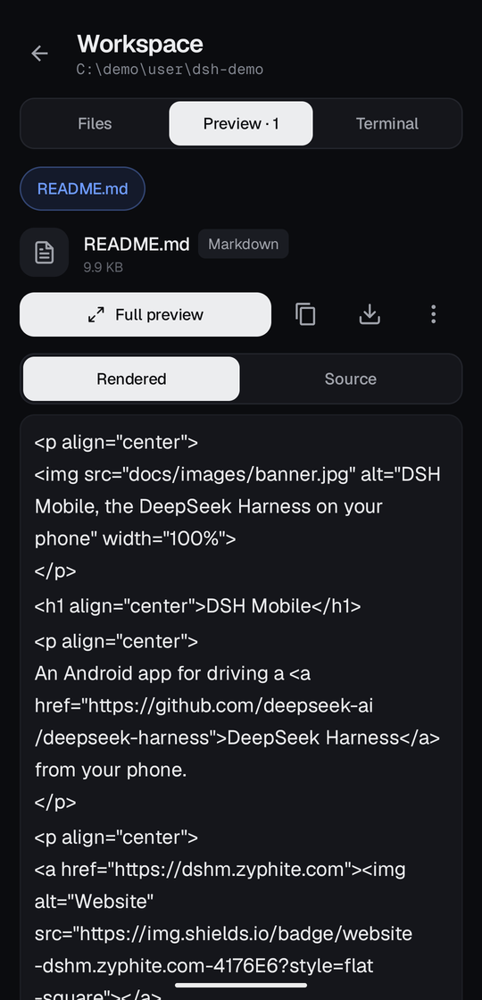
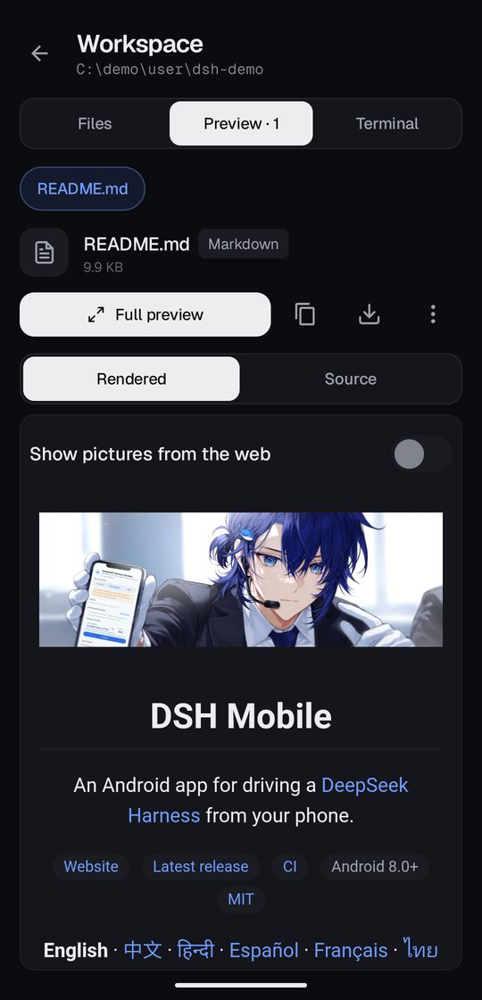
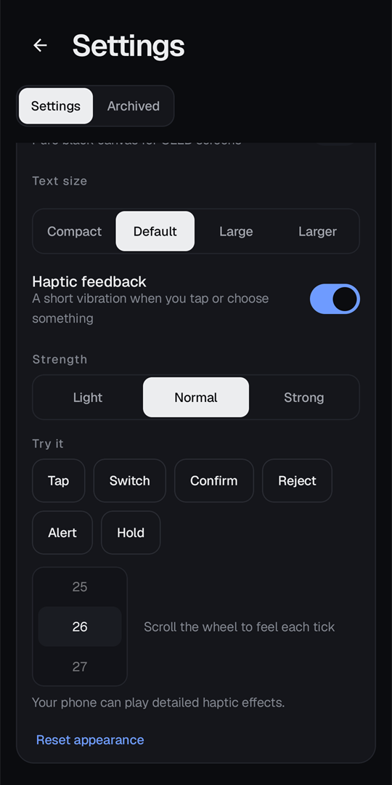
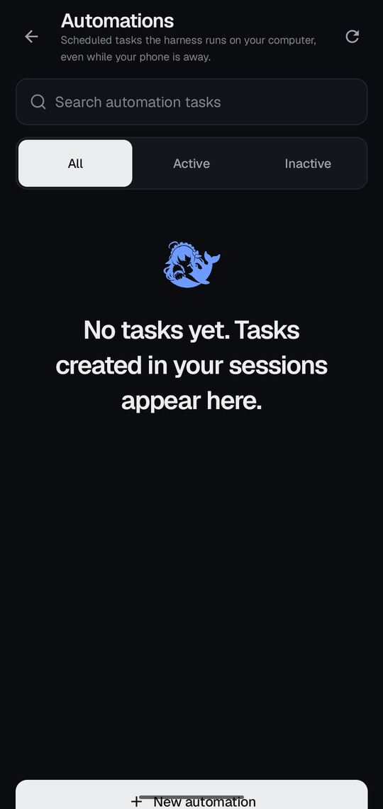
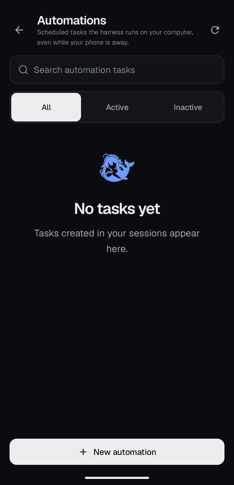
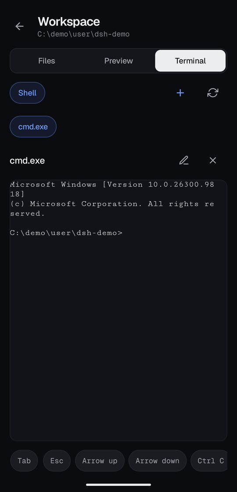
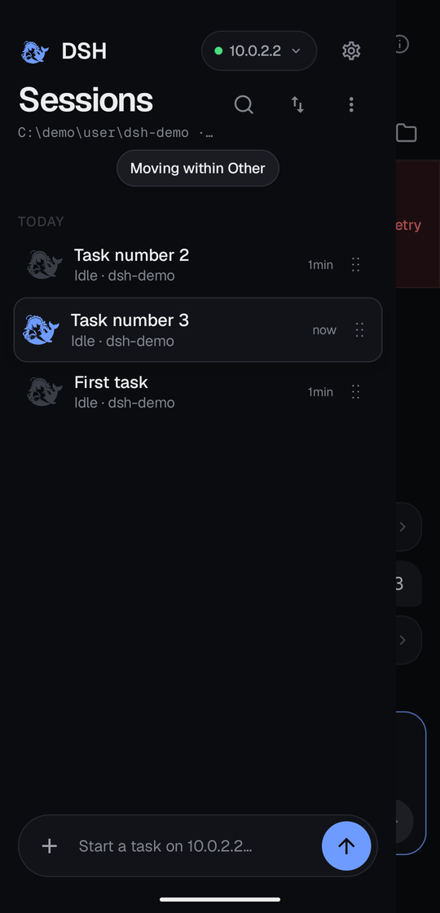

# Changelog

All notable changes to DSH Mobile are documented here. Format based on
[Keep a Changelog](https://keepachangelog.com/); the project uses SemVer.

## [Unreleased]

### Added

- **A default send mode for prompts sent while a turn is running.** Settings → Chat now offers
  **Default send mode**, Queue or Steer, so a reader who always wants one of them no longer flips
  the toggle in the composer's `+` sheet for every message. The choice applies to a session's
  composer until a mode is picked there, and that per-session pick survives a later change to the
  default; holding send still chooses the mode for one message alone. Upgrades keep Queue, so
  nothing changes until the choice is made.

## [0.20.0] - 2026-11-09

### Added

- **Pull down in Sessions to reload the list.** The drawer now answers a downward pull at the top
  of the list with a small ring that fills under your finger; past the latch it ticks, and letting
  go re-reads the session list from the harness. While the read runs the ring becomes a spinner, and
  when it lands the spinner is replaced by a check that pops in before the whole pill springs away.
  A pull that fails says so in the drawer instead of leaving a banner on the chat behind it. The
  same read is in the overflow menu and as a screen-reader action on the list, since a pull is not
  something TalkBack can perform.

### Fixed

- **Sessions started or renamed on the computer now show up in the drawer without reconnecting.** A
  session you began in the desktop app, or with `dsh` in a terminal, stayed out of the Sessions
  drawer until the app reconnected, and a rename made there never showed at all. The app only noticed
  a first message in the chat you had open. It now picks it up for every session, and the drawer also
  checks again when you open it, when you come back to the app, and every so often while it stays
  open. Those checks are spaced out and quiet, so they do not add load on the harness or show an
  error banner if one fails.

- **Tapping beside a dialog now closes it.** The scrim around every dialog in the app ignored taps:
  the windows are deliberately laid out edge to edge, and the platform only reports a tap as
  "outside" when it lands beyond the window, which it never could. The new-session picker was the
  one people noticed. The area around the plate dismisses again, and a tap on the plate itself still
  does not.

- **The permission presets are no longer touching each other.** The three cards in the permission
  sheet were drawn at zero offset, so their rounded corners collided and the selected card's accent
  border ran into its neighbours. Each preset now has a gap of its own.

### Changed

- **The `+` sheet splits commands and skills into two catalogs.** A session can publish dozens of
  commands and a machine can carry dozens of skills, and the sheet used to put both behind one
  endless scroll with the search field inside it — so the field scrolled away exactly when the
  catalog got big enough to need it. Commands and Skills are now tabs with live counts, the tabs and
  the search stay pinned while only the list scrolls, and the attach actions and send-mode choice
  moved to a footer bar so they no longer push the catalog off the bottom.

## [0.19.2] - 2026-11-08

### Added

- **Groundwork for an iOS app.** The `core` module is now Kotlin Multiplatform: the wire
  protocol, session logic and Markdown sanitizer that never needed the JVM build from
  `commonMain` for iOS device and simulator targets too, and CI compiles them on every
  push so shared code cannot quietly grow a JVM-only dependency. Nothing changed for the
  Android app — same classes, same packages. There is no iOS app yet; `docs/IOS.md` is
  the plan.

## [0.19.1] - 2026-11-07

This update fixes full-screen pages that slipped under the gesture bar, brings back the sessions drawer
and drag to reorder, and makes a README in Preview look the way it does on GitHub. Haptics now play
through the phone's vibration motor and have a place in Appearance to try them.

### Added

- **Markdown files look the way they do on GitHub.** A README with `
`, ``,
  `<h1>` and `<a>` used to show raw tags in Preview. Rendered mode now draws the page with its HTML,
  tables, task lists, strikethrough, links and headings, in your theme, light or dark. Pictures next
  to the file load from the workspace. Source, find in file and Full preview all still work.

  | Before | After |
  |:--:|:--:|
  |  |  |

- **Pictures from the web stay off until you ask.** Opening a README should not tell another server
  that you did, so badges and other web pictures show their alt text as a small pill. A "Show pictures
  from the web" switch above the page turns them on for that file only.
- **Links in a Markdown file go where you expect.** A link to another file in the workspace opens it
  in Preview, a `#heading` link scrolls the page, and a link to a web page asks "Open this link?"
  before it leaves the app.
- **Haptics are played through the phone's vibration motor.** Until now every buzz was a request for
  one of Android's touch effects, which many phones, HyperOS among them, play faintly or skip. The
  app now plays its own effects, picked for what each phone's motor can do, and a phone with no
  vibration motor stays quiet. They should be easier to feel on phones that did nothing before. This
  is checked on an emulator, where the vibration log shows what the app plays. How it feels in the
  hand has not been confirmed on a real phone yet.
- **Haptic strength, and a place to try it.** Appearance now has Light, Normal and Strong under the
  haptics switch, a "Try it" row (Tap, Switch, Confirm, Reject, Alert, Hold) and a small wheel to feel
  the ticks. If the phone's own Touch feedback is off, the page says so and opens the sound settings.

  

- **Ticks for movement, like a picker wheel.** One tick per step, lighter the faster you go and
  firmer where you stop. You get them when you drag a session or a project, move through the accent
  color's hue strip and color area, slide across the text size or another segmented control, pinch a
  picture back to fit or out to its largest zoom, scroll a PDF through its pages, or seek in audio and
  video.

### Changed

- Dragging a session now starts with a short lift and lands with a firm click. Rows you cross in
  between tick lightly.
- A hint like `Moving within <project>` replaces the filter chips while you drag a session, instead of
  floating over the first row.
- Chat replies that carry a little HTML, such as `<b>`, ` `, `<kbd>`, `<a href>`, `
` or a
  comment, now show bold text, line breaks, code and links instead of the tags.
- The app now declares the `VIBRATE` permission. It is a normal permission, so Android grants it at
  install with no prompt.
- Reset appearance also puts the haptic strength back to Normal.

### Fixed

- **Full-screen pages no longer slip under the gesture bar.** On a phone with gesture navigation, the
  Automations "New automation" button and the Terminal key row (Tab, Esc, the arrows, Ctrl C) were cut
  off at the bottom of the screen. With three-button navigation they were off screen. Every
  full-screen page now goes through one shared window that covers the whole display and leaves room
  for the status bar, the navigation bar, the camera cutout and the keyboard. That covers Automations,
  Plugins, the Workspace (Files, Preview, Terminal), Full preview and the image viewer. On Android 10
  to 14 these pages also stopped a little short of the screen edges, and that is fixed too. A unit
  test now fails the build if anything opens a dialog window by hand.

  | Automations before | Automations after | Terminal before | Terminal after |
  |:--:|:--:|:--:|:--:|
  |  |  |  |  |

- **The sessions drawer is no longer blank (#70).** In 0.19.0 the row of filter chips grew to fill the
  whole drawer, which left no room for the session list or the "Start a task" bar. The count said
  "All 3" over an empty panel, and search showed nothing for the same reason. The chips now take only
  their own height. Thanks to thanatosolo for reporting it.
- **Reordering works again.** A row dragged next to its only neighbour never swapped with it, and in a
  longer list it could not reach the first or last place. Dragging a whole project in Group by project
  did nothing at all. Both move now, and the new order is saved.

  

- **Steer is always there, and never fails silently.** In the + sheet, Steer could not be picked
  while the agent was idle, and it drew as a small tag next to the full Queue pill. It is now the
  same full pill and can always be picked. While nothing runs, a caption says "Steering needs a
  running turn", and pressing send in that state goes out as an ordinary queued prompt instead of a
  refusal. The queued prompt dock offers Steer only during a turn, and the subagent sheet follows the
  same rule.
- The empty Automations page no longer sets a whole sentence as a three-line headline. It says "No
  tasks yet", with the rest underneath in smaller type.

### Removed

- Copy link is gone from Session details. Use Export to save the session file.

## [0.19.0] - 2026-11-07

DSH Mobile gets a new look, a theme you can tune, a file viewer that opens far more kinds of files,
and a sessions list you can reorder and group by project. Every sentence in the app was also
rewritten in all 11 languages so it reads the way a person would say it.

### Added

- **A design of its own: "Ink".** A near-black canvas with one accent, a warm paper light scheme,
  bundled Geist and Geist Mono type, and rounder, calmer shapes. Every screen uses it, in light and
  dark, in all 11 languages. The app opens on a branded splash that fades into the first screen, and
  the system splash matches it.
- **A theme you can tune.** Settings → Appearance has Light, Dark or System; seven accent presets
  (Ink blue, Violet, Teal, Green, Amber, Rose, Mono) and a **Custom** colour; **True black** for OLED
  screens; an app text size (Compact, Default, Large, Larger); and a haptic feedback switch. Changes
  apply at once, and "Reset appearance" goes back to the Ink defaults.
- **Any colour can be the accent.** The Custom swatch opens a picker with a hue strip, a saturation
  and brightness area, a hex field (`#RRGGBB` or `RRGGBB`) and quick picks. It previews the accent in
  the dark and light schemes side by side before anything is saved. The app adjusts the lightness
  behind the scenes so text on the accent, and the accent itself, stay readable on both canvases.
- **Haptics and motion that match.** Presses tick, switches flip, confirmations and rejections have
  their own feel, and a hold is felt before its menu opens. All of it follows the haptic switch.
  Screens, sheets, buttons and rows move on shared curves, and the app respects the system "Remove
  animations" setting.
- **New screens from the design.** A full-screen Connecting screen with named stages, cancel and
  retry; a Connection lost screen with the attempt count; a searchable workspace with a Files,
  Preview and Terminal top bar; a background jobs sheet with a live timer; and automations, plugins,
  archive and the model, permission, preset, subagent, history and command sheets rebuilt in the
  new look.
- **The pairing scanner is a camera screen.** "Scan QR code" opens a full-screen viewfinder with a
  flashlight toggle and **Choose a photo**, which reads the code from a screenshot or a picture of
  the laptop screen. When the camera cannot be used, the sheet says why (permission refused, blocked
  in Settings, no camera, camera busy) and offers the one action that fixes it. Typing the
  eight-digit code still works.
- **Drag sessions into the order you want.** In Manual order, every session you can move has a grip
  at the end of its row. Drag it: the row lifts, the others slide aside, the list scrolls near the
  edges, and you feel a tick on pick-up, on each place you cross and on drop. A session can only
  move within its own project, so rows from other projects dim while you drag. The move is sent to
  the harness and rolls back with a message if the harness refuses it. Pinned rows have no grip,
  subagents travel with their parent, and TalkBack gets **Move up** and **Move down**.
- **Group by project.** The sort menu now offers Manual order, Sort by last update and **Group by
  project**. Each project sits under a header with a session count that you can fold shut, and
  sessions in no project go under **Other**. Projects and the sessions inside them can be dragged
  the same way. Folded groups and your order are remembered per harness.
- **Projects preview their newest five sessions.** The rest sit behind **Show all N**, and **Show
  less** puts them away. A project that holds the session you are reading always keeps it visible.
- **Follow streaming replies is a setting.** On by default: the transcript follows the newest row
  while a reply is written, stops when you scroll away, and resumes when you return to the bottom.
  Switched off, new rows land below the viewport and the jump pill counts them. Settings → Chat.
- **Preview is a full file viewer.** The header shows the file name, folder, size and type. **Full
  preview** opens the file on its own screen. Text gets line numbers, wrapping and **find in file**
  with a match count and highlighting. Pictures pinch, pan and double-tap to zoom. PDFs scroll page
  by page with zoom. Long text files load more as you reach the end.
- **Save a copy of any file to the phone.** It goes through the system file picker, and a file too
  big to preview can still be saved.
- **Many more kinds of file open in Preview.** CSV and TSV as a table. JSON, JSON Lines and GeoJSON
  pretty-printed or as a collapsible tree, with the spot of any error. Jupyter notebooks with their
  outputs. Diffs and patches. SVG, HTML and Markdown with a Rendered / Source toggle. More picture
  formats (BMP, ICO, animated GIF and WebP, plus HEIC and AVIF where the phone can decode them).
  Video and audio with play, pause and a seek bar. The contents of zip-based files (zip, jar, apk,
  docx and more), font specimens, and a hex dump for any other binary file. A file with no extension
  is recognised by its first bytes. YAML, TOML, INI, Dockerfile, Makefile, SQL, XML, HTML and shell
  files get syntax colour.
- **Clearer loading and error states in Preview.** A file shows a skeleton while it loads. A failure
  says what the harness answered and offers Retry, and a file that is too big offers Save a copy.
  Each open file remembers its scroll position and view when you switch tabs.
- **`mock-harness --viewer-fixtures`** serves sample files for trying the viewer by hand.

### Changed

- **One search field everywhere.** The chat list, the model, history and command pickers, the
  reference picker, Plugins, Automations, Archived sessions, the plugin list in Settings and the
  workspace file explorer now share one search field: a hairline that turns accent on focus, a
  search glyph, and a clear button that appears with the first character and keeps the keyboard up.
  The Search key closes the keyboard. In the file explorer, opening search raises the keyboard, Back
  closes it and forgets the query, and the filter also applies to the "Changed this session" card.
- **The words in the app read like a person wrote them.** Every on-screen sentence was rewritten in
  all 11 languages: plain wording, no error codes or developer terms, and no em dashes. A group of
  sessions in the chat list is now called a **project**, while the Files, Preview and Terminal panel
  keeps the name Workspace. "Refuse" is now "Don't allow", plugin states read Loaded and Not loaded,
  and speed figures are left out until there is something to show instead of a dash.
- **The light theme is warm paper, not white.** Status colours were re-checked so they stay readable
  at small sizes, and the window, splash, status bar and launch icon follow the scheme instead of
  the device's.
- **Controls follow one shape and size system.** Buttons are 44dp, icon buttons keep a 48dp target,
  filter chips and inputs share the same corner and height, and type moved to one scale, with Geist
  for Latin text and the system font carrying the other languages. Inputs everywhere (rename, new
  project, queue and goal edits, feedback, question answers) are now the same plate as the search
  and connect fields.
- **The top bars have more room.** The model selector in the chat header shows the whole model name
  again, with the status pill moved to the session title row. The model chip, tabs, preset chip and
  subagent tag size themselves, and the tabs scroll inside their own box so the workspace button
  is never squeezed out at large text sizes. The sessions list header uses one family of icon
  buttons, and its sort menu checks the order in use.
- **The Preview toolbar fits a narrow phone.** Refresh, copy path and close sit behind an overflow
  menu, and a text file over the preview limit shows its first part with a note instead of failing.
- **The changed-files card starts folded.** It shows only the count, and a tap opens the list. The
  fold is remembered per turn.
- **A turn's steps fold into one row under its prompt.** Reasoning and tool groups sit behind a
  single "Process" row with the step count, and tapping it opens them as before. A turn that has not
  answered yet, and the turn running now, stay expanded.
- **A pairing QR that names more than one address is tried in order.** A relay with both Ethernet
  and Wi-Fi lists every address it can be reached at, and the app now moves on to the next one when
  a failure says nothing about the code. A refused code, a lockout or a key mismatch is not retried
  elsewhere.
- **"Forget remembered harnesses" and "Forget which session to open" ask first.** The first removes
  every saved harness and its relay pairing, so the dialog says how many harnesses that is.
- **Sheets slide away before acting on a pick.** The permission picker used to vanish mid-animation
  while the next dialog opened over it. It now hides first, and a second tap during the slide is
  ignored.

### Removed

- **"Open on host" is gone from Preview.**

### Fixed

- **The "Needs you" card no longer approves a command you cannot read.** It shows up to four lines
  of the command and offers Review instead of a one-tap Approve when the command is cut off. A
  refused or unsent approval is now reported.
- **A long approval can no longer push Allow and Reject off the screen.** The command scrolls inside
  a capped area.
- **The Archived filter offers Restore and says the right thing.** An empty archive says "Nothing
  archived yet", and a failed restore says so.
- **The model chip no longer shimmers forever** when no session is open.
- **Buttons in Session Details now answer you.** Rename, Fork, Archive, Stop job, queue removal, the
  goal controls, the plan switch and Export reported failures on a banner hidden behind the open
  panel, and most said nothing on success. Failures and successes now show in the panel in plain
  words. Fork offers to open the copy, the plan switch moves at once and goes back with a message if
  refused, and a failed save no longer leaves an empty file. Pause, Edit and Clear for a goal sit
  right under the goal.
- **Subagent rows in Session Details open the subagent.** Ones with no transcript on the phone are
  no longer tappable.
- **Cancel on the Connecting screen really cancels.** A late result is dropped instead of connecting
  an app you backed out of.
- **Coming back to the Chat tab keeps your place.** An old send is not replayed.
- **Sheets rise above the keyboard.** This covers the sign-in token field, the subagent follow-up
  box, the plugin filter and the command search.
- **The keyboard stays up after you send.**
- **Picking a command or skill from the + sheet keeps what you typed.** "Chat about it" on a plan no
  longer clears the composer either.
- **The feedback dialog can always be closed, and speaks plainly.**
- **A thinking panel you opened stays open when the reply finishes.** So does the copy, branch and
  rate row.
- **Tapping the model you already use no longer resets its reasoning effort.** The picker shows a
  spinner while a switch is on its way and says so when the harness refuses.
- **A model picked in the app shows up in the app.** DeepSeek Harness 0.2.2 changed how live state
  reaches the phone, so a model change on the harness never reached the model chip. The app now
  reads both formats, which also restores live updates for permissions, todos, goal, plan, queue,
  subagents, preset and question state.
- **The permission chip no longer freezes after you change the permission.** Picking the preset
  already in force just closes the sheet, and a switch ends when it fails, when the harness reports
  a new value, after four seconds with a short "the harness didn't confirm" notice, or when you
  leave the session.
- **Files open from the workspace root again.**
- **Automations can be saved and deleted again on DeepSeek Harness 0.2.2.** Tasks the agent creates
  for a session are listed under that session, recurring-rule tasks show their rule, and opening
  "Change timing" on one no longer crashes the app. Saving and deleting automations now needs a
  0.2.2 harness.
- **A question survives an option the app does not know.** One unknown kind of question used to
  hide the card and leave the turn blocked until it timed out.
- **Images send again on a current harness.**
- **Agent chats open again on DeepSeek Harness 0.2.2.** A continuable agent keeps its composer and
  Stop, and a one-shot agent opens read-only.
- **Every question in a session notifies again.** Answering one used to silence the next question
  in the same session. (#67)
- **Nothing hides behind the system bars any more.** The workspace panel (including the terminal
  key row), automations, plugins and the image viewer draw edge to edge, and dialogs keep their
  OK and Cancel buttons on screen when the content is long or the keyboard is up.
- **Thai and other stacked scripts no longer lose the tops of their letters.**
- **The commands sheet scrolls as one surface.** Command rows lead with the real `/name`.
- **The composer keeps its text visible with attachments.**
- **A long reply no longer drags the page while you read it.** The transcript holds still while
  following is off and catches up in one step when you return to the bottom.
- **The scanner copes with turning the phone and with a refused camera.** The viewfinder is sized
  from the space left, the sheet survives rotation, and a refusal is named on screen instead of
  looking like a dead button.
- **Several layout problems were fixed.** The Sessions filter row scrolls (its Archived chip used to
  be clipped), file preview wraps long code lines, the workspace tree indents one step per depth,
  and bottom bars and composers sit above the navigation inset.
- **Read cards line up.** A line number stays beside its own line when long lines wrap.
- **Small controls have full-size touch targets.** The remove mark on an attachment, the + and @
  buttons beside the composer and the menu on a queued message are 48dp to hit.
- **Tool cards speak your language.** "killed by", "exit", file, line and result counts and similar
  labels were English everywhere, and they use proper plural forms now.
- **Small grey text is readable in the light theme.**
- **Answers you type into a question are no longer kept forever.**
- **The job output sheet lets you read.** A log that is streaming only follows while you are at the
  bottom, and **Jump to latest** appears when you scroll up.

## [0.18.0] - 2026-10-21

Pressing and holding things in the app now opens a menu of what you can do with them. This
started with issue #60, which asked for a way to copy a sent message so it could be fixed and sent
again.

| Holding a message you sent | After Rewind to this message | Holding a tool call | Holding Send during a turn |
|---|---|---|---|
|  |  |  |  |

### Added

- **Hold a message you sent** to copy it, select part of it, or put it back in the composer as a
  new message. If the composer already has text in it, the app asks before replacing it. With
  dsh-rewind-plugin installed the menu also has **Rewind to this message**. It withdraws the
  message and everything after it and puts the message back in the composer, so the corrected
  prompt replaces the wrong one. (#60)
- **Hold a tool call** to copy the command it ran, the path, link or search it used, or what it
  returned. A call on a file can also open the file or mention it in your next message.
- **Hold a file** in the changed-files card or the workspace browser to copy its path or mention it
  in your next message. Mentioning from the workspace closes it and leaves the reference in the
  composer.
- **Hold a queued message** to copy, edit, steer or remove it. Copy is new; the rest were already
  in its ⋮ menu.
- **Hold a prompt in the history sheet** to copy it or edit it as a new message.
- **Hold Send while a turn runs** to choose, for that message only, whether it steers the running
  turn or waits for the next one. The + sheet mentions this while a turn is running.

### Changed

- The session and workspace menus in the chat list now open in the same bottom sheet as every
  other hold, with icons and the name of what you held at the top, and holding gives a haptic
  tick. The workspace menu has a new **Copy path**.
- Android 12 and older show "Copied" after a copy, since they have no system confirmation of their
  own.
- Text put back in the composer from the transcript takes focus and opens the keyboard.

## [0.17.0] - 2026-10-21

Moves to DeepSeek Harness 0.2.1-rc.2, adds motion across the app, and makes connecting, reading
long runs and following subagents easier.

### Added

- **One-step connect.** Paste the link `dsh web` prints into the address field, or tap the new
  Paste button, and the app connects and signs in with the token in that link. The whole
  `dsh web: http://…` line works too.
- **Try again** on a failed connection. Progress and failure messages now scroll into view
  instead of turning up below the fold.
- **Jump to latest.** Scroll up during a long run and a button appears that takes you back to the
  newest message, with a count of what arrived while you were reading. Sending a message also
  takes you to the end.
- **Starter prompts** on a new session's empty page. Tapping one fills the composer and does not
  send it.
- **Copy session ID** in the session menu, as in the web client.
- While a turn runs, the top bar says "Working" instead of showing an unlabeled dot.
- **Changed files.** At the end of a turn that wrote or edited files, a card lists them. Tap a file
  to open it in the workspace preview. It shows up in both Chat and Trajectory.
- A history button beside the model chip lists the messages you sent in this session, with each
  one's time, a search field once the list is long, and a marker for prompts that carried an image.
  Picking one jumps the transcript to it, with the prompt at the top of the screen and its reply
  below. The list covers the history loaded so far; while there is more, "Load older messages" at
  the foot of the sheet pages it in. Replies are not listed: the harness records a turn as many
  assistant steps, so the few hundred of them would bury the prompts you were looking for.

### Changed

- Target DeepSeek Harness 0.2.1-rc.2.
- The terminal uses rc.2's two-way `terminal/attach` stream. Keystrokes and resizes go up the
  same stream the screen comes down on, and the harness numbers and acknowledges each one. Hosts
  before 0.2.1-alpha.3 keep the previous terminal.
- Screen changes, docks, approval and question cards, the connection banner, the `/` menu, tool
  rows and message actions animate in and out. Segmented controls slide their selection, the send
  button lights up once there is something to send, the stop button slides in beside it, and
  toasts drop in below the status bar.
- The Details panel follows your finger, closes with the system back gesture and sizes itself to
  the phone. Its close button is now on the outer edge.
- Back closes the chat list instead of leaving the app, and the list leaves a strip of the chat
  showing that you can tap to close it.
- The approval buttons, the permission chip, message actions and Scan network have bigger touch
  targets.
- Archiving from Details and clearing a goal ask for confirmation first.
- On a host with hot reload, updating a plugin removes the old version and then installs the new
  one, as the web client does. Such a host refuses to install over the old version.
- The todo and queue docks stay open while their contents change, and queue placements are
  translated.
- The model chip can use the whole width of the top bar.
- The address field uses an address keyboard without autocorrect, the Go key connects, and
  Connect stays disabled until there is an address.
- The reconnecting banner is amber with a spinner. A connection error is red and has its own
  Retry button.
- Trajectory folds the harness's injected context into one "Context" row, as Chat does, and drops
  the `step/start` and `step/end` rows around every tool call. The raw event log is still there,
  collapsed under "Raw" at the end.
- A subagent's follow-up controls are a Next turn / Steering switch and a Workspace button,
  instead of three plain text buttons.

### Fixed

- On rc.2 hosts, every background job added two raw JSON rows to the transcript.
- The composer sometimes kept the text of a message it had just sent, if the keyboard was still
  composing a word.
- "1 turns" and "1 steps" in the stats line and the Trajectory tab.
- Trajectory only showed the turns Chat had already loaded. It now has a "Load older messages" row.
- A reply that had just finished faded out and back in. While a reply streamed, the rows above it
  could slide over its text for a moment on each new line.
- The transcript now keeps up with a reply that adds rows. A tool card, the next message segment,
  a question card or the turn's final message used to land just below the bottom edge and stay
  there until you dragged it into view. If you scroll up to read, the view stays where you left
  it, and it follows again once you're back at the bottom.

## [0.16.0] - 2026-10-12

- Target DeepSeek Harness 0.2.1-alpha.2.
- Use the current session working directory for tool paths and session details.
- Respect cached projection sequence boundaries and explain migration-required forks.
- Display external subagent executions without offering a nonexistent local transcript.
- Install official plugin catalog targets and preserve their enabled state during recovery.
- Translate completed reasoning on demand when the host's experimental translation plugin is available.
- Keep oversized generated code lines readable without expensive token highlighting.
- Document native LAN binds and HTTPS; require signed APKs in release publication.
- Include the latest compact transcript and tool-image improvements from #54.
- Include on-phone Harness setup and Termux permission/runtime improvements from #55.

## [0.15.0] - 2026-10-09

Reworks the Details panel, the Workspace screen and Settings, draws workspace links in replies as
file pills, and adds a manual update check. From @mrbeandev (#52), with fixes from review.

### Added

- **Check now.** Settings > About has a button that runs the same GitHub check the app runs on its
  own and says what it found: a newer version (offered in the usual update dialog), up to date, or
  GitHub unreachable. A manual check also offers a release you dismissed earlier.
- **Workspace links as pills.** A reply's link to a workspace path is drawn as a pill with a file
  or folder icon. A file opens in Preview, and a folder opens Files at that directory. When the
  name suggests the wrong kind (`LICENSE` is a file, `.github` is a folder), the harness's answer
  corrects it. http(s) links work as before.

### Changed

- **Details panel.** The session is a card at the top with its full title, folder and path, the
  model and preset with labels, and its actions as buttons. Context comes next, then an Activity
  group (goal, plan, jobs, queue, subagents, workflow) and a Host group, each item in a bordered
  card. Tapping outside the panel closes it. The chat behind it dims, and on Android 12 and later
  it also blurs.
- **Workspace.** It opens from a button beside the Chat and Trajectory tabs, as a full screen with
  the workspace path in its header. Files, Preview and Terminal sit in one segmented control. Files
  shows folder and file icons and readable sizes, open files and terminals are pills, and each
  preview has a header with open-on-host, refresh and close. Code previews use the code font in a
  block that scrolls both ways. Open on host is hidden when the harness reports no desktop, and a
  failed open says what that means.
- **Settings and Archived are two tabs.** Each archived session is a card with its title, age,
  workspace, full path and a Restore button.
- **The agent preset chip** in the top bar shows only while the session is blank, because the
  harness fixes the preset once work starts. Details still shows it.
- **Paragraphs keep their line breaks**, as they do in the web client.
- **The automatic update check** runs whenever the app comes back to the foreground, at most once
  every six hours. It used to run once per process, so a phone that kept the app in memory for
  days never saw a release published after its last cold start.

### Internal

- Device tests cover tapping either edge of a file pill, folder pills and long pill labels.

## [0.14.0] - 2026-10-08

Adds a `/` menu to the composer and a picker for the dsh-rewind plugin's `/rewind`. Both come from
@mrbeandev (#50).

### Added

- **A `/` menu above the composer.** Type `/` at the start of a draft to list the session's
  commands and skills, filtered by name as you type. Tapping a command that takes no arguments
  runs it. Tapping one that does, or a skill, fills in its name and leaves the cursor after it.
- **A rewind picker for the dsh-rewind plugin.** When the host has
  [dsh-rewind-plugin](https://www.npmjs.com/package/dsh-rewind-plugin), `/rewind` and `/undo`
  open a list of the session's messages instead of running straight away. Pick a message, then
  rewind the conversation only, or the conversation and the code. Conversation and code shows the
  files it will restore or delete and asks you to confirm first. After a rewind, the withdrawn
  message goes back into the composer if the composer is empty, so you can edit and resend it.
  The app never sends a bare `/rewind`, which the plugin answers by rewinding to the latest
  message without asking.
- **Rewinds in the transcript.** Messages a rewind withdrew are hidden, as the web client hides
  them, and a "Rewound to here" divider marks each cut. If a cut covers the whole loaded page,
  the transcript pages back a limited number of times until something above the cut shows up.

### Internal

- Plugin pickers that the web client builds with `commandUi.decorate()` can now be ported
  natively. The app has a registry of decorations, one shared popup-select sheet (loading,
  search, retry, chained steps) and a check that the session's command catalog comes from the
  plugin being ported.
- Tests cover the rewind cut rule, the picker's command sequence and composer refill against the
  plugin's own text formats, the `/` menu's matching, and the picker sheet on a device.

## [0.13.0] - 2026-10-08

Moves the protocol baseline to DeepSeek Harness 0.2.1-alpha.1 and adds its management screens and timed questions.

### Added

- **Automation.** A new screen lists scheduled tasks, with search and a status filter. Each
  task has a Rules tab for its title, prompt and timing and a Records tab for its delivery
  history. You can delete an active task or open its session. New starts an unsent chat draft
  that asks the agent to create a task. Schedules and run times use the device's locale, and
  finished tasks show their last run when the host has one. The timing editor has its own
  controls for each kind of schedule: a date and time picker, an interval amount and unit,
  named weekdays, a time zone, and cron as an advanced field. Switching kinds keeps what you
  entered for each one, and saving checks for changes made elsewhere.
- **Plugin management.** Plugins opens on the installed inventory, which you can search; the
  install and update forms open separately. You can inspect, install and update packages,
  enable or disable bundles and single plugins, and remove installed bundles. Installs show
  progress and logs and can be cancelled. The app keeps each install's request ID, so it can
  pick up the result after a reconnect or a restart. Packages install disabled, and a build
  approval names the package and the scripts waiting to run. Update opens a prefilled form, and
  Settings shows Manage plugins even when nothing is installed.
- **Create plugin.** When the host offers the Creator (`cordis`) preset, Create plugin opens a
  new session with that preset and an unsent draft.
- **Timed questions and late answers.** The countdown and Take time sit inside the question
  card, and an expanded sheet is there when space is tight. Focusing the answer pauses the
  countdown in either view, and editing or Take time holds it. If the host moves on before you
  answer, you can still send a reply. Answer drafts survive an app restart, and you can reopen
  question cards and plan previews. Cards label the paused, held, queued and settled states, and
  an answered card keeps the question next to the answer.
- **File, folder and session references in drafts.** The composer's @ button, or typing @,
  opens the reference picker. It inserts a mention and saves its type, target and position with
  the draft. Each reference type has its own icon and label, folders have a separate browse
  action, and the picker shows empty, no-match and retry states. Mentions show a readable label
  instead of a session URI, and chips open their file, folder or session. Text and references
  are saved per host and session across restarts; editing inside a mention drops its reference.
- The model picker gets a search field when more than four models are available. It matches
  model and provider names or IDs and says so when nothing matches.
- Markdown previews show YAML frontmatter as collapsed document properties, with a bounded
  expanded view. An invalid header stays visible in the document.

### Changed

- The protocol baseline in Settings → About reads 0.2.1-alpha.1.
- A control is hidden when the host reports its capability as unavailable or its method as
  missing. On a 0.2.0-rc.1 host, for example, Automation is hidden while chat and questions keep
  working. Authorization errors, HTTP 403 included, and transport errors still show.
- Hosts can sit behind a reverse-proxy path such as `https://example.com/harness/`. Sign-in, API
  calls, file transfers and the live connection all use that path, and saved hosts keep it.
- Tool rows preview argument text while the model is still writing the call.
- The goal editor has room for several lines, and the goal bar shows up to three.
- The new Automation, Plugins and reference screens use the app's own sheets, controls and theme
  colors. Retry appears only after a failure; a healthy Automation list has a refresh action.
- Timing and plugin switches have accessible labels, and question headers and reference actions
  have 48dp touch targets. Package names, file mentions and other technical identifiers keep
  left-to-right order in right-to-left languages. Warning text in Plugins, models and goals is
  darker in light mode so it is easier to read.
- The new controls are translated into all 11 supported languages: English, Chinese, Hindi,
  Spanish, French, Arabic, Bengali, Portuguese, Russian, Urdu and Thai.

### Fixed

- **Goal actions could silently do nothing.** The app now reads the current goal from the
  host's `{ goal }` projection before editing, pausing, resuming, completing or clearing it.
- **Shell and diff cards no longer reject calls because of escalation fields.** Card matching
  no longer validates the obsolete `sandbox_permissions` and `justification` pair.

### Internal

- A new CI job builds the pinned harness and runs the real-host conformance suite against it.
  New tests cover the management contracts and timed questions, and proxy routing, draft
  references and the new UI models have local regression tests.
- The protocol fixture is `5badb15.json`, pinned to 0.2.1-alpha.1. The older `4878cda.json`
  fixture stays, and the pinned fixture test checks the baseline label and commit.
- YAML frontmatter parsing uses `org.yaml:snakeyaml:2.5` with safe constructors and limits on
  header size, nesting and aliases.

## [0.12.2] - 2026-10-01

Fixes the agent preset chip, which has not appeared on any harness this app supports.

### Fixed

- **The agent preset chip never showed.** The harness sends a session's preset only inside the
  list row's projections, as `projections.values.agentPreset`, but the app read a top-level
  `agentPreset` field that no supported harness sends. So the chip in the chat top bar, the
  current mark in the preset picker and the pill in the details panel never appeared, and with no
  chip there was no way to open the picker. The app now reads the projection. (#45, #46, from
  @bumblebeers)
- **A preset picked somewhere else now shows up right away.** When the web GUI or another phone
  picks a preset, the harness pushes the new value on the control stream, and the app now applies
  it to that session's row.

### Internal

- The protocol end-to-end test's mocked `session/list` row now has the shape the harness sends,
  with the preset inside `projections`. No mock had that shape before, which is how the bug got
  past the tests.
- A new conformance test checks that shape against a real harness: a blank session's row reports
  its preset only through the projection, and the row follows an `agentPresets/select`.

## [0.12.1] - 2026-09-29

Moves the protocol baseline to DeepSeek Harness 0.2.0-rc.1. Nothing the app sends or reads
changed between 0.1.7-rc.2 and 0.2.0-rc.1, so this release changes no behaviour, and
0.1.7-rc.x and 0.1.6 hosts keep working.

### Changed

- The protocol baseline in Settings → About reads 0.2.0-rc.1.
- `docs/COMPATIBILITY.md` is shorter and names harness releases by label only.

### Internal

- The pinned protocol fixture is re-checked against 0.2.0-rc.1 and renamed to its commit
  (`4878cda`). The conformance suite runs against 0.2.0-rc.1.

## [0.12.0] - 2026-09-25

Moves the protocol baseline to DeepSeek Harness 0.1.7-rc.2. A 0.1.6 harness still works: where
0.1.7 changed a shape, the app reads both, and it picks one from what the host answers. There is
no version check.

### Fixed

- **Against 0.1.7, every tool card lost its result.** Session format v4 moved a tool result's
  call id and error flag off the wrapper block inside its content and onto the message itself.
  The fold still read the wrapper, so each result folded with an empty call id and paired with no
  call, and the card showed no output, error text or exit code. Nothing crashed, so a
  conformance test now drives a real tool-calling turn against the harness and checks that the
  two pair up.
- **The preset list failed to load on 0.1.7.** The roster dropped `authorable`, which this client
  required, and that one missing field failed the whole list. A missing value now reads as false.
- **The subagent sheet and the Jobs card stayed empty on 0.1.7.** `subagents/list` was removed in
  favour of the parent's `subagentCatalog` projection, and jobs moved off `session/control` onto a
  `job/list` stream. The app reads both, and still asks a 0.1.6 host the old way.
- **Image and PDF previews, and the pictures inside an HTML preview, failed on 0.1.7.** `readAll`
  and `readRelated` were folded into `readBytes`, which now answers as multipart/form-data with
  the raw bytes in their own part. The client decodes that, and repeats the read the 0.1.6 way
  when the host refuses the new argument. The live file watch now takes a path, so each open
  preview gets its own watch. Before this, the host's refusal was swallowed and previews went
  stale.
- **Archiving a running session did nothing.** 0.1.7 refuses to archive a session whose turn,
  subagents or jobs are still running. The app now says what is running and offers to stop it
  and archive.
- **A harness 401 behind a relay was reported as a device-token problem**, which sent people to
  re-pair when re-pairing could not help. The app now says the harness refused the relay and
  points at updating `dsh-relay`. The Recent list also re-checks its rows every time the connect
  screen resumes, so one failed attempt no longer marks a harness unavailable for the rest of the
  process. (#40, #41, from @js-easy-school)

### Added

- **Stop a background job, and watch its output.** On 0.1.7 the Jobs card has a stop button on
  running rows, and tapping a job opens its output live. The view follows the tail and notes
  when earlier output was already dropped.
- **Pinned sessions.** Pin and unpin from a session's menu, and pinned sessions lead the drawer
  in their own section. The option is hidden against a harness without pinning.
- **Localized approval reasons.** When the harness sends a localized reason with an approval (an
  Auto review denial or a sandbox escalation), the card shows it in your language.
- **Tool-set changes in the transcript.** 0.1.7's new `developer/message` event records the
  agent's tools changing mid-session, and it shows as a collapsed context row naming the tools.

### Changed

- The protocol baseline in Settings → About reads 0.1.7-rc.2.
- A turn that ends in a way the transcript has nothing to say about (0.1.7's `forked`, or
  anything newer) no longer leaves an empty row.
- The preset authoring calls that 0.1.7 deleted are removed from the client. Nothing in the app
  used them.

### Internal

- The conformance suite runs against 0.1.7-rc.2. It no longer writes the `protocol` setting that
  0.1.7 refuses, it covers every call and stream above, and it reads a file back byte for byte
  through the multipart answer.
- The mock harness speaks the 0.1.7 shapes, multipart included, and the pinned protocol fixture
  is re-transcribed from rc.2.

## [0.11.7] - 2026-09-21

Contributions from @snailium, offered from a long-lived fork and split into reviewable pieces.

### Fixed

- **A failed tool call said "Something went wrong" and nothing else.** The result body carries the
  command's stderr, the path it was refused, or the tool's own message, and none of it was shown. A
  failure now shows its own text, with the generic string kept only for a result that genuinely
  carries no prose. The body is one level deeper than it looks: the message's content array holds a
  `tool-result` part whose own content array holds the actual prose, so reading only the outer array
  found a part it classified as non-prose and fell back every single time. A failed call also shows
  how long it ran. (#35)
- **Harness-injected context was rendered as though you had typed it.** Agent instructions, skill
  invocations, goals, team messages and the rest arrived as `user/message` events and got the
  reader's own bubble, which put a wall of configuration text on their side of the conversation. Those
  now collapse into a disclosure row. The test is a denylist of the one `source.kind` that means a
  person wrote it rather than an allowlist of injected kinds, because a kind this build has never seen
  is far likelier to be new harness context than a new way for someone to speak. (#35)
- **Opening a cold session started mid-tool-call.** The opening window now begins at the oldest real
  prompt, so a transcript opens on something a person said. Deliberately not applied to backwards
  paging: paging asks for the events just before what is loaded, and snapping to a prompt there would
  swallow the tail of the previous turn. (#35)
- **The permission picker was empty against a host that composes no catalog.** Combining the two
  sources overwrote the projection's own options with the catalog's, so a `permissionPresets/catalog`
  that answers 404 left nothing to choose from. The catalog is preferred only when it returned
  something. (#35)

### Added

- **Markdown tables, task lists and horizontal rules, and syntax highlighting in code blocks.**
  Tables render as a real grid with per-column alignment, task-list items get a checkbox marker and
  strike through when done. (#36)
- The Markdown parser and a syntax-highlighting lexer moved into `:core` as plain JVM code, leaving
  the app file to turn blocks into composables. A renderer carrying its own grammar means every
  change rewrites parsing and drawing together. Highlighting never alters the code's characters,
  which is asserted for a known language, an unknown one and an empty string, and an unrecognised
  language degrades to plain spans rather than throwing. (#36)
- Links in replies open in a browser only for `http` and `https`. Anything else is treated as a path
  into the session's own workspace, where the harness enforces its own boundary, so a reply cannot
  smuggle another scheme past the click handler. (#36)

### Internal

- The conformance module reports why the mock model server would not start, and survives the Windows
  command line when a scripted tool call carries JSON. Both were found by using the suite rather than
  by reading it. (#34)

## [0.11.6] - 2026-09-21

### Fixed

- **A long question left its card with no way to answer it.** Opening the keyboard on an
  `ask_user_question` card could take away the answer field, Submit and Skip together, leaving the
  question text and nothing else. With no Submit and no Skip there was no way to resolve the request
  from the card at all while the keyboard was up.

  The card is a header, a scrolling body and a footer, capped at a fraction of the height it is
  offered. Only the body was weighted, and a Compose column measures its unweighted children first,
  so the header took what it asked for and the footer and body divided whatever was left. The
  header's question text was unbounded, so it asked for as many lines as it had. With the keyboard
  down that was fine. With the keyboard up, the cap was recomputed against a much shorter column and
  a question of a few lines could ask for all of it.

  The question now leads the scrolling body instead of sitting in the fixed header, so the header
  stays small and the footer cannot be starved. Collapsed cards still show the question in the
  header, capped at two lines as before. On a card short enough that the question fills the body the
  field may sit below the fold, which is what a scroll is for: it is reachable, and focusing it
  brings it into view.

  Reported by @djurcola (#31), whose description named the symptom precisely enough to find it:
  prompt text only, field and Skip/Submit gone. Six earlier attempts missed it because every test
  written for it used a one-line question, and the length of the question was the whole cause.

## [0.11.5] - 2026-09-20

### Fixed

- **The queue dock will go empty against a current-master harness.** The harness stopped sending
  the pending queue: `session/control`'s baseline no longer carries a `queues` map and the
  `{"type":"queue"}` frame is gone, both deleted upstream in favour of publishing the agent's
  inbox as an ordinary projection. This app read only the old shapes, so against that harness the
  dock would have shown nothing at all and edit/remove/steer would have had nothing to act on —
  silently, because an absent projection and an empty queue look identical. The queue is now read
  from the `inbox` projection, with the placement the host used to compute derived here instead:
  work waiting for the next turn is queued, work waiting for the next step is steering when a
  person wrote it and context when something else did. The old frames are still read, so a harness
  that still sends them is unaffected.
- **PTC dispatch metadata was printing into the middle of transcripts.** The fold's list of
  log-only events named `tool/code-dispatch`, a name the harness had renamed to
  `tool/ptc-dispatch` before this client's own pinned baseline — so both events fell through to a
  raw JSON row headed with the event type, in among the actual conversation. Every durable event
  type the harness declares is now classified deliberately, and a test reads the harness's own
  generated vocabulary and fails in both directions: on a type it declares that this client has
  not decided about, and on one this client still names that the harness has dropped. That second
  direction is the one that had been missing, and it is the one that would have caught this.
- **A rate limit, a dead relay upstream and an over-large request all reported "this is not a
  harness"**, which sent people to re-check an address that was never wrong. HTTP 429, 502 and 413
  now each say what they are, and a 429 carries the peer's `Retry-After` when it stated one.
- **A single unfamiliar word from a newer harness could blank a whole panel.** A job's status, a
  preset's trust tier, a goal's phase and a request header's reason were each decoded as a closed
  set, so a value this build did not know failed the entire enclosing frame rather than the one
  field — taking every other job, preset or goal with it. Each now degrades to an unknown member,
  and the surfaces that read them present that honestly rather than guessing: an unknown trust
  tier shows no badge instead of claiming the person authored the preset.

### Added

- **Terminals opened from the phone are held open.** Current-master harnesses reclaim a terminal
  after a couple of hours of confirmed idle unless a window is holding it, and following a
  terminal deliberately does not count as a hold. A visible terminal tab now takes one, so a
  terminal left open is not collected underneath the person while its tab still looks live. A
  harness without the endpoint is unaffected.

### Added

- **A conformance suite that runs against a real harness.** `:conformance` boots the harness from a
  checkout, exchanges a launch token for a browser session, and drives the shipped `:core` client
  against it — the same transport, envelopes, mux and fold the app uses. Until now every automated
  check in this repository compared the client to a *description* of the harness: hand-written DTOs,
  a hand-curated fixture, or `mock-harness`, which is a re-implementation written by reading
  upstream. A misreading was invisible to all three, because the same misreading sat on both sides
  of the assertion. One test now makes every call the client knows how to make and asserts the
  harness understood it, which is how a renamed parameter gets caught here instead of in the field.
  The suite skips cleanly without a checkout, so ordinary CI is unchanged; see the module's own
  documentation to run it.
- Turns can be driven deterministically, using the harness's own scriptable model server, so
  behaviour that needed a paid API key to observe is testable without one.

### Documentation

- `docs/PROTOCOL.md` corrected against the harness source at both the pinned baseline and current
  master: the mux heartbeat is 2000 ms and not 30s (and two missed pongs, so about six seconds to
  a drop); a refused answer batch has no `bad-response` code and never did outside an archived
  design note; `turnBoundary` is host-side fold state and never crosses the wire; `session/prompt`
  answers `{accepted: true}` with no `command` slot; and the projection table was missing `inbox`,
  `agentPreset`, `subagentCatalog`, `subagentTiming` and `subagent`.

## [0.11.4] - 2026-09-19

### Fixed

- **An answered question card never went away.** Submitting an answer, dismissing the card with
  ✕, or skipping every question all settled correctly on the harness — and left the card on the
  phone frozen on "Submitting…" with its buttons dead. Tapping again did nothing, switching
  sessions only hid it, and reconnecting could not clear it, because nothing was pending on the
  host for it to withdraw; only a force-stop recovered. The card was waiting for the `cancel`
  frame that withdraws a request, and that frame is the one thing the answering client never
  receives: the host drops its delivery *first* and then cancels the deliveries that remain, so
  every client except the one that acted is told. A taken answer now ends the card on its own
  receipt, and `cancel` goes on covering the cases it is actually sent for — another client
  answering, or the harness's caller giving up. 0.11.3 routed the previously-dead buttons
  straight into this, so it cost a force-stop per question. (#27)
- The same for an approval: allowing or refusing one now closes the panel. And a refused decision
  says so, instead of leaving two buttons that appear to do nothing — the tool call behind an
  approval the harness would not take stays blocked, which is worth a word. (#27)
- A question card with no request left behind it — the harness forgot it, or the session went
  away underneath it — is taken off the screen rather than left as a control with nothing to
  answer.
- **A card submission reported as "Could not reach the harness" on 0.11.2** was the `$events/result`
  envelope refused on the wire, fixed in 0.11.3 — nothing was wrong with the network the message
  sent people to go and check. Upgrading past 0.11.3 is the whole of that fix. (#28)
- The mock harness this repo checks itself against had a matching defect, found while confirming
  the above: its port of the host's answer-acceptance law was reading the wrong envelope, so it
  refused every well-formed answer to a question it had actually pushed. The law had been
  unreachable in practice since the payload moved inside `args`, which is how a repaired answer
  path went untested end to end. It is exercised on a real request now, both verdicts pinned.

Reported by @djurcola (#27) and @sortjiajun (#28).

## [0.11.3] - 2026-09-19

### Fixed

- **Every answer to a question card and every approval failed on the wire.** Tapping Submit on
  an `ask_user_question` card, or allowing or rejecting an approval, was refused by the host
  and the tool call on the other end stayed blocked — the only way through was to stop the turn
  and send the choice as an ordinary message. `$events/result` is an ordinary Remote, so its
  `clientId`, `eventId` and `outcome` belong inside the usual `args` object; this one call
  posted them bare, and the gateway answers that with *Remote event result requires exactly one
  plain-object args field*. It was the only unary in the client that did not go through the
  wrapping path, and it now does. The mock harness had been written from the app rather than
  from the host and enforced the same wrong shape, so both halves of this repo agreed on a
  payload no harness would take; it now requires the wrapper, and the bare shape is pinned as a
  refusal on both sides. (#25)
- A refusal of an answer is no longer reported as **"Could not reach the harness."** Anything
  the host sent back other than `not-pending` was folded into "unsent", which sent reporters to
  debug their network for what was a protocol fault. A reply that reached the host and came
  back `ok:false` now names the host's own code; "could not reach" is kept for a request that
  genuinely never completed. (#25)

## [0.11.2] - 2026-09-18

### Fixed

- A permanent red "Reconnecting…" banner over a healthy, streaming connection, against a
  harness 0.1.2 host. That version packs a run of consecutive assistant deltas into one
  `chunks` history record carrying only the run's first sequence number, and the app read the
  record as a single event — which swallowed every number after the first and left the
  journal looking gapped. Packed records are read again and expanded back into one event per
  delta. (#20)
- Generated text no longer flickers at the bottom of the transcript while a reply is being
  thought or written. The list is laid out in reverse, so the row the viewport anchors on is
  the newest one: a growing reply extends in place instead of displacing everything after it,
  and following the tail costs no scroll at all. Reading back through history mid-turn is
  steady for the same reason, and a page of older messages can no longer move what is on
  screen. (#21)
- Opening a session and moving between sessions are quicker. The three reads a fresh connection
  starts with — session list, agent presets, permission catalog — ran one after
  another, and every session tap then waited on four more round trips for skills, models,
  subagents and commands before the transcript could paint, though none of them is needed to
  draw a message. They now run alongside the work that is. (#22)
- The permission chip keeps its options while its catalog refreshes, instead of emptying for
  the length of a round trip. (#22)
- **A running turn offered no way to send.** Send and stop shared one slot, so starting a turn
  replaced the send button with the red stop button, and the on-screen return key inserts a
  newline. Queue and Steer sat in the + sheet with no way to reach them from a phone. Send now
  sits beside stop while a turn runs, enabled once there is something to send, and stop keeps
  its place on the right. The mode chosen in the + sheet still decides whether the message is
  queued or steers the running turn, and a queued message appears in the queue dock as
  before. (#23)
- **Every `/api` call was refused on an IPv6-only network.** The `Host` header was assembled by
  hand from the address with no brackets, so an address like `fdef:…:d12a` on port 3443
  went out as `fdef:…:d12a:3443`, which no URL parser can read back. dsh-relay logged
  `unparsable-host` and refused each request before it reached the harness, and the harness's
  own fence parses the header the same way. Pairing, health checks and the event stream were
  unaffected, because nothing else sets that header by hand. IPv6 literals are bracketed now,
  here and in the two other places an address was spelled into a URL by hand. (#24)
- A 403 from something in front of the harness says so and names the reason the refusal carried,
  rather than reporting the harness's trust fence. The two have entirely different fixes. (#24)
- The stop button announced nothing to a screen reader. Its label was attached to the icon of a
  round composer button, and stop is the one such button that draws a plain square instead of an
  icon. The label now sits on the button itself, whichever of the two it draws. (#23)

Reported by @MatunSh (#20, #21, #22, #23) and @ServerDestroyer (#24).

## [0.11.1] - 2026-09-17

### Fixed

- Completion notifications were suppressed for the whole process once a session had been
  opened, because the open-session check never cleared. Suppression now applies only while
  that session is open *and* the app is in the foreground; a backgrounded app notifies
  again. (#19)
- Only the first completion per session ever notified: the fallback `SessionIdle` signal
  carried a constant sequence number, so later completions were discarded as duplicates.
  Each running→idle transition now counts its own sequence. (#19)
- The "event stream would not open" diagnosis now also suggests force-stopping the app —
  Android can freeze it right after launch, which looks identical from here. (#19)

## [0.11.0] - 2026-09-15

### Added

- Photo picking now accepts several images at once. The app reads them off the UI thread,
  checks the host's count and byte limits, reports skipped files in one message, and sends
  the accepted images in one prompt. Drafts and attachments stay with their host and session,
  including after a failed send.
- The workspace has full-screen Files, Preview, and Terminal panels. Files open in text,
  Markdown, image, PDF, and isolated HTML/SVG views. Terminals support shell selection,
  tabs, input, resizing, renaming, closing, and reconnect recovery.
- Settings can search archived sessions and restore them. Message feedback now has confirmed
  ratings and retraction, including version-conflict handling.
- System and context updates remain inspectable in the conversation. Delivered files, nested
  tool results, images, JSON, diffs, command search, and elapsed times have clearer views.

### Changed

- The harness target is `0.1.6-alpha.1` plus master commit
  `0d1f50007f9bca3f52b06e1c3074fa14d5fb0720`.
- Permission presets are loaded from their own catalog and refreshed when the host changes it.
  Preset mode selection is optional. Subagent prompts carry an explicit delivery choice, and
  child transcripts, queue editing, and steering use the current session.
- The new interface text is included in all 11 language resources. The LAN guide now explains
  browser-session authentication separately from transport encryption.

### Fixed

- A newly entered host could be forgotten after a 401 probe, leaving its Sign in dialog saying
  "Try connecting first." The attempted host is now retained.
- Attachments from inactive or child sessions now use the owning host and session for fetching
  and caching.

Validation and remaining live coverage are tracked in [VALIDATION-0.11.0.md](docs/VALIDATION-0.11.0.md).

## [0.10.1] - 2026-09-14

### Fixed

- **A picture could stay in the composer while the message went out without
  it.** After switching sessions or starting a new one, a staged picture was
  left out of the message. The text arrived on its own, the picture stayed in
  the strip, no toast appeared and the harness stored nothing. Right after
  launching it happened from the first send, because the chat screen appears
  before the app has opened a session. Files and the attachments of `/goal`
  and `/plan` were dropped the same way.

  The send button was still wired to the attachment list of whichever session
  was open when the chat screen first appeared. The composer holds its send
  callback through `rememberUpdatedState`, which ignores a new value equal to
  the one it already holds. The callback was `::send`, a reference to a local
  function, and such a reference is equal to every other reference to the
  same function whatever it captured, so each later session's callback was
  thrown away. The same stale callback took the queue-or-steer choice from
  that first session, sent any picture still staged there with a message from
  a different session, and put a refused draft and its pictures back where
  nobody could see them. The composer now gets a lambda, which is rebuilt when
  what it captures changes and is compared by identity. The bug dates from
  0.5.0.

  Reported by @rutracker-dot, whose relay logs showed the pictures never left
  the phone and whose screen recording showed one staying in the strip through
  a send.

## [0.10.0] - 2026-09-05

The protocol moved again, and this release moves with it.

Harness 0.1.3-alpha.1 changed what a session log is. Through 0.1.2 a reply was
written to the log one token at a time, as `assistant/chunk` events, and this
app read those events back to show the answer as it was being written. Session
format v2 keeps one event per model attempt instead: the assembled message,
with the exact stream it came from folded inside it. The live deltas go to a
follower only if it asks for them, over a separate stream that is never logged
and never replayed.

**A 0.9.x app on a 0.1.3 harness connects, reads history and sends messages,
and never shows an answer being written.** It also cannot run a single slash
command, because the argument that carries a command's attachments was renamed.
The reverse holds too: this app asks a 0.1.2 harness for a stream it does not
know and sends it an argument it does not declare. Upgrade both, or neither.
Reaching a harness through a relay still needs **dsh-relay 0.2.1**.

### Added

- **Attach any file.** Harness 0.1.3 takes files as well as pictures, and so
  does the `+` menu. A picked file starts uploading the moment it is chosen.
  The bytes stream to the host's new raw-byte route with a progress ring on
  the chip, or go through the base64 Remote when a relay does not proxy that
  route, and the message that follows cites the receipt the upload answered
  with. Files ride prompts, `/goal` and `/plan` alike, and appear in the
  transcript as a name-and-size chip on both sides of the conversation. A file
  you attach is copied verbatim onto the harness computer; `docs/SECURITY.md`
  now says so. Strings were added in all eleven locales.
- **A reply on screen while it is written.** The follow stream is opened with
  `assistantStream`. Its `start`, `chunk` and `end` frames fold into one
  provisional message that the settlement replaces, and a reconnect in the
  middle of an answer restores the partial text from the snapshot's baseline
  instead of showing nothing until the step ends.

### Changed

- **Protocol baseline moved to harness 0.1.3-alpha.1.** `assistant/chunk` is
  gone from the durable vocabulary, and `assistant/attempt`, a model attempt
  that settled without a message, joined it. The packed `chunks` history record
  and the code that expanded it are gone with them, since there is nothing left
  to pack. History records are plain events again.
- **Every business error code is namespaced.** `attachment-error` is now
  `session/attachment-invalid`, and the gateway's own refusals, which used to
  arrive as a bare `internal`, carry `gateway/arguments-invalid`,
  `gateway/input-invalid` and the rest. The app matches the new names. The
  carrier codes it mints itself are unchanged.
- **Commands carry attachments.** `commands/execute` takes
  `submittedAttachments` where it took `images`: images and file receipts, each
  tagged with its type. A catalog entry declares `input.attachments` where it
  declared `input.images`. The composer's refusal copy says "attachments" in
  every locale.
- **Subagent follow-ups use prompt parts**, the same vocabulary a session
  prompt uses, which is what 0.1.2-alpha.3 made them.
- **The mock harness speaks 0.1.3**: namespaced gateway codes, the renamed
  command argument, both upload paths, and a helper that pushes assistant
  frames. The end-to-end test now streams a reply through the real mux, from a
  baseline caught mid-stream to its settlement, and stages a file through the
  real transport.

### Fixed

- **Streaming was never shown.** Even on 0.1.2, the fold accumulated a reply's
  chunks and rendered nothing until the step settled; the transcript sat empty
  under a running turn. It now emits a provisional message for the open
  attempt, marked as streaming, after every durable node.

## [0.9.3] - 2026-08-29

### Fixed

- **Sending a message always failed against a harness 0.1.2.** Connecting,
  listing sessions, reading history and choosing a model all worked, so the app
  looked healthy right up to the moment you sent anything — at which point the
  gateway answered `wire field "request" failed boundary validation` and the
  text never reached an agent. 0.1.2 made `requestId` a required field of both
  `session/prompt` and `subagents/prompt`: an identity the sender mints, one per
  human message, which the host persists on the message the prompt is accepted
  as. This client sent no such field on either call. Both requests carry one
  now, minted per message.

  It is validated *inside* the request object rather than beside the other
  arguments, which is why nothing else on the surface was affected and why the
  refusal named a field rather than a missing argument.

  Reported by @snailium, who traced it to both DTOs and confirmed against a
  live 0.1.2-alpha.1 that the same call succeeds with an id and fails without
  one.

### Changed

- **The mock harness now holds a request object to the host's required
  fields.** It matched the outer argument keys and stopped there, one layer
  above where this bug lived, and implemented neither prompt endpoint at all —
  so no test in the repo had ever sent a message. Both endpoints are registered
  now, refusing a missing required field the way the real gateway does, and the
  suite sends real prompts through the real client against them.

## [0.9.2] - 2026-08-28

Verified on an Android emulator against a live relay, which is how the first
two of these were found.

### Fixed

- **A failure straight after pairing named no address**, reading "Something
  answered at , but it is not a DeepSeek Harness." Pairing connects through the
  connection manager directly rather than through the connect screen's own
  path, so the screen never recorded which host was being attempted. It falls
  back to the manager's active host now.

### Changed

- **Local-network mode no longer claims nothing checks who you are.** That was
  true through harness 0.1.1 and is not true of 0.1.2, which signs each device
  in before it will answer at all. The banner says what is actually still worth
  warning about: the connection is authenticated but not encrypted. Corrected
  in all eleven locales.

## [0.9.1] - 2026-08-28

### Fixed

- **"Pair a relay" closed the instant it opened, after the first successful
  pairing.** The screen closes itself when the view model reports a paired
  endpoint, and that report was a latched value rather than a one-shot signal.
  The view model is scoped to the activity, not to the screen, so it outlived
  the pairing screen it belonged to — and the next time pairing opened, the
  flag was still set from last time and the close fired immediately. It reads
  exactly like the button doing nothing. The signal is consumed as the screen
  acts on it now, and consumed *before* closing, since closing removes the
  composable and cancels the effect that would otherwise have cleared it.

  Pairing a relay for the first time on a fresh install was unaffected, which
  is why it survived the 0.9.0 release: the flag is only stale once something
  has set it.

## [0.9.0] - 2026-08-28

The protocol underneath moved, and this release moves with it.

Harness 0.1.2-alpha.1 did not extend the wire this app speaks — it replaced it.
The package every one of this client's DTOs was ported from,
`packages/host/apiproxy`, was deleted upstream, and each operation moved onto
the business service that owns it. Every method was renamed, both event sockets
were replaced by one, `host.describe` is gone, reading a transcript became a
stream, and the whole `/api` surface now wants a browser session before it will
answer at all.

**This release does not speak the 0.1.1 protocol.** Every previous baseline move
left the older wire working; this one cannot. A 0.9.0 app cannot connect to a
0.1.1 harness, and a 0.8.0 app cannot connect to a 0.1.2 one — both fail at the
handshake rather than partway through a session. Upgrade both, or neither.

Reaching a harness through a relay additionally needs **dsh-relay 0.2.0**: the
relay strips the client's `Cookie` before forwarding, so until it holds a
harness session of its own every proxied request is answered 401.

### Changed

- **One socket, opened by name.** `/api/events.mux` and `/api/events.host` —
  two downlink-only sockets, each carrying a fixed frame union — are now
  `/api/remote.mux`, which multiplexes independently cancellable logical
  streams and is written to as well as read. A client that sends nothing on it
  now receives nothing.
- **Readiness is a frame, not a call.** A connection is ready when the host's
  `$events` stream yields its opening `ready` frame, which proves the host
  installed its incremental listeners before answering. `host.describe` used to
  play that role and no longer exists.
- **Every method renamed**, from `domain.method` to `namespace/method`. Several
  calls that took a request object now take flat named arguments, because the
  gateway matches an args object against the host method's own parameter names.
- **History is a stream.** `session.history` became `session/follow` — which
  opens with a complete snapshot and replaces it wholesale on every reconnect —
  plus `session/page`, a read that *requires* the follow generation's cursor.
  There is no longer a way to read history without following first. History
  pages can also carry losslessly packed runs of assistant deltas, which the app
  expands.
- **Queue, jobs, projections and the workspace registry** arrive on their own
  streams (`session/control`, `workspace/follow`), each opening with a complete
  baseline rather than a trickle of updates.
- **Approvals and questions** are agent-scoped waterfalls on `$events`, answered
  through `$events/result` and bound to the connection generation by a
  `clientId`. `/api/respond` is gone. A dismissal is now a rejection rather than
  an `ok: false` receipt — answering every item with an empty selection remains
  a valid answer, which the model reads as no preference.
- **Tool cards are derived here now.** The host stopped computing render
  intents, so terminal, diff, read, search and web cards are built in the app
  from the raw call, result and durable metadata. Anything not recognised in
  full falls back to the generic card rather than being half-rendered.

### Added

- **Sign in to a harness.** Harness 0.1.2 authenticates its whole API against a
  signed browser session, so a direct connection now asks for the launch token
  the harness prints when it starts. Paste the startup line, the URL, or just
  the token. The session survives harness restarts even though the token itself
  changes on every one.
- **401 is told apart from 403.** They need opposite fixes — a 403 is about the
  address a request arrived on and is fixed on the harness, a 401 is about who
  is asking and is fixed by signing in — so the connect screen says which
  happened and offers the matching action.

### Removed

- **The loopback-only method tier.** Harness 0.1.2 deleted its
  `PRIVILEGED_METHODS` list; there is one uniform authenticated surface, and
  possession of a browser session authorizes the complete tool-capable API. A
  paired device now reaches settings and credentials where it previously got a
  refusal. Behind a relay, what gates those is the relay's own
  `privilegedMethods` policy — set it to `loopback-only` if a phone should not
  reach them. This is a real change in posture; see `docs/SECURITY.md`.
- **The harness's version, working directory and attached-session count.** No
  0.1.2 wire field carries any of them. Where the version was shown, the app
  now shows the host's home directory or its own pinned protocol baseline,
  labelled as this client's fact rather than the harness's.
- **The client's one version-shaped branch.** `commands/execute` took a required
  `images` argument only from 0.1.0-rc.8, so the client chose its shape from a
  field only that release emitted. 0.1.2 declares the parameter unconditionally
  and deleted the field that was read, so both are gone.

### Fixed

- A response value of the wrong shape could throw out of the wire client instead
  of returning a result. Decoding an object where a primitive is declared
  surfaces from inside kotlinx as an `IndexOutOfBoundsException`, not a
  `SerializationException`, and the narrower catch let it escape — turning
  "that is not a harness" into a crash on the connect screen.

## [0.8.0] - 2026-08-22

The app can hold a credential.

Until now the only way to reach a harness from a phone was to rebind it to every
interface with no authentication at all — the LAN patch in `harness/README.md`,
which anyone on the same Wi-Fi could use to run commands on your computer. That
was not a gap in this app so much as the absence of a layer: the harness's own
`/api` fence says outright that it "is not an auth layer", and its CLI refuses
`--host 0.0.0.0` because doing so "would expose remote code execution to the
network".

[`dsh-relay`](https://github.com/sorsama/deepseek-harness-relay) is that layer,
mounted beside the harness rather than inside it, and this release is the client
half of it. The relay's own notes were blunt that the previous bridge —
accepting requests from whatever address a paired phone was last seen on — is
not authentication, and that it existed only because the alternative available
to a 0.5.0 client was worse. It is no longer needed: set
`compat.addressGrants: false` once every client you use has paired.

### Added

- **You choose how to connect.** The connect screen opens on a two-way choice —
  **Local network** or **Relay** — and nothing crosses between them, auto-connect
  included. They are not two routes to the same place: one talks to a harness
  that authenticates nobody, the other presents a token to a relay that pins its
  own key, and a single screen covering both would have to be wrong about one of
  them. Existing installs open on Local network, exactly where they were.
- **Pairing, by QR or by code.** Open `/relay/pair` on the computer running the
  harness and scan what it shows; or type the eight-digit code and the address
  yourself when the camera is not an option. The two do not establish the same
  thing, and the screen says which one happened: the QR carries the relay's
  public key, so the first byte the app sends is already verified, while a typed
  address has no key to check against until the relay answers. Scanning uses
  ZXing, so it needs no Google Play Services, and the camera permission is
  requested at the moment you tap Scan.
- **Encrypted, pinned transport.** `https://` works for `/api` and for both
  event streams, and when the relay is self-signed the app pins its public key —
  SHA-256 over the certificate's DER SubjectPublicKeyInfo, the value the relay
  publishes. The pin *replaces* certificate-authority validation rather than
  running after it, which is the only arrangement that actually verifies a
  self-signed relay: OkHttp's own pinner is consulted after the platform trust
  store has already rejected the chain.
- **Relays announce themselves.** Relay mode browses mDNS `_dsh._tcp` and reads
  the port, TLS posture and key pin straight out of the advertisement, which
  removes the subnet sweep entirely. Nothing depends on it — multicast is
  filtered on plenty of networks and the relay's `mdns` flag can be off — so a
  quiet browse falls back to knocking the two ports a relay uses, which costs a
  fraction of the harness sweep.
- **A relay can be reached from outside your Wi-Fi.** The "not on this phone's
  network" guard is skipped for an endpoint holding a relay token, so a
  forwarded port or a VPN address works. Every other address keeps the guard and
  its specific explanation, which is still the fastest correct answer on a LAN.

### Changed

- **The connect screen was rebuilt around one rule: at most one paragraph before
  something you can act on.** Relay mode opened with six lines of explanation
  across two blocks, then three empty sections each saying a version of "you
  have no relay", and only then the button that is the entire point of the
  screen. There is now a single notice under the mode chooser — tinted as a
  warning for local network, which is the mode that carries one — and the
  pairing call to action is a card that *is* the empty state rather than a
  fourth block below it. Once a relay is paired it steps back to a ghost button.
  The chat's empty-state hero, complete with a "Preview" pill that means nothing
  here, is replaced by a compact masthead that leaves the chooser above the fold
  on a normal phone.
- **403 from a relay reads as "pair again".** A relay answers 403 — never 401 —
  for a missing, expired or revoked token alike, which is the same status the
  harness's `Host` fence uses and carries nothing a rejected WebSocket upgrade
  could disambiguate. The app decides from what it already knows: an address it
  holds a token for gets "pair again", any other address gets the trust-fence
  advice it always got. The reconnect loop also **stops** on that outcome
  instead of backing off forever — there is nothing to wait for, and the fix is
  on the relay's pairing page.
- **A changed relay key is reported, never worked around.** The relay mints a
  new key whenever the addresses its certificate covers change, so a harness
  laptop that moves networks rotates its pin and looks exactly like something
  else answering at that address. The app says the key changed and stops; it
  never falls back to CA validation.
- **Bearer tokens are stored encrypted.** The key is generated in the Android
  Keystore and never leaves it; only ciphertext reaches app storage. Forgetting a
  host drops its token in the same act, and Settings → clear data drops all of
  them. A blob that will not decrypt — after a device restore, say — is dropped
  rather than raised, because that is the same terminal state as a revoked token
  and reporting it as an error would offer a choice nobody has.
- **The harness's own address works on the pairing screen.** `dsh-relay` 0.1.1
  redirects `/relay` on the harness's web server to the relay's listener, which
  makes the address this app has asked people for since its first release a
  usable thing
  to type. The app resolves that redirect itself rather than letting OkHttp
  follow it: the target names a different scheme and port, which decides both
  the key to pin and what gets remembered, and a 302 rewrites the claim's POST
  into a GET — delivering it as a page view that answers with markup instead of
  a token. Discovery reads the same answer, so a relay found through a redirect
  is recorded where it actually listens.
- **A relay that refuses the address is reported, not hidden.** The relay's
  DNS-rebinding fence runs before every route, so an address it does not know
  itself by — an emulator's host alias, a name it was never told — answers 403
  to the unauthenticated liveness probe as readily as to anything else. Reading
  that as "nothing there" is why a scan could come back empty while the harness
  log said `refused GET /relay/health: untrusted-host`. Such a relay now appears
  on the discovery list with the address to add to its `publicHostnames`, the
  same way a trust-fenced harness already did — it is the most recoverable thing
  a scan can turn up, and the one the phone cannot fix on its own. Pairing tells
  the two 403s apart by their body: the relay answers `pairing-failed` for a
  code it will not take, and its fence answers plain text before any route.
- **The relay scan knocks loopback first.** A relay reached through
  `adb reverse`, or running on the phone itself, answers at `127.0.0.1` — the
  one address a relay always trusts, so it pairs with no configuration at all.
- **The client is checked against the real relay, not only against a mock.** Every
  other relay test here runs against a stand-in written from reading the plugin,
  which is exactly what cannot catch a misreading — it would be baked into the
  client and the mock alike and every assertion would still pass.
  `RelayConformanceTest` boots the actual `dsh-relay` in front of the mock
  harness and drives the real pairing, bearer and pinning paths through it. It
  skips unless the plugin's sources are on the machine, so CI is unaffected; set
  `DSH_RELAY_SRC` to point it at a checkout.
- `docs/SECURITY.md` now documents both trust models rather than one, including
  the honest limits: typed pairing is trust-on-first-use, a relay serving
  plaintext sends the token in the clear, and authenticating to a relay grants
  the same power as a shell on that computer. `docs/PROTOCOL.md` gains the relay
  contract; `harness/README.md` now leads with the relay and keeps the
  unauthenticated patch below it.

## [0.7.0] - 2026-08-21

### Fixed

- **A harness behind an HTTPS reverse proxy could not be connected to at all**
  (#6). Two faults compounded, one per way of typing the address. The host
  field took its text as a bare hostname, so a pasted `https://agent.home` went
  to DNS scheme and all — and failed with advice about running ipconfig. And
  every URL the app built began `http://`, so even the plain hostname with port
  443 sent cleartext to a TLS socket and was told it had found something that
  "is not a DeepSeek Harness". The host field now reads what people actually
  paste — scheme, port, a trailing path, IPv6 brackets — and an `https://`
  scheme (or port 443 with no scheme) makes the whole connection TLS: every
  `/api` call, both event streams, and session-log downloads. The choice is
  remembered per host, so reconnects and auto-connect keep speaking it.
- A failed TLS handshake now has its own diagnosis instead of landing in the
  generic bucket, naming the two things it can mean: a certificate this phone
  does not trust (install the local CA), or `https://` aimed at a plain-HTTP
  port (drop the scheme). `SSLException` *is* an `IOException`, so before this
  it fell through to the message sniffer and matched nothing.
- The name-does-not-resolve message suggested only ipconfig on Windows, which
  read as a wrong guess to anyone whose computer runs Linux or macOS (#6). It
  now names all three.

### Added

- User-installed CA certificates are trusted for HTTPS connections
  (`<certificates src="user" />`). A LAN proxy is almost always signed by a
  local CA — Caddy's internal CA, mkcert — which only ever works if the
  phone's owner deliberately installed it; without this entry every such setup
  failed closed with a handshake error the app could name but not fix.
  Verification is not otherwise relaxed: no accept-anyway flow, no hostname
  bypass. `docs/SECURITY.md` describes the model, and `harness/README.md`
  gained the Caddy walkthrough and a troubleshooting entry for the new
  failure message.

## [0.6.0] - 2026-08-21

The baseline moves to harness **0.1.1-rc.2**, and this one is a re-verification
rather than a migration: across 207 harness commits, not one RPC method, event
type, projection key or slash command changed shape. What changed is what the
same shapes carry.

### Changed

- Protocol baseline moves to harness **0.1.1-rc.2**. The wire surface is
  identical to rc.8; the release raised the shipped image bounds and began
  normalizing stored images, and one wire-shape change that appeared in
  0.1.1-rc.1 (`session.create`'s `reuseWorkspaceBlank`) was reverted before
  rc.2, so nothing of it reaches a client.
- **The image limits the app assumes when a host publishes none are the new
  ones**: 20MB per image (up from 3.5MB), 200MB per message (up from 100MB),
  64M pixels (up from 40M) and 8192px per side (up from 2000px). A host that
  publishes its own `imageLimits` projection is obeyed exactly as before — the
  defaults only stand in for one that publishes nothing, and the host's own
  refusal still gets the last word there.
- **An attachment reference now describes what the harness stored, not what was
  uploaded.** 0.1.1-rc.2 re-encodes images on ingest, so the reference's media
  type can differ from the upload's, its id is the digest of the normalized
  bytes, and an animated GIF flattens to one frame. The app has always treated
  the id as opaque and rendered what the host returns, so nothing visible
  changes — but the reference gained an optional `originalDimensions` carrying
  the upload's pixel size when the host scaled it, and the client now decodes
  it.
- Picking a text-only model on a session that already contains images is no
  longer refused by the harness. The app never special-cased that refusal, so
  the relaxation arrives on its own; older hosts still answer
  `model-unavailable` and the app still surfaces it.
- The mock harness answers `host.describe` as 0.1.1-rc.2 and publishes the
  raised image limits.

## [0.5.0] - 2026-08-20

The baseline moves to harness **0.1.0-rc.8**, and this one is a migration rather
than a re-verification. The previous move, rc.5 → rc.7, touched nothing on the
wire at all; this one changes a call's arguments, adds a required field to two
shapes, and gives slash commands something they never had — the ability to carry
a picture.

### Fixed

- **Every slash command was about to stop working.** rc.8 gave
  `commands/execute` a third argument, `images`, and the harness's gateway
  matches an args object against the method it is calling *exactly* — it refuses
  a missing key as readily as an unexpected one. This client sent two arguments,
  so against an rc.8 harness `/compact`, `/plan`, the permission picker and the
  feedback buttons would each have failed, and — because an unrecognised error
  code is treated as a broken link — each failure would also have raised the red
  connection banner over a session that was perfectly healthy. The client now
  sends the shape the host in front of it actually declares. It works out which
  by looking for `host.describe.home`, a field rc.8 made required and rc.7 never
  sent, rather than by comparing version strings: the app has never been willing
  to branch on a version string, and a fork or a downstream build deserves to be
  judged on what it sends. Both releases keep working.
- **A stopped answer used to vanish.** Tapping stop mid-reply discarded every
  word the model had already written: nothing was ever committed for a cancelled
  step, so the transcript closed over the gap as if the turn had never spoken.
  rc.8 finalises that prefix as a real message and marks it, and the client now
  reads the mark. It also stops the last complete message of a multi-step turn
  from being labelled interrupted when it was the *next* step that got cut.
- **Attaching several images made several messages.** The prompt call takes a
  list of content parts and the harness admits that list as one batch — this
  client was sending one call per picture, so four images became four separate
  user messages, and the host's own per-message limits on image count and total
  size could never fire at all. One message is now one call.
- `web_search` rows in the transcript went blank. rc.8 replaced the tool's single
  `query` with a `queries` array of up to four, and a row reading only the old key
  found nothing left to show; it now reads either, and lists them.

### Added

- **`/goal` and `/plan` take image attachments.** Type the command with pictures
  attached and they ride along — into the goal's objective, or into the message
  that opens plan mode.
- **A command that cannot take your pictures now says so.** Before, attaching an
  image to `/compact` silently demoted the whole line to a prompt: the literal
  text `/compact` went to the model, the command never ran, and nothing on screen
  explained why. It is refused instead, with the draft and the images both left
  where they were so the refusal is something you can act on.
- **Images are checked against every bound the host publishes, before upload.**
  The count, the total size, the file size, the resolution and — new in rc.8 —
  the 2000px per-side limit. Three of those five were being received and ignored,
  and the per-side one did not exist. A refused picture now names the limit it
  crossed rather than reading "Could not attach that image", and so does a
  refusal that still comes back from the harness: the same sentences serve both,
  so it does not matter to you which side said no.
- The picker also catches a file whose contents contradict its extension — a JPEG
  named `.png` — which the harness would have rejected after the round trip.

### Changed

- Protocol baseline moves to harness **0.1.0-rc.8**. What moved on the wire:
  `host.describe` gained a required `home`; the `imageLimits` projection gained a
  required `maxImageDimension`; `commands/execute` gained a required `images`
  argument; command descriptors gained an optional `input.images`;
  `assistant/message` gained an optional `interrupted`; `web_search` swapped
  `query` for `queries`. Four `team/*` event types were added for an experimental
  feature no shipped harness composes, and they pass through as unknown events
  the way anything unfamiliar does.
- The shipped per-image limit is **3.5MB**, down from 5MB, following the harness's
  own default. It applies only when a harness publishes no limits of its own; one
  that does is still obeyed. On an older harness that publishes none, a 4MB image
  it would have accepted is now turned away — the reverse mistake costs a round
  trip and a failed turn, so this is the direction to be wrong in.
- The mock harness answers a mismatched argument object the way the real gateway
  does, instead of accepting whatever arrives. That is what would have caught the
  `commands/execute` break from this side, and now it does.

## [0.4.0] - 2026-08-18

Two threads run through this release. The first is the question the agent asks
you: the card it arrives in can now be folded away while you decide, and — less
happily — the answer you type into it now actually reaches the model, which until
this release it did not. The second is chips, which turn out to have been
invisible on a light background since the beginning: the reasoning tiers in the
model picker, and every other plain chip in the app.

### Fixed

- **Every free-text answer this app has ever sent was discarded in transit.** The
  harness puts `custom` on the answer it belongs to; this client wrote it one
  level out, beside the list of answers rather than on one of them. The host
  parses that payload with a schema that *strips* keys it does not declare rather
  than objecting to them, so nothing failed: the answer went out, came back
  accepted, and reached the model with the typed text simply gone. Nobody could
  have noticed from this end. The batch is now built from a type whose shape is
  the wire's, and the mock harness enforces the host's real acceptance rules
  rather than acknowledging whatever arrives — which is what would have caught it.
- Even had it arrived, only one of them would have. A batch carried a single
  `custom` for all its questions, taken from whichever one happened to be
  answered first, so a second free-text answer overwrote nothing and went
  nowhere. Each question now carries its own.
- Paging back to check an earlier answer showed it blank, and paging forward
  again overwrote the real one with the blank. The panel kept its selection
  keyed on the page number, so leaving the page discarded it; the batch is now
  one list of drafts that paging only moves a cursor through.
- A batch that contained a plan review **alongside other questions** answered
  only the plan review and left the rest unsent. The host compares an answer
  batch against the request it resolves and refuses one of a different length
  outright, so the response was rejected, the harness's wait stayed open, and the
  `ask_user_question` call never unblocked — a hung session with nothing on
  screen to explain it. The decision card now claims a request only when it can
  answer all of it: one question, a plan to show, a binary choice, and an approve
  label naming a real option. Everything else takes the ordinary flow, where
  every answer is still reachable.
- Dismissing a question was not a dismissal. **Cancel** answered every question
  with an empty selection, which is a perfectly valid answer that the model reads
  as "no preference". It now fails the request the way the harness's own client
  does, and the host settles the tool call as cancelled.
- **Chat about it** on a plan review answered *Decline* and then cleared the
  draft, which told the agent something you had not said. It dismisses the
  request instead — wanting to talk it over first is not one of the options on
  offer. A plan review that offers no second option no longer draws a Decline
  button that had nothing to send.
- An option the model marks as its recommendation arrives with `(Recommended)`
  appended to the label — the tool's own schema tells it to write that — and the
  card showed the marker as part of the choice. It is now a badge beside the
  label, in both the English and Chinese forms and both widths of parenthesis,
  while the wire keeps the label whole, because the host checks a selection
  against the labels it sent.
- A question's supporting detail rendered as plain text, so a plan or a table in
  it arrived as markup.
- **Every plain chip in the app was invisible in light mode.** `DsPill` fills
  itself with `bgLayer2`, faithfully to the harness — but in the harness's light
  theme `bg-base` and all three `bg-layer` rungs are the same pure white, so a chip
  on any of them is white on white. The web never notices: `:hover` paints the chip
  the moment a pointer nears it. A touchscreen has no pointer to near it with, so
  the model and preset triggers in the details panel, the subagent counts in the
  drawer, the goal phase, the workflow status and the suggestion chips on the empty
  session were all just runs of grey text, two of them tappable with nothing to say
  so. Chips now rest on `bgModulePlatform`, which steps off every surface in both
  themes; a chip that does something takes a hairline as well, that being what is
  left to distinguish a trigger from a badge once both have a fill. This is the
  third time this app has had to relearn that a hover-revealed affordance is an
  invisible one — the chat-bar chips and the disclosure chevron were the first two.

### Added

- **The question card folds up.** A chevron in its header collapses it to the
  title strip, so you can read the conversation you are being asked about and
  then come back to it; the draft, the choice and the position in the batch all
  survive. This is the harness's own rc.7 addition, and it earns its place twice
  over here: the web card replaces the input bar in a fixed-height column, while
  this one sits between the transcript and the composer, where a question with a
  long detail and six options otherwise buries everything above it.
- Options are numbered on a single choice and carry a check box on a multiple
  one, so which kind of question you are looking at is visible before you tap.
- The card says when an answer is incomplete, and jumps to the question that is
  missing, rather than silently submitting empty answers. If the harness refuses
  the answer outright it now says so; before, the card simply stayed put.

### Changed

- The model picker reads as a set of choices rather than a list of words. Each
  model is a card now, the live one carrying the accent wash and border instead of
  only a blue name and a tick stranded at the far edge, and the reasoning tiers sit
  **inside** that card under a label that says what they set. They used to appear
  under every model in the list — a dead control beneath each row nobody had
  chosen, tripling the height of the sheet — and they were drawn as pills whose
  unselected fill is `bgLayer2`, which is the sheet's own colour, so three of the
  four tiers were invisible and the row read as a caption rather than a control.
  The tiers now use the segmented track the Chat / Trajectory tabs already use,
  lifted into `DsSegmented` so there is one such control rather than two. It gained
  an outline on the way: the track's fill is a step off `bgLayer1`, but in dark mode
  it is the *same* colour as `bgLayer2`, so on a sheet the fill alone showed nothing.
- The card no longer grows without limit. It takes at most a fixed share of the
  column and scrolls its options inside that, keeping the header and the actions
  reachable. It was previously measured before the composer below it, so a long
  batch could push the composer off the bottom of the screen entirely.
- Protocol baseline moves to harness **0.1.0-rc.7**. Nothing on the wire moved
  between rc.5 and rc.7 — no method, no event type, no projection key, no slash
  command — so this is a re-verification rather than a migration. The one label
  that did change: the `code` agent preset is **PTC mode** in English now, as it
  already was in Chinese. The preset's id is untouched.
- `docs/COMPATIBILITY.md` stops claiming the app compares the harness's version
  against the baseline and warns on a mismatch. It never did, and it should not:
  the harness releases far more often than this client and nearly always without
  touching the client surface, so the warning would fire on almost every session
  while still saying nothing about the changes that matter. The document now
  describes what the app actually relies on, which is degrading on shape.
- `docs/PROTOCOL.md` records how a question request is settled, including the
  rules the host checks an answer against. It is the one shape in this protocol
  where getting it wrong is silent.

## [0.3.1] - 2026-08-17

### Fixed

- Only the first button in any row was drawn. `DsButton` laid its content out
  with `fillMaxSize`, so the content claimed the whole width on offer and took
  the button with it, leaving nothing for whatever came next — the details
  panel showed **Rename** but not Fork or Archive, the export row showed
  **Download session log** but not Copy, the disconnect dialog showed no
  Cancel, and the update dialog added in 0.3.0 showed no **Later**. The content
  now fills only the height; a button that wants to span its parent still says
  so through its own modifier, as several already did.

## [0.3.0] - 2026-08-17

The theme of this release is the difference between a control that exists and a
control you can find: a scan that finishes, a search that answers, a session list
you can navigate, and buttons that look like buttons. It also fixes a crash that
took the app down on any session with a long log.

### Added

- Settings gained a **Plugins** section: one row carrying the count, opening a
  sheet that lists the harness's composed plugins by short module name with
  their enabled state and mount phase, the raw loader entry id behind a
  disclosure, and a filter. A sheet rather than an inline list because a real
  deployment mounts a hundred and fifty of them, which no settings page should
  try to hold. Read-only, because that is the whole of what the harness offers a
  client — `pluginInventory/list` has no counterpart that changes anything, and
  the `settings.*` calls behind the web UI's plugin configuration are
  loopback-pinned and answer 403 over a network.
- The app offers a new release when GitHub has one: a dialog naming the version,
  a link to the release page, and nothing else — it cannot install anything
  itself. Offered once per release; declining it stays declined until a later
  one appears. This is the only request the app makes to anything other than the
  harness, so Settings → About can switch it off.
- Subagent sessions nest under the session that spawned them in the chat list,
  each parent collapsible and carrying a count, to whatever depth the run went.
  They were previously dumped into one flat "Subagents" heading per workspace,
  which said nothing about which run produced which.
- The details panel can now change the model and the agent preset, and shows
  the current model at all.
- A sweep can be cancelled while it runs, and hosts appear as they are found
  rather than all at once when it finishes.
- A harness that is running but rejects this device is now listed and explained
  rather than dropped, since it is the most recoverable thing a scan can find.

### Changed

- **Scan network** is roughly an order of magnitude faster. The sweep now knocks
  each address with a bare TCP connect and only pays for `host.describe` where a
  socket opens, with a flat 128-wide fan-out over every address/port pair. It
  previously sent a full HTTP request to all 254 addresses, tried known ports in
  series, and synchronised every 32 probes so each batch cost its slowest member
  — the better part of a minute on one port, and minutes across several.
- The model, preset and subagent chips in the chat bar are drawn as pills rather
  than bare text. The harness's own triggers are transparent because they have a
  hover state; a touch screen does not, so nothing indicated they were tappable.
- The session-order control names the order it is in and offers the other one,
  instead of being an unlabelled ⇅ icon. The choice now persists.
- Plan mode is a labelled switch in the details panel rather than a card whose
  title stated one state and whose button stated the other.
- Loading earlier messages no longer fights the reader. Two things were wrong:
  decoding a page and re-folding the transcript ran on the main thread, because
  the call was launched from a composition scope and nothing moved it off; and
  the auto-scroll was keyed on the *item count*, so a page arriving at the top
  threw the view down to the newest message — the opposite of what asking for
  older messages means. The work now runs on a background dispatcher, and the
  scroll follows the newest `seq` instead, so only growth at the tail moves the
  view.
- The language picker is a dropdown instead of a grid of twelve cells. The grid
  spent four rows of the settings page on a choice made once, and at three per
  row the longer endonyms had to be ellipsised — so it was both the largest
  thing on the screen and unable to spell out its own options.

### Fixed

- The app ran out of memory and died shortly after opening a session with a long
  log. Two causes, both of which grew with the length of the session:
  - The transcript pulled history without limit. Automatic paging ran while the
    list was shorter than the screen, but a page is counted in *events* and most
    events — chunk deltas, tool traffic, turn boundaries — render nothing, so a
    session whose log is mostly machinery never filled the screen however much
    was loaded. It pulled four thousand events at a time until the heap gave
    out. The fill is now worth one page, after which the head of the list offers
    to fetch more; scrolling to the top still pages back as far as wanted.
  - Every streamed event re-folded the whole transcript and republished it. A
    turn arrives as a long run of deltas, so this was quadratic in the length of
    the session and allocated hundreds of megabytes a second. Rebuilds are now
    coalesced to one per display frame, and an in-order event no longer re-sorts
    the event list.
- Changing the app language flashed a black screen. Applying a locale is a
  configuration change, and the default response is to destroy and rebuild the
  activity — between the two there is no window at all, so the screen showed
  what is behind one, which is black. `MainActivity` now declares
  `configChanges="locale|layoutDirection"`, so the framework delivers the change
  instead of tearing the activity down: Compose re-reads its resources, the text
  swaps in place, and the transcript and scroll position survive. Verified by
  sampling frames through a switch — the frame that used to come back pure black
  no longer occurs, and right-to-left still mirrors correctly in Arabic.
- Two smaller things the same investigation turned up, both of which would have
  shown as a flash of the wrong colour once the black one was gone:
  `android:windowBackground` was transparent and the launch theme's background
  was a hardcoded white, and both now use one token with a `values-night`
  variant; and that token resolved against the *device's* dark-mode setting
  rather than the app's own Appearance, so an app set to Dark on a light phone
  had a white window behind it. The scheme is now applied to the resource layer
  from `Application.onCreate`, where it costs no extra activity restart.
- The chat bar named the session's agent preset with its raw wire id
  (`standard`) rather than a readable name, because the preset roster is
  host-scoped and nothing fetched it until the chip was tapped. It is now
  fetched on connect, and a shipped preset id resolves to its localized name
  even before the roster lands.
- Search did nothing. Its only source of results was `session.search`, which is
  full-text over message *content* and is off in the shipped harness
  configuration (`session-query-sqlite` at `openAt: never`) — so the call failed,
  the drawer swallowed the error behind itself, and the list never changed.
  Session titles and workspace names are now matched locally, as the harness's
  own sidebar does under the same configuration, with content hits merged in
  where the host provides them. When content search is unavailable the drawer
  says so once, quietly, instead of failing.
- Built-in agent presets displayed in Chinese whatever language the app was set
  to. The harness reads their names from `preset.yml` files written in Chinese
  and its web client overrides them with its own translations; this client
  trusted the wire name. The four shipped presets now read Standard / Code /
  Minimal / Creator mode in all eleven languages.
- The per-app language did not reach bottom sheets and dialogs on Android 12 and
  below. The app manages its own locale storage but only applied it after
  `onCreate`, by which point windows built from an earlier context had already
  taken the device language. AppCompat's `autoStoreLocales` now restores it in
  `attachBaseContext`, and `android:localeConfig` declares the shipped set.
- Plan mode could be turned on but never off: both directions of the toggle sent
  `/plan`, which only ever enters plan mode. Leaving requires `/plan off`.
- The user message bubble was still hard to see. It now sits a step darker than
  the web token with a stronger edge, and its width tracks the screen the way
  the harness's `min(525px, 82%)` does rather than a flat 320dp.
- A malformed session lineage could make a subagent its own parent, rendering
  neither it nor its children.

### Security

- `docs/SECURITY.md` gained a "What DSH Mobile connects to" section. The update
  check is the first request the app makes to anything other than the harness,
  so the document no longer claims every connection is a user-initiated LAN
  endpoint, and it names the switch that turns the check off.

## [0.2.0]

### Added

- History pages itself: scrolling back through a transcript fetches the next
  page automatically instead of asking for a tap, and a session that opens on
  fewer messages than the screen holds keeps pulling until it is full.
- "Connect manually" reports what it is doing — checking the address, reaching
  the host, opening the event streams, verifying the harness — rather than
  greying the button out and saying nothing.
- A failed connection now names its cause and the fix: a dropped connection
  (firewall or router client-isolation), a refused one (harness still bound to
  loopback), a trust-fence rejection, a name that does not resolve, a port
  serving something that is not a harness, or an address outside the phone's
  own subnet — which is checked before probing, and also explains why
  **Scan network** finds nothing.
- `harness/README.md` gained a Troubleshooting section covering each of those,
  including the Windows firewall rule and how to confirm the harness is bound
  to `0.0.0.0` rather than `127.0.0.1`.
- Cancel a connection attempt that is backing off and retrying.

### Fixed

- User messages rendered as plain text. The bubble was drawn every time and was
  invisible: its fill sits at a 1.06:1 contrast ratio against the white
  transcript background. It now carries a hairline border in both themes.
- A failed connection left the Connect button disabled indefinitely with no
  error. The failure watchdog polled for a connection phase the loop leaves
  within milliseconds of starting, so it could never fire.
- The connect pre-flight probe advertised a 700 ms budget that the transport
  discarded, so a manual connect could block for 30 seconds — and a subnet
  sweep for minutes — before reporting anything.
- A trust-fence rejection (HTTP 403) was reported as "could not reach a
  harness", sending people after a network problem while the harness was
  running and healthy. Rejections of the WebSocket upgrade were likewise
  unclassifiable.
- The address typed into the manual fields was lost on rotation.
- A validation failure reported the empty field rather than the address tried.
- A user turn whose content arrives as a bare string, or in a block kind this
  client does not recognise, no longer disappears from the transcript.

## [0.1.0] - unreleased

Initial release.

### Added

- Connection to a DeepSeek Harness (v0.1.0-rc.5) over the web `/api` protocol
  (HTTP unary + dual WebSocket event streams, reconnect with backoff).
- Discovery: manual host entry, active Wi-Fi subnet scan, remembered hosts,
  loopback (same-device) connection, auto-connect toggles.
- Discord-style navigation: swipe from the left edge opens the workspace-
  grouped chat list; right-edge swipe opens the session details panel.
- Chat: streamed turns, reasoning disclosure, markdown, tool cards
  (terminal/diff/read/search/web/generic), queue dock (edit/remove/steer),
  history paging, image attachments.
- Feature modules: goals, plan mode + plan review, approvals, user
  questions, todo dock, subagents, background jobs, workflow runs, skills,
  model selection, agent presets, settings (read-only over LAN), trajectory
  ledger, session export, message feedback.
- Notifications: turn complete, goal complete/blocked, review/question
  requested; foreground service for background connection.
- DeepSeek Harness visual design system (colors, typography, radii,
  components) with light/dark/system themes.
- Localization: en, zh-Hans, hi, es, fr, ar, bn, pt, ru, ur, th (RTL aware).
- Harness-side LAN companion (`harness/`) and developer tooling
  (`mock-harness/`, `tools/capture/`).

