<p align="center">
  
</p>

<h1 align="center">DSH Mobile</h1>

<p align="center">
  Una aplicación de Android para manejar un <a href="https://github.com/deepseek-ai/deepseek-harness">DeepSeek Harness</a> desde tu teléfono.
</p>

<p align="center">
  <a href="https://dshm.zyphite.com"></a>
  <a href="https://github.com/sorsama/deepseek-harness-mobile/releases/latest"></a>
  <a href="https://github.com/sorsama/deepseek-harness-mobile/actions/workflows/ci.yml"></a>
  
  <a href="LICENSE"></a>
</p>

<p align="center">
  <a href="README.md">English</a> ·
  <a href="README.zh-CN.md">中文</a> ·
  <a href="README.hi.md">हिन्दी</a> ·
  <b>Español</b> ·
  <a href="README.fr.md">Français</a> ·
  <a href="README.th.md">ไทย</a>
</p>

El DeepSeek Harness es un agente de programación con IA que se ejecuta en tu ordenador y tiene una
interfaz web. DSH Mobile se conecta a ese harness y te da los mismos controles en una aplicación
nativa de Android. Puedes empezar una tarea sentado frente al ordenador y luego, desde el teléfono,
seguirla, responder a sus preguntas y aprobar sus comandos.

No necesitas un ordenador. En la mayoría de los teléfonos Android la aplicación puede ejecutar el
harness ella misma: toca **Configurar** una vez y el teléfono tendrá su propio harness. Si ya ejecutas
el harness en un ordenador, la aplicación también puede conectarse a él, por tu Wi-Fi o desde
cualquier lugar a través de un relay.

Es una aplicación no oficial, hecha por la comunidad.

El [sitio del proyecto](https://dshm.zyphite.com) ofrece una presentación en una sola página, y la
[wiki](https://github.com/sorsama/deepseek-harness-mobile/wiki) tiene la guía de uso completa.

## Capturas de pantalla

| Conectar | Chat | Trayectoria | Detalles |
|:--:|:--:|:--:|:--:|
| 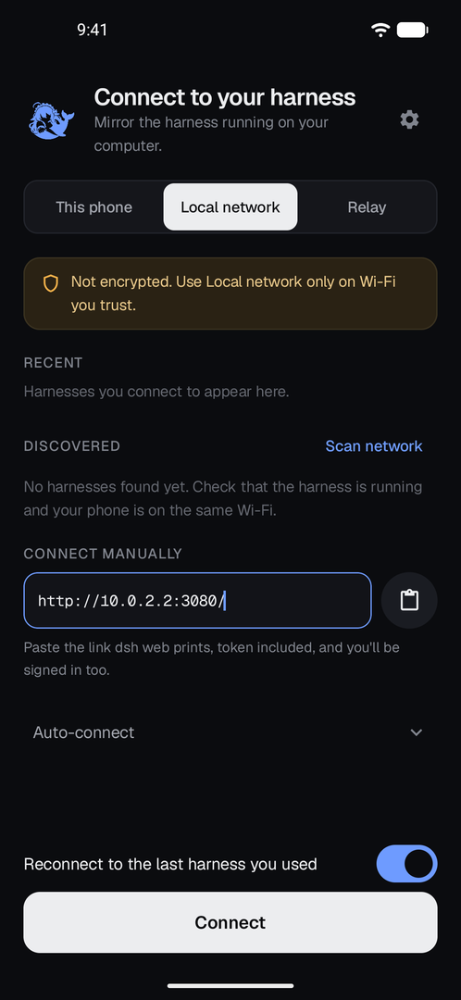 | 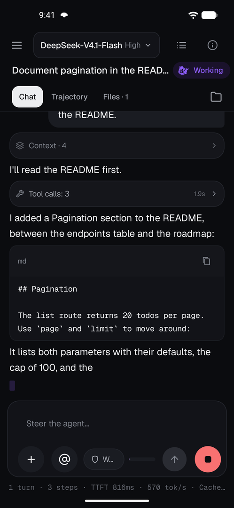 | 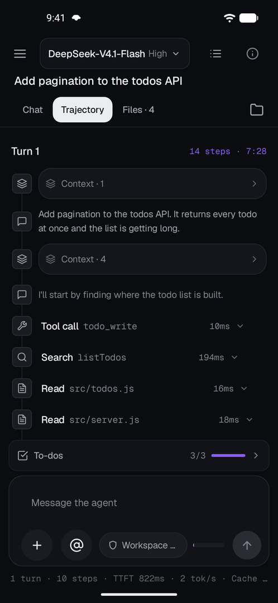 | 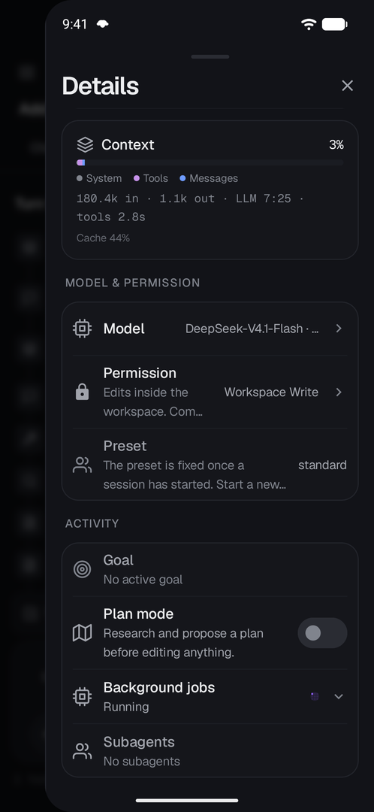 |
| Pega el enlace que imprime el harness y quedas conectado y con la sesión iniciada. | Las respuestas llegan en streaming. Las llamadas a herramientas se agrupan en una fila que puedes abrir. | Cada llamada a herramienta, turno a turno. | El modelo, el contexto, el objetivo, el modo plan y los trabajos de la sesión. |

| Subagentes | Terminal | Sesiones | Vista previa |
|:--:|:--:|:--:|:--:|
| 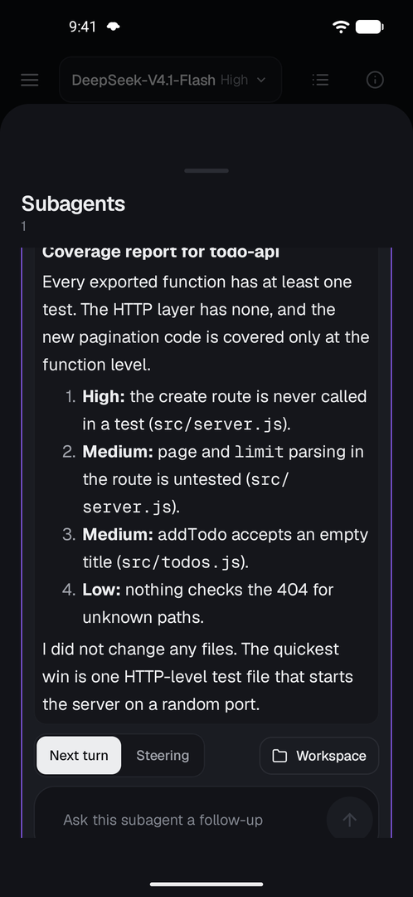 | 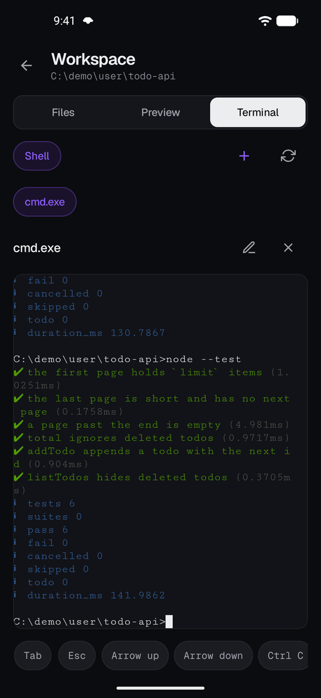 | 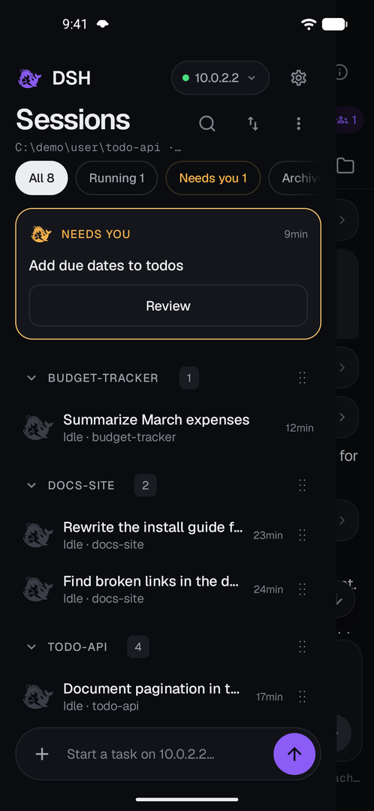 | 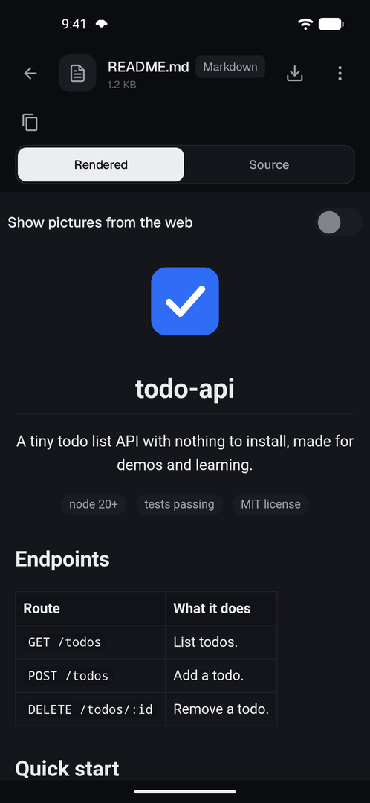 |
| Lee lo que hizo un subagente y envíale un mensaje de seguimiento. | Un shell real en el ordenador del harness. | Agrupa las sesiones por proyecto y arrástralas al orden que prefieras. | Un README dibujado como lo hace GitHub, en su propia pantalla. |

| Apariencia | Selector de color | Tema claro | Tema oscuro |
|:--:|:--:|:--:|:--:|
| 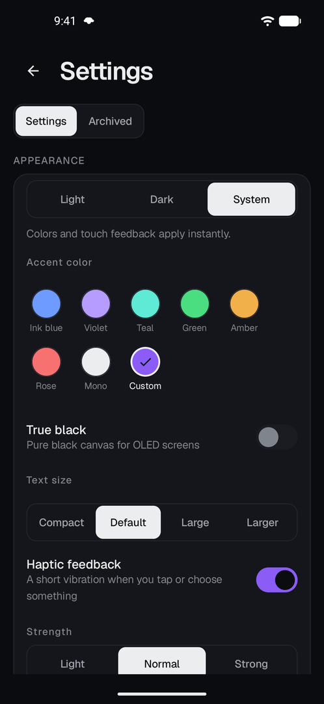 | 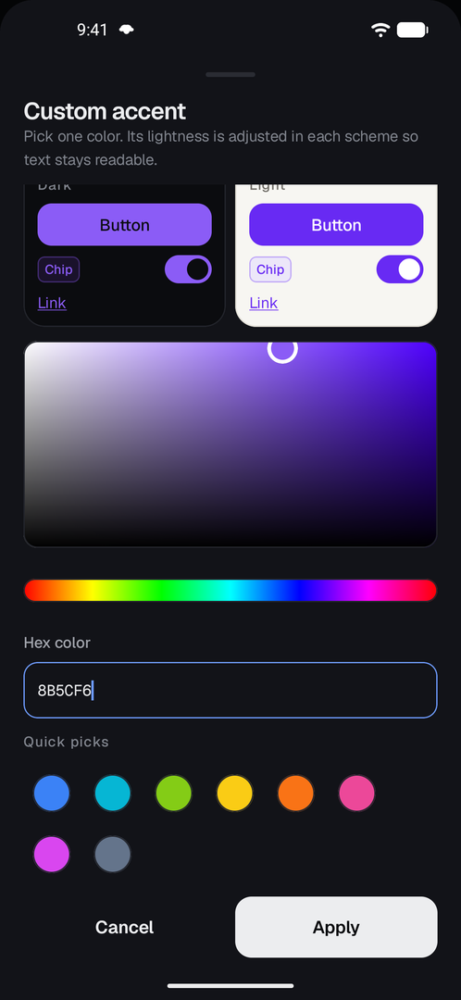 | 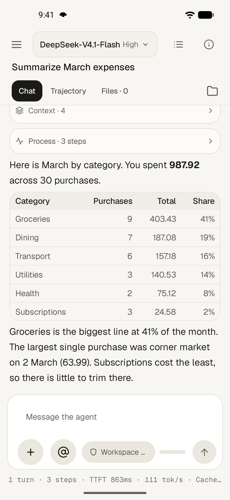 | 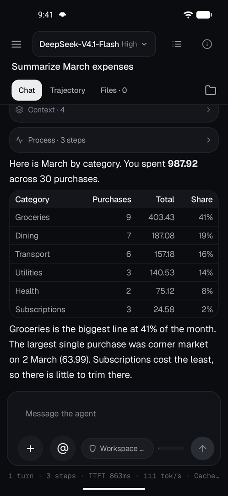 |
| Siete colores de acento o el que quieras, y una respuesta táctil que puedes probar. | Elige un color con la franja y el área, o escribe un código hexadecimal. | Claro, con un aspecto de papel cálido. | Oscuro, o el del sistema. |

## Qué puedes hacer

- Chatear con el agente. Las respuestas llegan en streaming con su razonamiento, los bloques de
  código y las llamadas a herramientas. Puedes adjuntar fotos y archivos, mencionar archivos con
  `@` y ejecutar comandos y habilidades con `/`.
- Mantener pulsado un mensaje, una llamada a herramienta o un archivo para ver qué más puedes
  hacer con él: copiarlo, corregir un mensaje enviado y volver a enviarlo, o mencionar un
  archivo en tu próximo mensaje.
- Responder a lo que el agente necesita de ti: aprobar o rechazar un comando, contestar sus
  preguntas y revisar un plan antes de que empiece.
- Seguir de cerca los trabajos largos. Los objetivos, las listas de tareas pendientes, los
  mensajes en cola, los trabajos en segundo plano y los subagentes tienen cada uno su propia
  vista, y puedes pausarlos, dirigirlos o detenerlos.
- Organizar las sesiones a tu manera. Arrástralas para ponerlas en el orden que quieras, o
  agrúpalas por proyecto y pliega los grupos que no uses.
- Buscar con un mismo campo de búsqueda en todas partes: sesiones, modelos, comandos, plugins,
  tareas programadas y archivos del espacio de trabajo.
- Recibir una notificación cuando termina un turno, cuando un objetivo se completa o se bloquea, o
  cuando el agente espera una respuesta. La conexión se mantiene activa en segundo plano.
- Explorar y previsualizar los archivos del espacio de trabajo, y abrir una terminal en el
  ordenador del harness.
- Abrir archivos a pantalla completa en la vista previa: tablas CSV, árboles JSON, notebooks,
  PDF, imágenes, vídeo, audio y archivos comprimidos, con búsqueda dentro del archivo. Guardar una
  copia deja cualquier archivo en tu teléfono.
- Gestionar el propio harness: modelos, preajustes de agente, plugins, tareas programadas y
  sesiones archivadas.
- Personalizar la aplicación. El diseño Ink viene en claro y oscuro, con colores de acento
  predefinidos o uno propio, negro puro para pantallas OLED y un tamaño de texto que puedes cambiar.
- Usar la aplicación en inglés, chino, hindi, español, francés, árabe, bengalí, portugués, ruso,
  urdu o tailandés. Admite idiomas que se escriben de derecha a izquierda.
- Actualiza la aplicación desde la propia aplicación: descarga la versión nueva, la comprueba y se
  la entrega al instalador de Android.

El [registro de cambios](CHANGELOG.md) recoge lo que cambió en cada versión.

## Sin ordenador: el harness en tu teléfono (Beta)

| Conectar | Configuración | Página del harness | Proyectos | Aprobación |
|:--:|:--:|:--:|:--:|:--:|
| 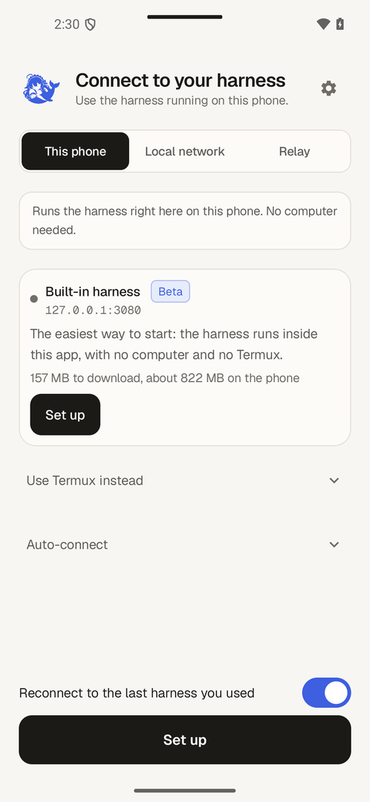 | 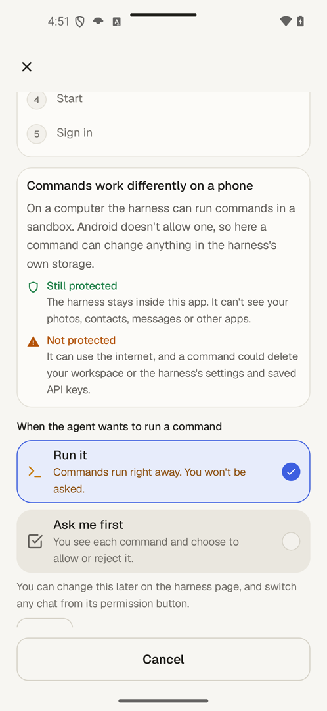 | 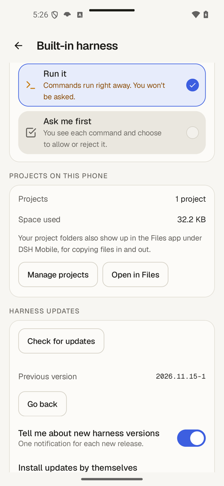 | 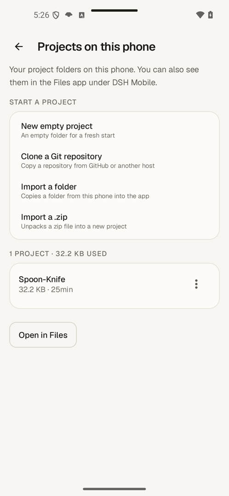 | 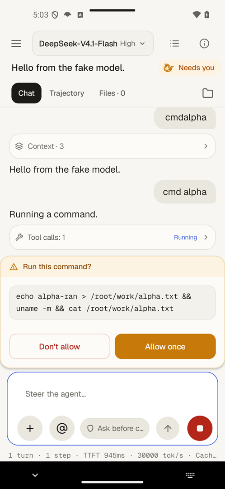 |
| Una instalación nueva se abre aquí. | Descargar, comprobar, desempaquetar, iniciar, iniciar sesión. | Iniciar, detener, comandos, actualizaciones, almacenamiento, registro. | Clonar, importar, compartir y abrir en Archivos. | Con Preguntarme antes, cada comando te espera. |

**Beta.** El harness integrado es nuevo en 0.22.0 y se probó en emuladores y en un teléfono Samsung, así que puede que todavía no funcione en todos los teléfonos. Un harness en tu ordenador (Red local, Relay) o en Termux sigue funcionando como antes.

La aplicación puede ejecutar el DeepSeek Harness dentro de sí misma: un pequeño sistema Linux con
Node.js y el harness, que se descarga una vez, se comprueba con una firma y se ejecuta con `proot`. Es
el mismo harness que ejecutarías en un ordenador, con las mismas sesiones y herramientas.

- **Lo que cuesta.** Unos 155 MB de descarga la primera vez y alrededor de 1,1 GB en el teléfono
  (1,4 GB libres mientras se configura). El harness usa unos 300 a 400 MB de memoria mientras
  funciona. Necesita un teléfono de 64 bits con Android 8.0 o posterior, y una clave de API de un
  proveedor de modelos, que añades en la aplicación (Ajustes, Models).
- **Lo que puede hacer.** Chats, agentes y subagentes, archivos y comandos de shell (`git`, `node`,
  `npm`, `curl`, y más con `apt-get`), clonar repositorios Git y todo lo que la aplicación hace con
  un harness en un ordenador.
- **Lo que no puede hacer.** Ejecutar comandos en un sandbox (Android no permite ninguno dentro de
  una aplicación), acceder a tus fotos, descargas u otras aplicaciones, ni ejecutar un modelo en el
  teléfono. Habla con tu proveedor de modelos por internet.
- **Comandos.** Tú eliges qué pasa cuando el agente quiere ejecutar un comando: **Ejecutarlo**, o
  **Preguntarme antes**, que muestra cada comando completo y espera a que lo permitas o lo rechaces.
  En los dos casos el harness se queda dentro de la aplicación; un comando puede usar internet y
  cambiar los archivos y proyectos del propio harness.
- **Tus archivos.** Los proyectos viven en la aplicación y aparecen en la app Archivos del sistema
  como **DSH Mobile**, para abrirlos, copiar archivos dentro y fuera o compartir un proyecto como zip.
- **Actualizaciones.** Las versiones nuevas del harness llegan sin actualizar la aplicación: te lo
  dice una vez y las instala cuando tocas Actualizar (o sola por Wi-Fi, si lo activas). Si una versión
  nueva no arranca, vuelve la anterior. La aplicación se actualiza desde **Ajustes, Acerca de**. Son
  dos cosas distintas.
- **Mantenerlo en marcha.** Android detiene el trabajo en segundo plano. La página del harness tiene
  una lista de comprobación (notificaciones, batería, el límite de procesos en segundo plano), y
  algunos fabricantes necesitan su propio ajuste.

La guía completa, con soluciones ordenadas por los mensajes que muestra la aplicación, está en
[`harness/ON-DEVICE.md`](harness/ON-DEVICE.md) (en inglés).

## Primeros pasos

### 1. Instala la aplicación

Descarga el APK desde la [última versión](https://github.com/sorsama/deepseek-harness-mobile/releases/latest)
e instálalo. Necesitas Android 8.0 o posterior.

### 2. Haz que el harness sea accesible

Con el harness integrado (arriba) no hay nada que configurar aquí: elige **Este teléfono** y toca
**Configurar**. Para usar un harness en un ordenador, sigue leyendo.

De forma predeterminada, el harness solo escucha en su propio ordenador. Elige la configuración
que corresponda al lugar donde vaya a estar tu teléfono.

#### En la misma Wi-Fi que el ordenador

Inicia el harness en la dirección de red local del ordenador. En el harness 0.2.1-alpha.2 y
posteriores:

```sh
dsh web --host 192.168.1.20
```

Usa la dirección real de tu ordenador en lugar de `192.168.1.20`. El harness imprime una línea
como `dsh web: http://192.168.1.20:3080/?token=…`. En la aplicación, elige **Red local**, pega
ese enlace completo en el campo de dirección (o toca el botón Pegar) y toca **Conectar**. El token
del enlace inicia la sesión en el teléfono, y a partir de ahí el harness aparece en **Recientes**
para la próxima vez. Las versiones anteriores del harness necesitan un pequeño parche en lugar de
`--host`; consulta [`harness/README.md`](harness/README.md).

#### Fuera de casa

Instala [dsh-relay](https://github.com/sorsama/deepseek-harness-relay), un plugin del harness que
añade contraseña, cifrado y emparejamiento de dispositivos. Después elige **Relé** en la
aplicación y escanea el código QR de emparejamiento. La [página Relay de la wiki](https://github.com/sorsama/deepseek-harness-mobile/wiki/Relay)
explica el proceso paso a paso.

#### Cable USB o emulador

Ejecuta `dsh web` en el ordenador y `adb reverse tcp:3080 tcp:3080`. En la aplicación, elige
**Este teléfono** e inicia sesión con el enlace que imprimió `dsh web`.

#### En el propio teléfono

Elige **Este teléfono** y toca **Configurar**: la aplicación descarga y ejecuta el harness ella misma
y luego inicia sesión. Consulta [`harness/ON-DEVICE.md`](harness/ON-DEVICE.md).

Si prefieres tus propias versiones de Node y del harness, el harness también puede ejecutarse en
[Termux](https://f-droid.org/packages/com.termux/) (abre **Usar Termux en su lugar** en la misma
pantalla), y la aplicación puede iniciarlo, detenerlo e iniciar sesión por ti. Configurar Node en
Termux todavía no funciona en todos los dispositivos; lee primero [`harness/TERMUX.md`](harness/TERMUX.md).

#### Tu propio proxy inverso HTTPS

Pega su dirección `https://` en el modo **Red local**. El proxy cifra la conexión, pero no
comprueba quién se conecta. Consulta [`harness/README.md`](harness/README.md).

### 3. Empieza a trabajar

Elige una sesión de la lista (desliza desde el borde izquierdo) o empieza una nueva. Si una
conexión falla, la aplicación te dice por qué, y la
[página de solución de problemas](https://github.com/sorsama/deepseek-harness-mobile/wiki/Troubleshooting)
de la wiki está organizada según esos mensajes.

## Seguridad

Lee [docs/SECURITY.md](docs/SECURITY.md) antes de conectarte a través de una red. Un teléfono con
la sesión iniciada puede hacer todo lo que puede hacer el agente, y el agente ejecuta comandos en
tu ordenador. Iniciar sesión equivale a dar acceso a un shell.

- El modo Red local comprueba el token de inicio de sesión, pero no cifra nada. Úsalo solo en una
  red de confianza.
- El modo Relé añade cifrado y un certificado fijado, y funciona desde fuera de tu red.
- Mantén en privado el enlace de `dsh web`. Cualquiera que lo tenga puede iniciar sesión hasta que el
  harness se reinicie.
- El harness integrado se queda dentro de la aplicación y no puede ver tus fotos, contactos ni otras
  aplicaciones, pero sus comandos no tienen sandbox: un comando puede usar internet y cambiar los
  archivos, ajustes y claves de API guardadas del propio harness. Elige **Preguntarme antes** para leer
  cada comando antes de que se ejecute.

## Compatibilidad

DSH Mobile se prueba con **DeepSeek Harness 0.2.2-rc.1**. Las versiones anteriores del harness,
hasta la 0.1.6, siguen funcionando en su mayor parte, pero las funciones nuevas necesitan un
harness más reciente. La [tabla de compatibilidad](docs/COMPATIBILITY.md) indica qué versión de la
aplicación corresponde a cada versión del harness.

## Compilar desde el código fuente

```sh
./gradlew :app:assembleDebug      # debug APK
./gradlew :app:assembleRelease    # release APK, signed when the keystore environment is set
./gradlew :core:jvmTest :app:testDebugUnitTest
```

Para comprobar la aplicación con un harness real, compila una copia local del repositorio del
harness y ejecuta la suite de conformidad:

```sh
DSH_HARNESS_SRC=/path/to/deepseek-harness ./gradlew :conformance:test
```

Las compilaciones de publicación toman la versión de la etiqueta de git.
[CONTRIBUTING.md](CONTRIBUTING.md) explica el ciclo de desarrollo, la organización de los módulos
y los pasos para publicar una versión.

| Ruta | Contenido |
|---|---|
| `app/` | La aplicación de Android: pantallas, conexión, notificaciones, traducciones |
| `core/` | Código del protocolo en Kotlin puro: tipos de datos del protocolo, clientes RPC y de streams, lógica de reconexión, el plegado de eventos de la sesión |
| `conformance/` | Pruebas que arrancan un harness real y comprueban cada llamada que hace la aplicación |
| `mock-harness/` | Un pequeño servidor de harness simulado para las pruebas |
| `tools/capture/` | Graba tráfico real del harness como fixtures de prueba |
| `harness/` | Guías de configuración para el harness integrado, la red local y Termux |
| `docs/` | [Arquitectura](docs/ARCHITECTURE.md), [notas del protocolo](docs/PROTOCOL.md), [compatibilidad](docs/COMPATIBILITY.md), [seguridad](docs/SECURITY.md) |

El plugin del relé está en su propio repositorio,
[sorsama/deepseek-harness-relay](https://github.com/sorsama/deepseek-harness-relay).

## Licencia

[MIT](LICENSE). El material de terceros incluido en la aplicación se enumera en
[THIRD_PARTY_NOTICES.md](THIRD_PARTY_NOTICES.md). DeepSeek Harness y su marca pertenecen a sus
propietarios. Este proyecto no está afiliado a ellos.
