<p align="center">
  
</p>

<h1 align="center">DSH Mobile</h1>

<p align="center">
  Une application Android pour piloter un <a href="https://github.com/deepseek-ai/deepseek-harness">DeepSeek Harness</a> depuis votre téléphone.
</p>

<p align="center">
  <a href="https://dshm.zyphite.com"></a>
  <a href="https://github.com/sorsama/deepseek-harness-mobile/releases/latest"></a>
  <a href="https://github.com/sorsama/deepseek-harness-mobile/actions/workflows/ci.yml"></a>
  
  <a href="LICENSE"></a>
</p>

<p align="center">
  <a href="README.md">English</a> ·
  <a href="README.zh-CN.md">中文</a> ·
  <a href="README.hi.md">हिन्दी</a> ·
  <a href="README.es.md">Español</a> ·
  <b>Français</b> ·
  <a href="README.th.md">ไทย</a>
</p>

Le DeepSeek Harness est un agent de programmation IA qui tourne sur votre ordinateur et dispose
d'une interface web. DSH Mobile se connecte à ce harness et vous donne les mêmes contrôles dans
une application Android native. Vous pouvez lancer une tâche depuis votre bureau, puis la suivre,
répondre à ses questions et approuver ses commandes depuis votre téléphone.

Il s'agit d'une application non officielle, développée par la communauté. Elle a besoin d'un
harness lancé à un endroit qu'elle peut joindre : sur votre ordinateur, ou sur le téléphone
lui-même grâce à Termux.

Le [site du projet](https://dshm.zyphite.com) présente l'application sur une seule page, et le
[wiki](https://github.com/sorsama/deepseek-harness-mobile/wiki) contient le guide d'utilisation complet.

## Captures d'écran

| Se connecter | Discussion | Trajectoire | Détails |
|:--:|:--:|:--:|:--:|
| 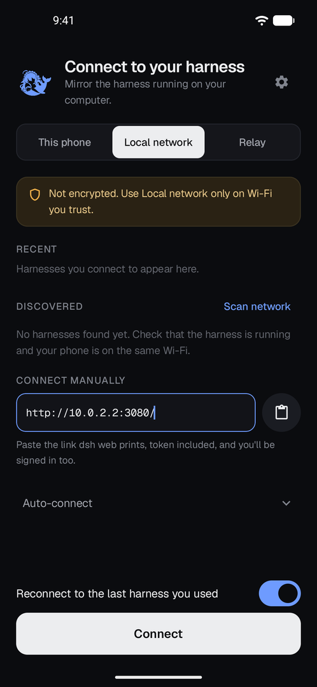 | 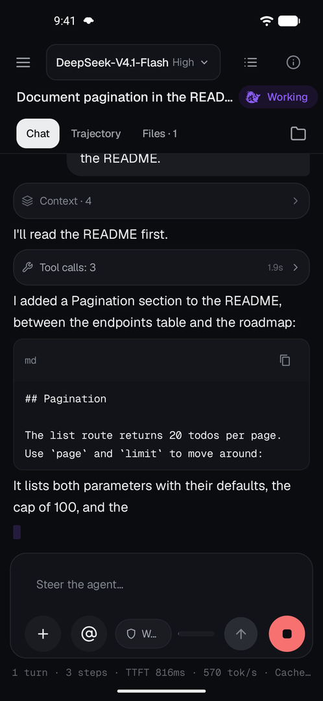 | 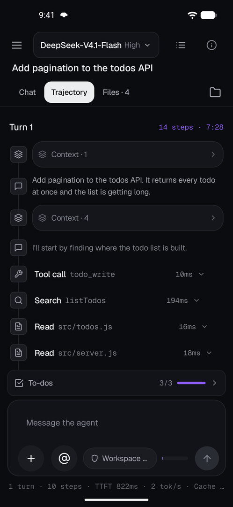 | 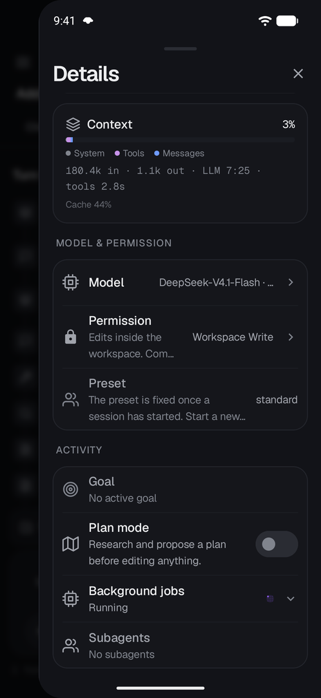 |
| Collez le lien affiché par le harness, et vous voilà connecté et identifié. | Les réponses s'affichent au fil de l'eau. Les appels d'outil se replient en une ligne que vous pouvez ouvrir. | Chaque appel d'outil, tour par tour. | Le modèle, le contexte, l'objectif, le mode plan et les tâches de la session. |

| Sous-agents | Terminal | Sessions | Aperçu |
|:--:|:--:|:--:|:--:|
| 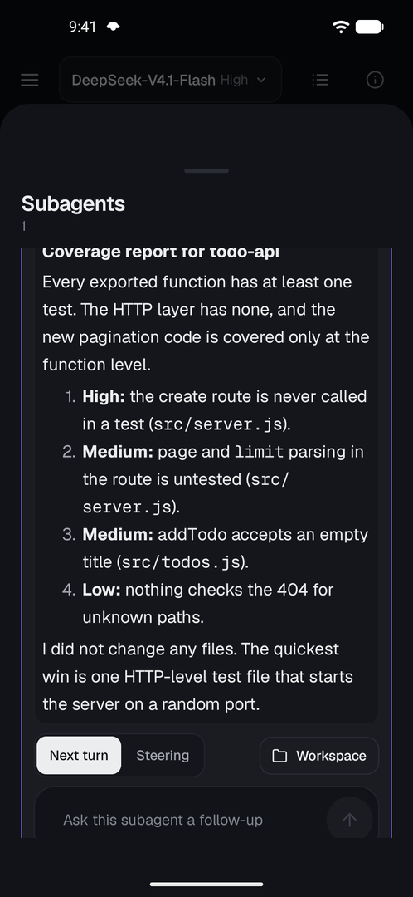 | 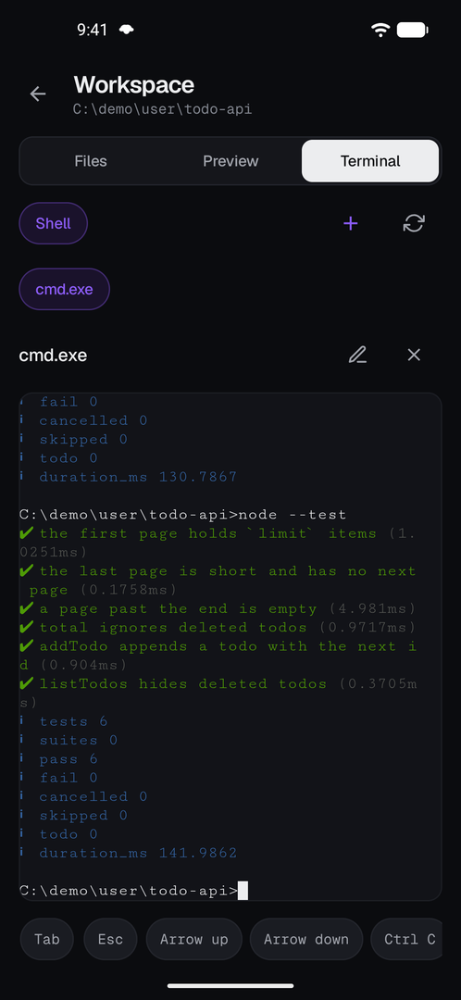 | 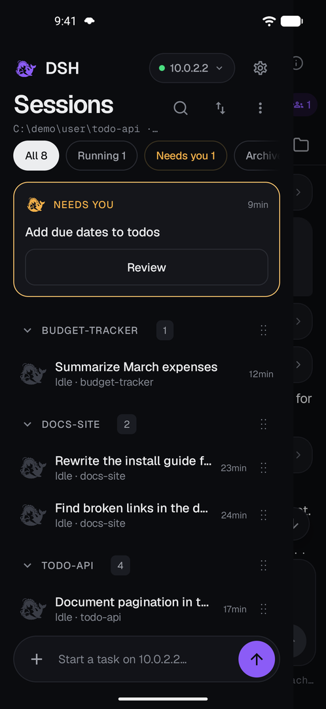 | 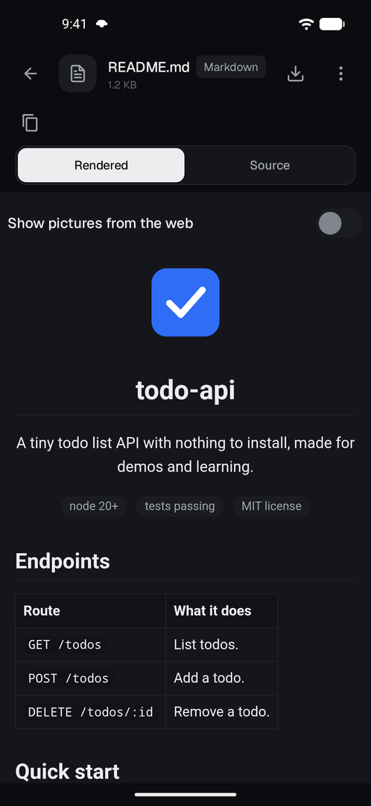 |
| Voyez ce qu'un sous-agent a fait et envoyez-lui un message de suivi. | Un vrai shell sur l'ordinateur du harness. | Regroupez les sessions par projet et faites-les glisser dans l'ordre que vous voulez. | Un README affiché comme sur GitHub, sur son propre écran. |

| Apparence | Sélecteur de couleur | Thème clair | Thème sombre |
|:--:|:--:|:--:|:--:|
| 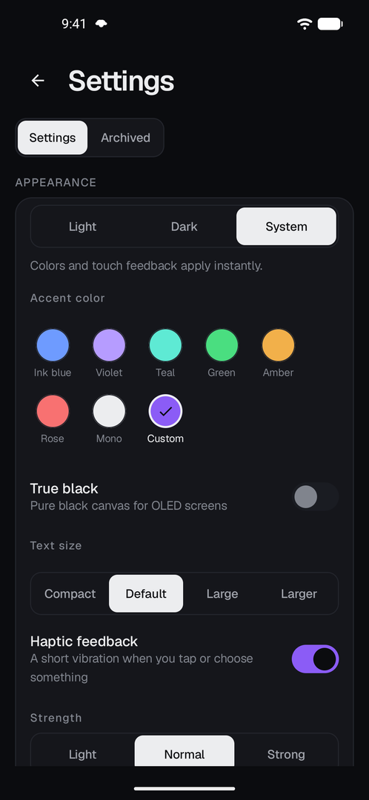 | 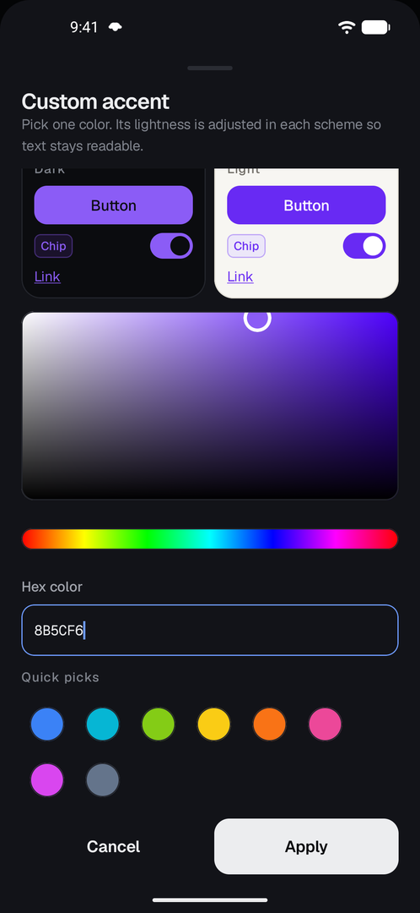 | 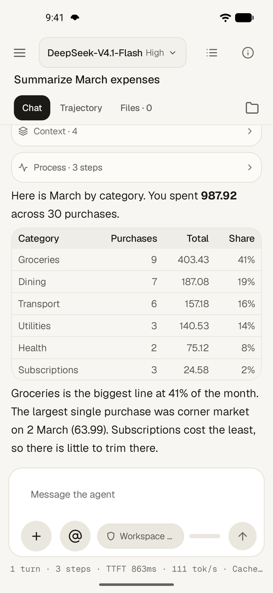 | 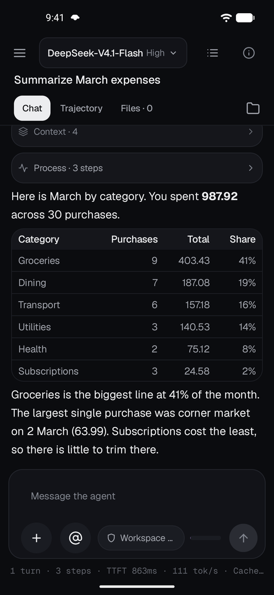 |
| Sept couleurs d'accentuation, ou la couleur de votre choix, et un retour tactile à essayer. | Choisissez une couleur avec la bande et la zone, ou saisissez un code hexadécimal. | Clair, avec un fond papier chaleureux. | Sombre, ou selon le système. |

## Ce que vous pouvez faire

- Discutez avec l'agent. Les réponses s'affichent au fil de l'eau, avec leur raisonnement, leurs
  blocs de code et leurs appels d'outil. Vous pouvez joindre des photos et des fichiers, citer des
  fichiers avec `@`, et lancer des commandes et des compétences avec `/`.
- Appuyez longuement sur un message, un appel d'outil ou un fichier pour voir ce que vous pouvez
  en faire d'autre : le copier, corriger un message envoyé puis le renvoyer, ou citer un fichier
  dans votre prochain message.
- Répondez quand l'agent a besoin de vous : approuvez ou refusez une commande, répondez à ses
  questions, et relisez un plan avant qu'il ne démarre.
- Gardez un œil sur les travaux longs. Les objectifs, les listes de tâches, les messages en file
  d'attente, les tâches en arrière-plan et les sous-agents ont chacun leur propre vue, et vous
  pouvez les mettre en pause, les réorienter ou les arrêter.
- Organisez vos sessions à votre façon. Faites-les glisser dans l'ordre voulu, ou regroupez-les
  par projet et repliez les groupes que vous n'utilisez pas.
- Retrouvez ce que vous cherchez avec le même champ de recherche partout : sessions, modèles,
  commandes, plugins, tâches planifiées et fichiers de l'espace de travail.
- Recevez une notification quand un tour se termine, quand un objectif est atteint ou bloqué, ou
  quand l'agent attend une réponse. La connexion reste active en arrière-plan.
- Parcourez et prévisualisez les fichiers de l'espace de travail, et ouvrez un terminal sur
  l'ordinateur du harness.
- Ouvrez les fichiers en plein écran dans l'aperçu : tableaux CSV, arbres JSON, notebooks, PDF,
  images, vidéo, audio et archives, avec recherche dans le fichier. « Enregistrer une copie » met
  n'importe quel fichier sur votre téléphone.
- Gérez le harness lui-même : modèles, préréglages d'agent, plugins, tâches planifiées et sessions
  archivées.
- Personnalisez l'application. Le design Ink existe en clair et en sombre, avec des couleurs
  d'accent prédéfinies ou la vôtre, un noir pur pour les écrans OLED et une taille de texte réglable.
- Utilisez l'application en anglais, chinois, hindi, espagnol, français, arabe, bengali, portugais,
  russe, ourdou ou thaï. Les langues qui s'écrivent de droite à gauche sont prises en charge.

Le [journal des modifications](CHANGELOG.md) indique ce qui a changé dans chaque version.

## Premiers pas

### 1. Installer l'application

Téléchargez l'APK depuis la [dernière version](https://github.com/sorsama/deepseek-harness-mobile/releases/latest)
et installez-le. Il vous faut Android 8.0 ou plus récent.

### 2. Rendre le harness accessible

Par défaut, le harness n'écoute que sur son propre ordinateur. Choisissez la configuration qui
correspond à l'endroit où se trouvera votre téléphone.

#### Sur le même Wi-Fi que l'ordinateur

Lancez le harness sur l'adresse de l'ordinateur dans le réseau local. Avec le
harness 0.2.1-alpha.2 ou plus récent :

```sh
dsh web --host 192.168.1.20
```

Remplacez `192.168.1.20` par l'adresse réelle de votre ordinateur. Le harness affiche une ligne du
type `dsh web: http://192.168.1.20:3080/?token=…`. Dans l'application, choisissez **Réseau local**,
collez ce lien en entier dans le champ d'adresse (ou touchez le bouton Coller), puis touchez
**Se connecter**. Le jeton contenu dans le lien connecte le téléphone, et le harness apparaît
ensuite sous **Récents** pour les fois suivantes. Les versions plus anciennes du harness ont besoin
d'un petit correctif à la place de `--host` ; voir [`harness/README.md`](harness/README.md).

#### Hors de chez vous

Installez [dsh-relay](https://github.com/sorsama/deepseek-harness-relay), un
plugin du harness qui ajoute un mot de passe, le chiffrement et l'appairage des appareils. Choisissez
ensuite **Relais** dans l'application et scannez le QR code d'appairage. La [page du wiki sur le relais](https://github.com/sorsama/deepseek-harness-mobile/wiki/Relay)
explique la marche à suivre.

#### Câble USB ou émulateur

Lancez `dsh web` sur l'ordinateur, puis `adb reverse tcp:3080 tcp:3080`. Dans
l'application, choisissez **Ce téléphone** et connectez-vous avec le lien affiché par `dsh web`.

#### Sur le téléphone lui-même

Le harness peut tourner dans [Termux](https://f-droid.org/packages/com.termux/).
Choisissez **Ce téléphone** : l'application peut alors démarrer et arrêter le harness, et vous
connecter elle-même. L'installation de Node dans Termux ne fonctionne pas encore sur tous les
appareils ; lisez d'abord [`harness/TERMUX.md`](harness/TERMUX.md).

#### Votre propre reverse proxy HTTPS

Collez son adresse `https://` en mode **Réseau local**. Le proxy
chiffre la connexion, mais il ne vérifie pas qui se connecte. Voir
[`harness/README.md`](harness/README.md).

### 3. Se mettre au travail

Choisissez une session dans la liste (balayez depuis le bord gauche) ou démarrez-en une nouvelle.
Si une connexion échoue, l'application en donne la raison, et la
[page de dépannage](https://github.com/sorsama/deepseek-harness-mobile/wiki/Troubleshooting) du wiki
est organisée selon ces messages.

## Sécurité

Lisez [docs/SECURITY.md](docs/SECURITY.md) avant de vous connecter par le réseau. Un téléphone
connecté peut faire tout ce que l'agent peut faire, et l'agent exécute des commandes sur votre
ordinateur. Autoriser une connexion revient à donner un accès shell.

- Le mode Réseau local vérifie le jeton de connexion, mais ne chiffre rien. Ne l'utilisez que sur
  un réseau de confiance.
- Le mode Relais ajoute le chiffrement et un certificat épinglé, et fonctionne depuis l'extérieur
  de votre réseau.
- Gardez le lien `dsh web` pour vous. Toute personne qui l'a peut se connecter jusqu'au redémarrage
  du harness.

## Compatibilité

DSH Mobile est testé avec **DeepSeek Harness 0.2.2-rc.1**. Les versions plus anciennes du harness,
jusqu'à la 0.1.6, fonctionnent encore pour l'essentiel, mais les fonctions récentes demandent un
harness récent. Le [tableau de compatibilité](docs/COMPATIBILITY.md) indique quelle version de
l'application va avec quel harness.

## Compiler depuis les sources

```sh
./gradlew :app:assembleDebug      # debug APK
./gradlew :app:assembleRelease    # release APK, signed when the keystore environment is set
./gradlew :core:jvmTest :app:testDebugUnitTest
```

Pour vérifier l'application face à un vrai harness, compilez une copie locale du harness et lancez
la suite de conformité :

```sh
DSH_HARNESS_SRC=/path/to/deepseek-harness ./gradlew :conformance:test
```

Les builds de release prennent leur version dans le tag git. [CONTRIBUTING.md](CONTRIBUTING.md)
décrit la boucle de développement, l'organisation des modules et les étapes de publication.

| Chemin | Contenu |
|---|---|
| `app/` | L'application Android : écrans, connexion, notifications, traductions |
| `core/` | Code de protocole en Kotlin pur : types échangés sur le réseau, clients RPC et de flux, logique de reconnexion, pliage des événements de session |
| `conformance/` | Tests qui lancent un vrai harness et vérifient chaque appel de l'application |
| `mock-harness/` | Un petit faux serveur de harness pour les tests |
| `tools/capture/` | Enregistre le trafic d'un vrai harness comme fixtures de test |
| `harness/` | Guides d'installation pour le réseau local et Termux |
| `docs/` | [Architecture](docs/ARCHITECTURE.md), [notes de protocole](docs/PROTOCOL.md), [compatibilité](docs/COMPATIBILITY.md), [sécurité](docs/SECURITY.md) |

Le plugin de relais a son propre dépôt,
[sorsama/deepseek-harness-relay](https://github.com/sorsama/deepseek-harness-relay).

## Licence

[MIT](LICENSE). Les éléments tiers inclus dans l'application sont listés dans
[THIRD_PARTY_NOTICES.md](THIRD_PARTY_NOTICES.md). DeepSeek Harness et sa marque appartiennent à
leurs propriétaires. Ce projet n'a aucun lien avec eux.
