<p align="center">
  
</p>

<h1 align="center">DSH Mobile</h1>

<p align="center">
  अपने फ़ोन से <a href="https://github.com/deepseek-ai/deepseek-harness">DeepSeek Harness</a> चलाने के लिए एक Android ऐप।
</p>

<p align="center">
  <a href="https://dshm.zyphite.com"></a>
  <a href="https://github.com/sorsama/deepseek-harness-mobile/releases/latest"></a>
  <a href="https://github.com/sorsama/deepseek-harness-mobile/actions/workflows/ci.yml"></a>
  
  <a href="LICENSE"></a>
</p>

<p align="center">
  <a href="README.md">English</a> ·
  <a href="README.zh-CN.md">中文</a> ·
  <b>हिन्दी</b> ·
  <a href="README.es.md">Español</a> ·
  <a href="README.fr.md">Français</a> ·
  <a href="README.th.md">ไทย</a>
</p>

DeepSeek Harness एक AI कोडिंग एजेंट है जो आपके कंप्यूटर पर चलता है और जिसका एक वेब इंटरफ़ेस है।
DSH Mobile उस harness से जुड़ता है और आपको वही नियंत्रण एक नेटिव Android ऐप में देता है। आप
अपनी डेस्क पर कोई काम शुरू कर सकते हैं, और फिर फ़ोन से उस पर नज़र रख सकते हैं, उसके सवालों के
जवाब दे सकते हैं और उसकी कमांड को मंज़ूरी दे सकते हैं।

आपको कंप्यूटर की ज़रूरत नहीं है। ज़्यादातर Android फ़ोन पर ऐप खुद harness चला सकता है: एक बार
**सेट अप करें** पर टैप करें और फ़ोन के पास अपना harness होगा। अगर आप पहले से कंप्यूटर पर harness
चलाते हैं, तो ऐप उससे भी जुड़ सकता है, अपने Wi-Fi पर या relay के ज़रिए कहीं से भी।

यह एक अनौपचारिक ऐप है, जिसे समुदाय ने बनाया है।

[प्रोजेक्ट साइट](https://dshm.zyphite.com) पर एक पेज में पूरा परिचय है, और
[wiki](https://github.com/sorsama/deepseek-harness-mobile/wiki) में पूरी उपयोगकर्ता गाइड है।

## स्क्रीनशॉट

| कनेक्ट करें | चैट | ट्रैजेक्टरी | विवरण |
|:--:|:--:|:--:|:--:|
| 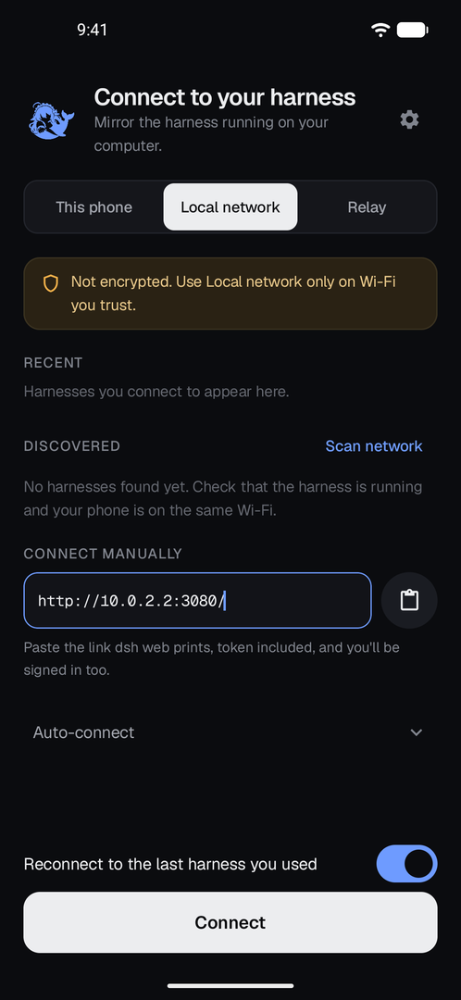 | 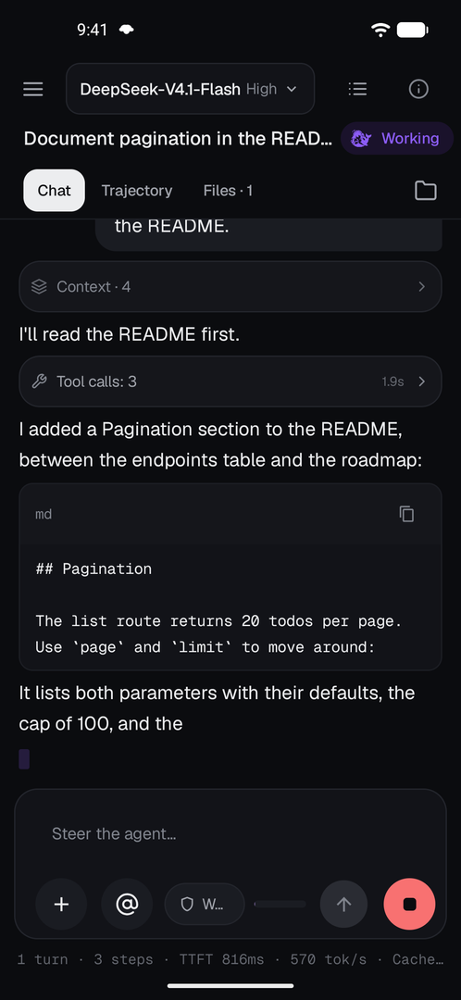 | 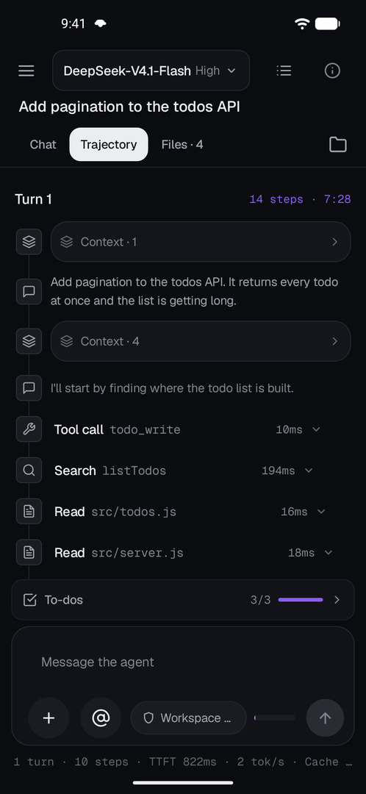 | 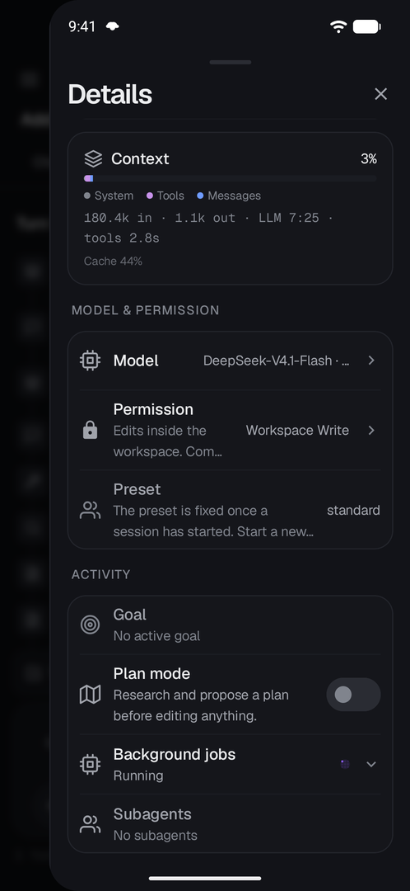 |
| harness जो लिंक प्रिंट करता है उसे पेस्ट करें, और आप कनेक्ट होकर साइन इन हो जाते हैं। | जवाब स्ट्रीम होकर आते हैं। टूल कॉल एक पंक्ति में सिमट जाती हैं, जिसे आप खोल सकते हैं। | हर टूल कॉल, टर्न दर टर्न। | सेशन का मॉडल, संदर्भ, लक्ष्य, प्लान मोड और बैकग्राउंड कार्य। |

| उप-एजेंट | टर्मिनल | सेशन | प्रीव्यू |
|:--:|:--:|:--:|:--:|
| 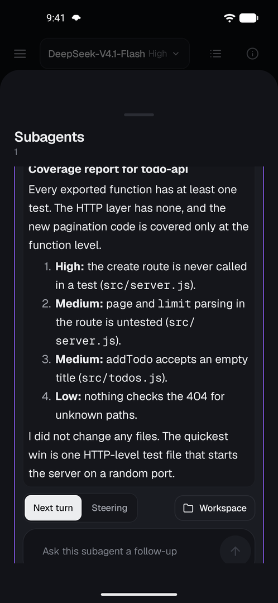 | 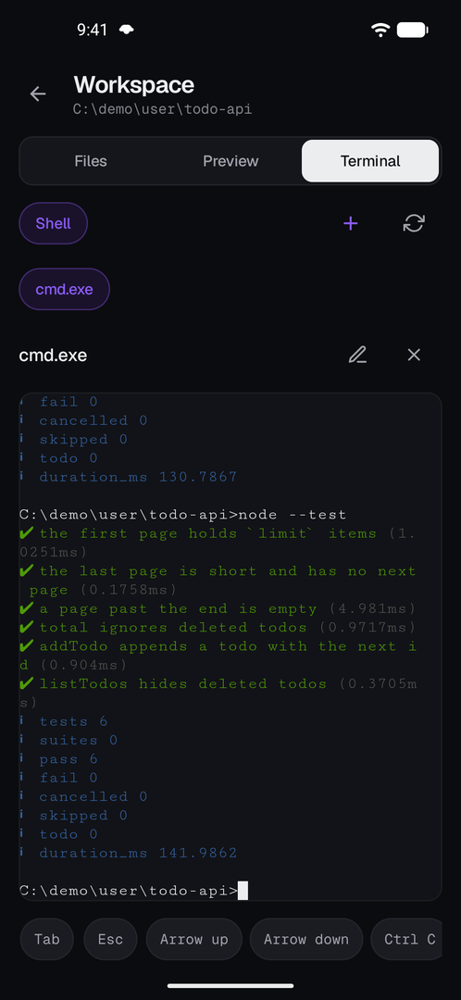 | 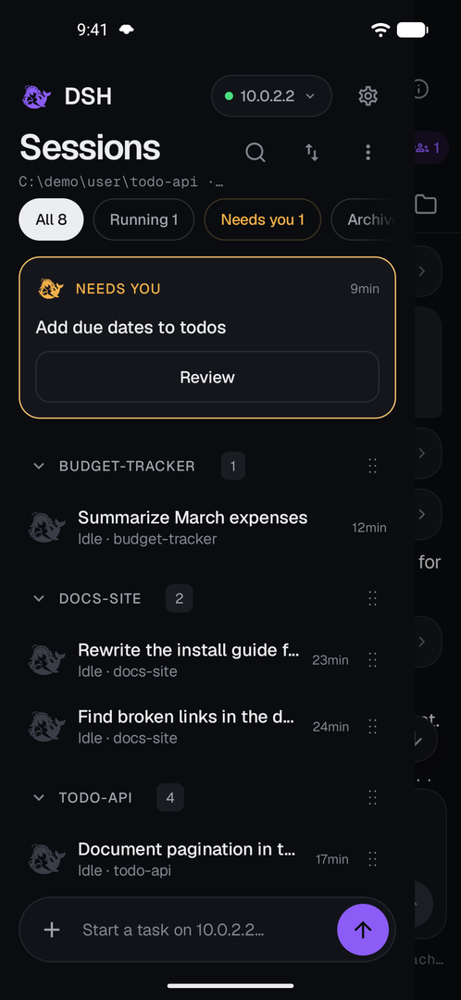 | 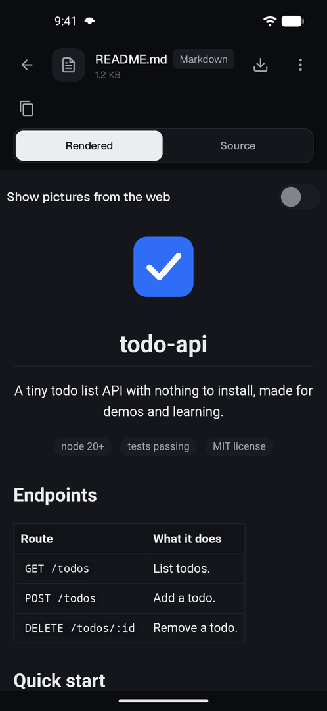 |
| देखें कि उप-एजेंट ने क्या किया, और उसे आगे का संदेश भेजें। | harness वाले कंप्यूटर पर एक असली shell। | सेशन को प्रोजेक्ट के हिसाब से ग्रुप करें और खींचकर अपने क्रम में लगाएँ। | README वैसा ही दिखता है जैसा GitHub पर, अपनी पूरी स्क्रीन पर। |

| दिखावट | रंग चुनने वाला | लाइट थीम | डार्क थीम |
|:--:|:--:|:--:|:--:|
| 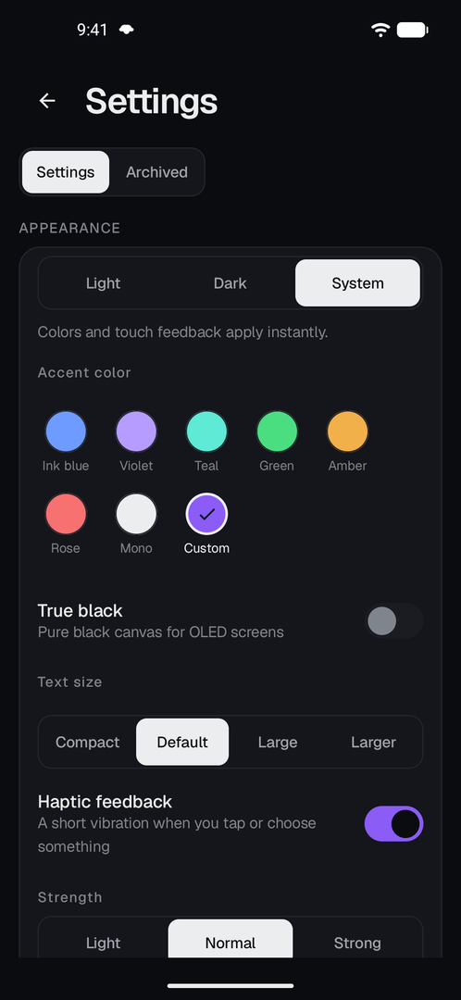 | 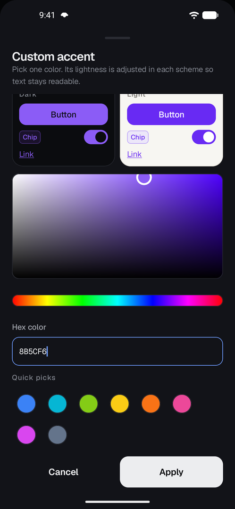 | 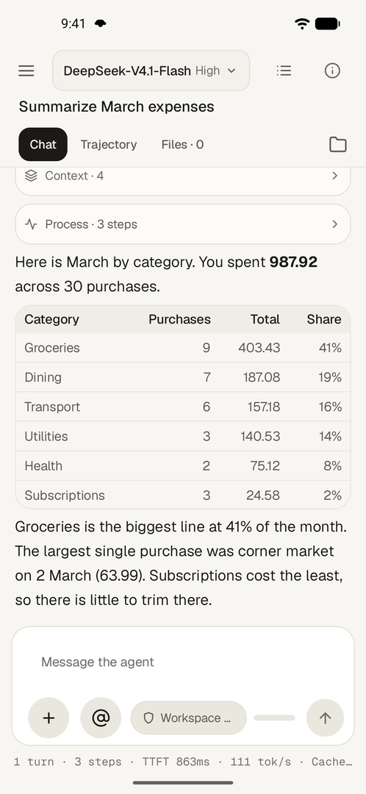 | 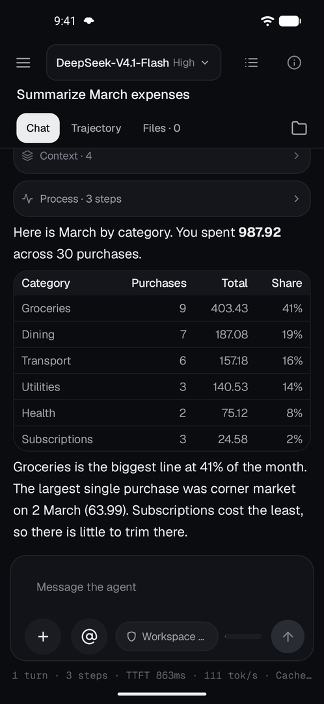 |
| सात एक्सेंट रंग या अपनी पसंद का कोई भी रंग, और हैप्टिक फ़ीडबैक जिसे आप आज़मा सकते हैं। | पट्टी और रंग-क्षेत्र से रंग चुनें, या hex कोड लिखें। | लाइट थीम, कागज़ जैसे गर्म रंग के साथ। | डार्क थीम, या सिस्टम के हिसाब से। |

## आप क्या कर सकते हैं

- एजेंट से चैट करें। जवाब अपनी रीज़निंग, कोड ब्लॉक और टूल कॉल के साथ स्ट्रीम होकर आते हैं। आप
  फ़ोटो और फ़ाइलें अटैच कर सकते हैं, `@` से फ़ाइलों का हवाला दे सकते हैं, और `/` से कमांड और स्किल चला सकते हैं।
- किसी संदेश, टूल कॉल या फ़ाइल को दबाकर रखें और देखें कि उसके साथ और क्या कर सकते हैं: उसे कॉपी करें,
  भेजे गए संदेश को सुधारकर दोबारा भेजें, या अगले संदेश में किसी फ़ाइल का हवाला दें।
- एजेंट को आपसे जो चाहिए, उसका जवाब दें: किसी कमांड को मंज़ूरी दें या अस्वीकार करें, उसके सवालों
  के जवाब दें, और काम शुरू होने से पहले प्लान की समीक्षा करें।
- लंबे काम पर नज़र रखें। लक्ष्य, कार्य सूचियाँ, कतार में लगे संदेश, बैकग्राउंड कार्य और उप-एजेंट,
  सबका अपना अलग व्यू है, और आप उन्हें रोक सकते हैं, निर्देशित कर सकते हैं या बंद कर सकते हैं।
- अपने सत्र अपने हिसाब से रखें। उन्हें खींचकर मनचाहे क्रम में लगाएँ, या प्रोजेक्ट के हिसाब से ग्रुप करें
  और जो ग्रुप काम का न हो, उसे समेट दें।
- हर जगह एक ही सर्च बॉक्स से खोजें: सत्र, मॉडल, कमांड, प्लगइन, शेड्यूल किए गए कार्य और वर्कस्पेस की फ़ाइलें।
- जब कोई टर्न पूरा हो, कोई लक्ष्य पूरा हो या अटक जाए, या एजेंट आपके जवाब का इंतज़ार कर रहा हो,
  तब सूचना पाएँ। कनेक्शन बैकग्राउंड में भी बना रहता है।
- वर्कस्पेस की फ़ाइलें ब्राउज़ करें और उनका प्रीव्यू देखें, और harness वाले कंप्यूटर पर टर्मिनल खोलें।
- फ़ाइलें पूरी स्क्रीन पर प्रीव्यू में खोलें: CSV टेबल, JSON ट्री, नोटबुक, PDF, तस्वीरें, वीडियो, ऑडियो और
  आर्काइव, फ़ाइल के भीतर खोज के साथ। “कॉपी सहेजें” से कोई भी फ़ाइल फ़ोन में रख सकते हैं।
- harness को खुद मैनेज करें: मॉडल, एजेंट प्रीसेट, प्लगइन, शेड्यूल किए गए कार्य और संग्रहित
  सत्र।
- ऐप का रूप अपने हिसाब से बदलें। Ink डिज़ाइन लाइट और डार्क में आता है, इसमें एक्सेंट रंग के प्रीसेट या अपना
  रंग, OLED स्क्रीन के लिए ट्रू ब्लैक और बदला जा सकने वाला टेक्स्ट साइज़ मिलता है।
- ऐप को अंग्रेज़ी, चीनी, हिन्दी, स्पेनिश, फ़्रेंच, अरबी, बांग्ला, पुर्तगाली, रूसी, उर्दू या थाई
  में इस्तेमाल करें। दाएँ से बाएँ लिखी जाने वाली भाषाओं का भी समर्थन है।
- ऐप को ऐप के अंदर से ही अपडेट करें: यह नया वर्शन डाउनलोड करता है, उसे जाँचता है और Android के
  इंस्टॉलर को सौंप देता है।

[चेंजलॉग](CHANGELOG.md) में हर रिलीज़ के बदलाव दिए गए हैं।

## कंप्यूटर की ज़रूरत नहीं: आपके फ़ोन पर harness (बीटा)

| कनेक्ट | सेट अप | harness पेज | प्रोजेक्ट | मंज़ूरी |
|:--:|:--:|:--:|:--:|:--:|
| 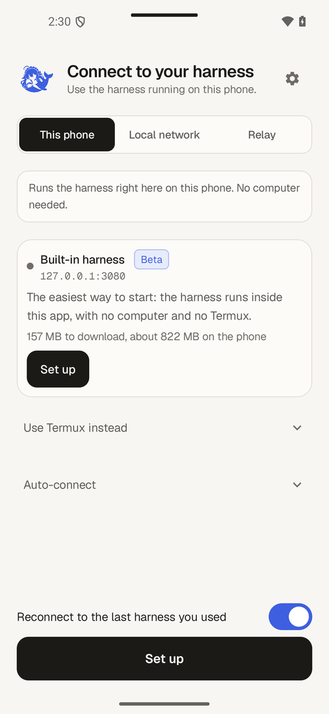 | 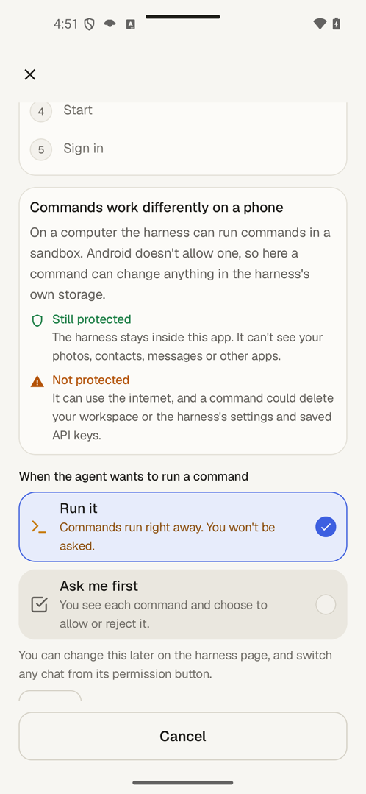 | 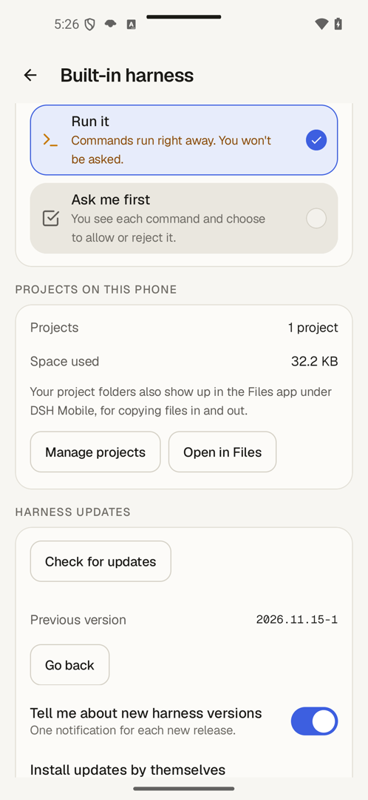 | 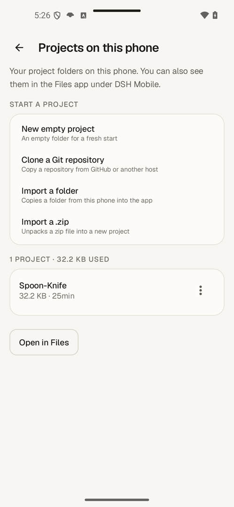 | 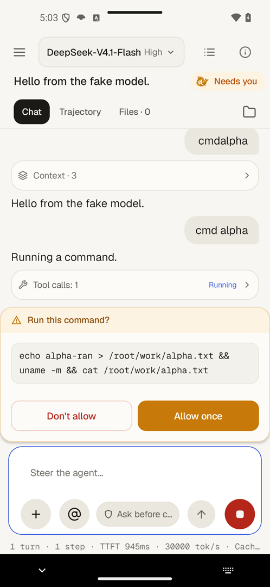 |
| नया इंस्टॉल यहीं खुलता है। | डाउनलोड, जाँच, अनपैक, शुरू, साइन इन। | शुरू, बंद, कमांड, अपडेट, स्टोरेज, लॉग। | क्लोन, इम्पोर्ट, शेयर और Files में खोलें। | पहले मुझसे पूछें चुनने पर हर कमांड आपका इंतज़ार करती है। |

**बीटा।** बिल्ट-इन harness 0.22.0 में नया है और इसे एम्युलेटर और एक Samsung फ़ोन पर परखा गया है, इसलिए हो सकता है यह अभी हर फ़ोन पर काम न करे। आपके कंप्यूटर पर (लोकल नेटवर्क, रिले) या Termux में चलने वाला harness पहले की तरह काम करता है।

ऐप DeepSeek Harness को अपने अंदर ही चला सकता है: Node.js और harness वाला एक छोटा Linux सिस्टम, जो एक बार
डाउनलोड होता है, हस्ताक्षर से जाँचा जाता है और `proot` से चलता है। यह वही harness है जो आप कंप्यूटर पर
चलाते, वही सेशन और वही टूल।

- **कितना लगता है।** पहली बार लगभग 155 MB डाउनलोड, और फ़ोन पर लगभग 1.1 GB (सेट अप के दौरान 1.4 GB
  ख़ाली जगह)। चलते समय harness लगभग 300 से 400 MB मेमोरी लेता है। Android 8.0 या नए वाला 64-बिट फ़ोन
  चाहिए, और किसी मॉडल प्रोवाइडर की API key, जिसे आप ऐप में जोड़ते हैं (सेटिंग्स, Models)।
- **क्या कर सकता है।** चैट, एजेंट और सबएजेंट, फ़ाइलें और shell कमांड (`git`, `node`, `npm`, `curl`, बाकी
  `apt-get` से), Git रिपॉज़िटरी क्लोन करना, और वह सब जो ऐप कंप्यूटर वाले harness के साथ करता है।
- **क्या नहीं कर सकता।** sandbox में कमांड चलाना (Android ऐप के अंदर sandbox की अनुमति नहीं देता), आपकी
  फ़ोटो, डाउनलोड या दूसरे ऐप तक पहुँचना, या फ़ोन पर मॉडल चलाना। यह इंटरनेट से आपके मॉडल प्रोवाइडर से बात करता है।
- **कमांड।** एजेंट कमांड चलाना चाहे तो क्या हो, यह आप चुनते हैं: **चला दें**, या **पहले मुझसे पूछें**, जिसमें
  हर कमांड पूरी दिखती है और अनुमति या मना करने का इंतज़ार करती है। दोनों में harness ऐप के अंदर रहता है;
  कमांड इंटरनेट इस्तेमाल कर सकती है और harness की अपनी फ़ाइलें और प्रोजेक्ट बदल सकती है।
- **आपकी फ़ाइलें।** प्रोजेक्ट ऐप में रहते हैं और सिस्टम के Files ऐप में **DSH Mobile** के नाम से दिखते हैं,
  ताकि आप उन्हें खोल सकें, फ़ाइलें अंदर-बाहर कॉपी कर सकें, या प्रोजेक्ट zip के रूप में शेयर कर सकें।
- **अपडेट।** harness के नए वर्शन ऐप अपडेट के बिना आते हैं: ऐप एक बार बताता है और आपके अपडेट पर टैप करने
  पर इंस्टॉल करता है (या चालू करने पर Wi-Fi पर खुद)। नया वर्शन शुरू न हो तो पिछला वापस आ जाता है। ऐप खुद
  **सेटिंग्स, ऐप के बारे में** से अपडेट होता है। दोनों अलग हैं।
- **चालू रखना।** Android बैकग्राउंड काम रोक देता है। harness पेज पर एक चेकलिस्ट है (नोटिफ़िकेशन, बैटरी,
  बैकग्राउंड प्रोसेस की सीमा), और कुछ फ़ोन कंपनियों को अपनी अलग सेटिंग चाहिए।

पूरी गाइड, ऐप के संदेशों के हिसाब से समस्या समाधान के साथ, [`harness/ON-DEVICE.md`](harness/ON-DEVICE.md)
(अंग्रेज़ी में) में है।

## शुरुआत करें

### 1. ऐप इंस्टॉल करें

[नवीनतम रिलीज़](https://github.com/sorsama/deepseek-harness-mobile/releases/latest) से APK डाउनलोड करें
और उसे इंस्टॉल करें। इसके लिए Android 8.0 या उससे नया संस्करण चाहिए।

### 2. harness तक पहुँच बनाएँ

बिल्ट-इन harness (ऊपर) के साथ यहाँ कुछ सेट नहीं करना: **यह फ़ोन** चुनें और **सेट अप करें** पर टैप करें।
कंप्यूटर वाले harness के लिए आगे पढ़ें।

डिफ़ॉल्ट रूप से harness सिर्फ़ अपने ही कंप्यूटर पर सुनता है। आपका फ़ोन जहाँ होगा, उसके हिसाब से
सेटअप चुनें।

#### कंप्यूटर वाले Wi-Fi पर ही

harness को कंप्यूटर के लोकल नेटवर्क पते पर चालू करें।
harness 0.2.1-alpha.2 और उससे नए संस्करणों पर:

```sh
dsh web --host 192.168.1.20
```

`192.168.1.20` की जगह अपने कंप्यूटर का असली पता डालें। harness एक लाइन प्रिंट करता है, जैसे
`dsh web: http://192.168.1.20:3080/?token=…`। ऐप में **लोकल नेटवर्क** चुनें, वह पूरा लिंक पता
फ़ील्ड में पेस्ट करें (या पेस्ट करें बटन पर टैप करें), और **कनेक्ट करें** पर टैप करें। लिंक में
मौजूद टोकन फ़ोन को साइन इन कर देता है, और अगली बार के लिए harness **हाल के** में दिखने लगता है।
पुराने harness संस्करणों में `--host` की जगह एक छोटा पैच लगाना पड़ता है; देखें [`harness/README.md`](harness/README.md)।

#### घर से दूर

[dsh-relay](https://github.com/sorsama/deepseek-harness-relay) इंस्टॉल करें। यह एक
harness प्लगइन है जो पासवर्ड, एन्क्रिप्शन और डिवाइस पेयरिंग जोड़ता है। फिर ऐप में **रिले** चुनें
और पेयरिंग QR कोड स्कैन करें। wiki का [Relay पेज](https://github.com/sorsama/deepseek-harness-mobile/wiki/Relay)
इसे कदम दर कदम समझाता है।

#### USB केबल या एमुलेटर

कंप्यूटर पर `dsh web` और `adb reverse tcp:3080 tcp:3080` चलाएँ।
ऐप में **यह फ़ोन** चुनें और `dsh web` ने जो लिंक प्रिंट किया था, उससे साइन इन करें।

#### खुद फ़ोन पर

**यह फ़ोन** चुनें और **सेट अप करें** पर टैप करें: ऐप खुद harness डाउनलोड करके चलाता है, फिर साइन इन
करता है। देखें [`harness/ON-DEVICE.md`](harness/ON-DEVICE.md)।

अगर आप अपने Node और harness वर्शन चाहते हैं, तो harness [Termux](https://f-droid.org/packages/com.termux/)
में भी चल सकता है (उसी स्क्रीन पर **इसके बजाय Termux इस्तेमाल करें** खोलें), और ऐप उसे चालू-बंद कर सकता है
और साइन इन कर सकता है। Termux में Node सेट करना अभी हर डिवाइस पर काम नहीं करता; पहले
[`harness/TERMUX.md`](harness/TERMUX.md) पढ़ें।

#### आपका अपना HTTPS रिवर्स प्रॉक्सी

**लोकल नेटवर्क** मोड में उसका `https://` पता पेस्ट करें। प्रॉक्सी
कनेक्शन को एन्क्रिप्ट करता है, पर यह नहीं जाँचता कि कनेक्ट कौन कर रहा है। देखें
[`harness/README.md`](harness/README.md)।

### 3. काम शुरू करें

सूची से कोई सेशन चुनें (बाएँ किनारे से अंदर की ओर स्वाइप करें) या नया सेशन शुरू करें। अगर कनेक्शन
विफल होता है, तो ऐप उसकी वजह बताता है, और wiki का
[समस्या-निवारण पेज](https://github.com/sorsama/deepseek-harness-mobile/wiki/Troubleshooting) इन्हीं
संदेशों के हिसाब से बना है।

## सुरक्षा

नेटवर्क पर कनेक्ट करने से पहले [docs/SECURITY.md](docs/SECURITY.md) पढ़ें। साइन इन किया हुआ फ़ोन
वह सब कर सकता है जो एजेंट कर सकता है, और एजेंट आपके कंप्यूटर पर कमांड चलाता है। किसी को साइन इन
करने देना वैसा ही समझें जैसे उसे shell की पहुँच देना।

- लोकल नेटवर्क मोड साइन-इन टोकन जाँचता है, पर कुछ भी एन्क्रिप्ट नहीं करता। इसे सिर्फ़ ऐसे
  नेटवर्क पर इस्तेमाल करें जिस पर आपको भरोसा हो।
- रिले मोड एन्क्रिप्शन और पिन किया हुआ सर्टिफ़िकेट जोड़ता है, और आपके नेटवर्क के बाहर से भी काम करता है।
- `dsh web` लिंक किसी को न दें। जिसके पास भी यह लिंक है, वह harness के दोबारा शुरू होने तक साइन इन कर सकता है।
- बिल्ट-इन harness ऐप के अंदर रहता है और आपकी फ़ोटो, संपर्क या दूसरे ऐप नहीं देख सकता, लेकिन उसकी कमांड के
  लिए कोई sandbox नहीं है: कमांड इंटरनेट इस्तेमाल कर सकती है और harness की अपनी फ़ाइलें, सेटिंग्स और सेव की
  गई API keys बदल सकती है। हर कमांड चलने से पहले पढ़ने के लिए **पहले मुझसे पूछें** चुनें।

## संगतता

DSH Mobile को **DeepSeek Harness 0.2.2-rc.1** पर टेस्ट किया गया है। 0.1.6 तक के पुराने harness
संस्करण भी ज़्यादातर काम करते हैं, लेकिन नई सुविधाओं के लिए नया harness चाहिए।
[संगतता तालिका](docs/COMPATIBILITY.md) बताती है कि ऐप का कौन सा संस्करण किस harness के साथ चलता है।

## सोर्स से बिल्ड करना

```sh
./gradlew :app:assembleDebug      # debug APK
./gradlew :app:assembleRelease    # release APK, signed when the keystore environment is set
./gradlew :core:jvmTest :app:testDebugUnitTest
```

ऐप को असली harness के साथ जाँचने के लिए, harness का एक checkout बिल्ड करें और कन्फ़ॉर्मेंस सूट चलाएँ:

```sh
DSH_HARNESS_SRC=/path/to/deepseek-harness ./gradlew :conformance:test
```

रिलीज़ बिल्ड अपना संस्करण git टैग से लेते हैं। [CONTRIBUTING.md](CONTRIBUTING.md) में
डेवलपमेंट लूप, मॉड्यूल की संरचना और रिलीज़ के चरण दिए गए हैं।

| पथ | क्या है |
|---|---|
| `app/` | Android ऐप: स्क्रीन, कनेक्शन, सूचनाएँ, अनुवाद |
| `core/` | सादा Kotlin प्रोटोकॉल कोड: वायर टाइप, RPC और स्ट्रीम क्लाइंट, री-कनेक्ट लॉजिक, सेशन इवेंट फ़ोल्ड |
| `conformance/` | टेस्ट जो एक असली harness चालू करते हैं और ऐप की हर कॉल को जाँचते हैं |
| `mock-harness/` | टेस्ट के लिए एक छोटा नकली harness सर्वर |
| `tools/capture/` | असली harness ट्रैफ़िक को टेस्ट फ़िक्स्चर के रूप में रिकॉर्ड करता है |
| `harness/` | बिल्ट-इन harness, लोकल नेटवर्क और Termux के लिए सेटअप गाइड |
| `docs/` | [आर्किटेक्चर](docs/ARCHITECTURE.md), [प्रोटोकॉल नोट्स](docs/PROTOCOL.md), [संगतता](docs/COMPATIBILITY.md), [सुरक्षा](docs/SECURITY.md) |

रिले प्लगइन अपनी अलग रिपॉज़िटरी में है:
[sorsama/deepseek-harness-relay](https://github.com/sorsama/deepseek-harness-relay)।

## लाइसेंस

[MIT](LICENSE)। ऐप के साथ शामिल तीसरे पक्ष की सामग्री
[THIRD_PARTY_NOTICES.md](THIRD_PARTY_NOTICES.md) में सूचीबद्ध है। DeepSeek Harness और उसका ब्रांड उनके
मालिकों का है। यह प्रोजेक्ट उनसे संबद्ध नहीं है।
