<p align="center">
  
</p>

<h1 align="center">DSH Mobile</h1>

<p align="center">
  一款 Android 应用，让你在手机上操控 <a href="https://github.com/deepseek-ai/deepseek-harness">DeepSeek Harness</a>。
</p>

<p align="center">
  <a href="https://dshm.zyphite.com"></a>
  <a href="https://github.com/sorsama/deepseek-harness-mobile/releases/latest"></a>
  <a href="https://github.com/sorsama/deepseek-harness-mobile/actions/workflows/ci.yml"></a>
  
  <a href="LICENSE"></a>
</p>

<p align="center">
  <a href="README.md">English</a> ·
  <b>中文</b> ·
  <a href="README.hi.md">हिन्दी</a> ·
  <a href="README.es.md">Español</a> ·
  <a href="README.fr.md">Français</a> ·
  <a href="README.th.md">ไทย</a>
</p>

DeepSeek Harness 是一个运行在你电脑上的 AI 编程代理，自带网页界面。DSH Mobile 连接到这个 harness，把同样的操作搬进原生 Android 应用。你可以在电脑前开始一个任务，然后在手机上跟进进度、回答它的提问、批准它要执行的命令。

你不需要电脑。在大多数 Android 手机上，应用可以自己运行 harness：点一次**设置**，手机就有了自己的 harness。如果你已经在电脑上运行 harness，应用也可以连接它，通过家里的 Wi-Fi，或者通过中继在任何地方连接。

这是一个非官方的社区应用。

[项目主页](https://dshm.zyphite.com)用一页做了概览，完整的用户指南在 [wiki](https://github.com/sorsama/deepseek-harness-mobile/wiki)。

## 截图

| 连接 | 对话 | 轨迹 | 详情 |
|:--:|:--:|:--:|:--:|
| 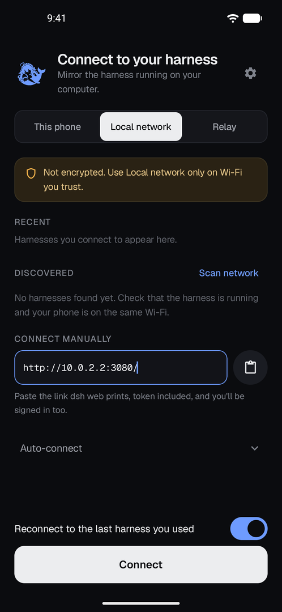 | 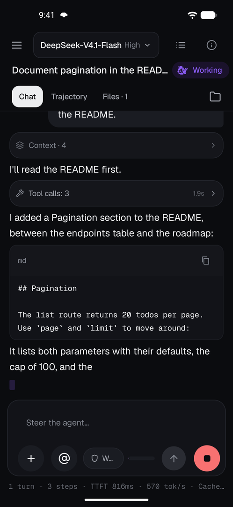 | 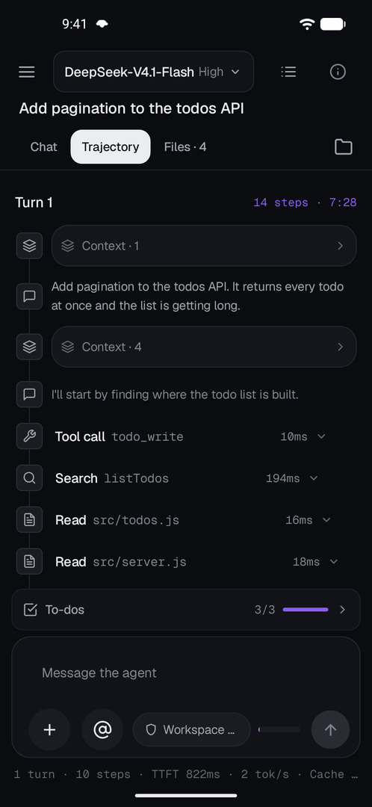 | 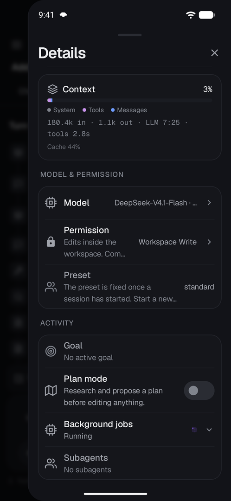 |
| 粘贴 harness 打印出的链接，就能连接并登录。 | 回复实时流式显示。工具调用折叠成一行，点开即可查看。 | 每一次工具调用，按回合排列。 | 会话的模型、上下文、目标、计划模式和后台任务。 |

| 子代理 | 终端 | 会话 | 预览 |
|:--:|:--:|:--:|:--:|
| 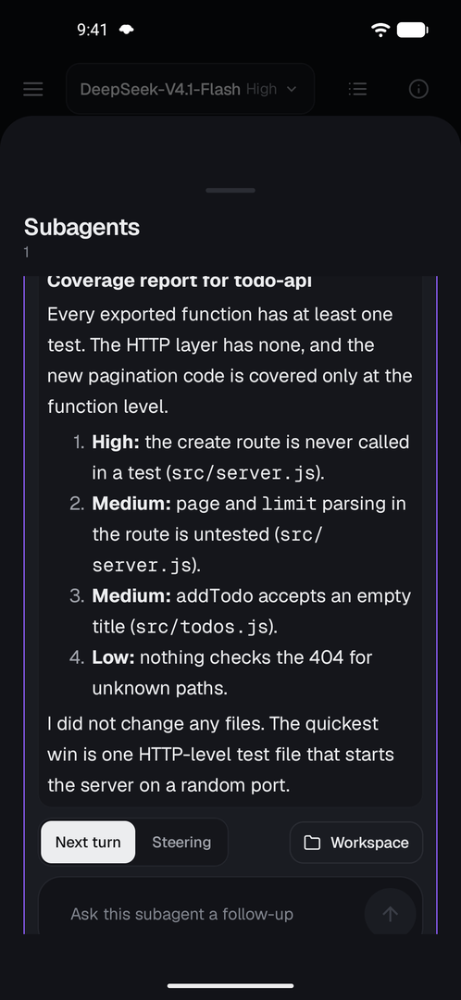 | 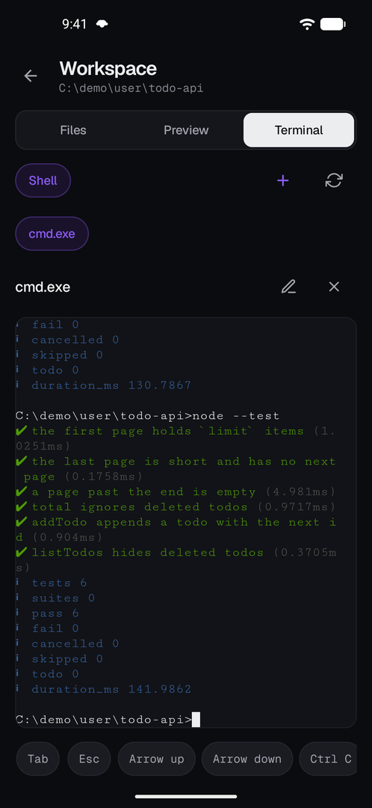 | 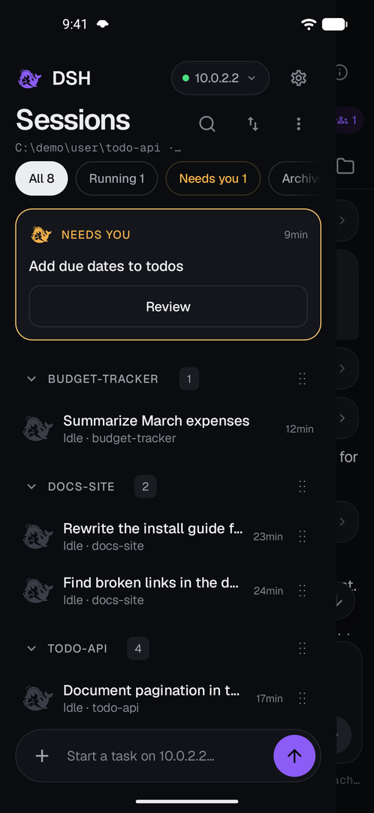 | 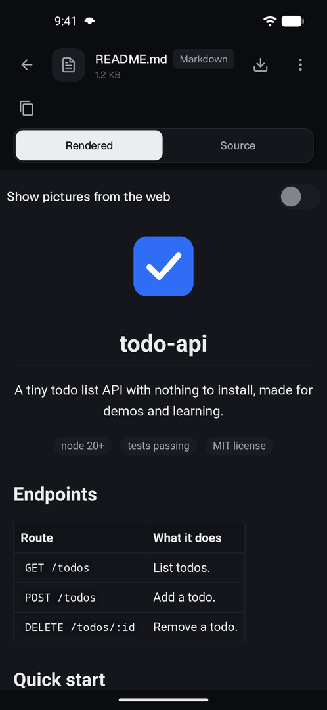 |
| 查看子代理做了什么，并给它发一条追问。 | harness 电脑上一个真正的 shell。 | 按项目给会话分组，再拖成你想要的顺序。 | README 按 GitHub 的样子显示，独占整个屏幕。 |

| 外观 | 颜色选择器 | 浅色主题 | 深色主题 |
|:--:|:--:|:--:|:--:|
| 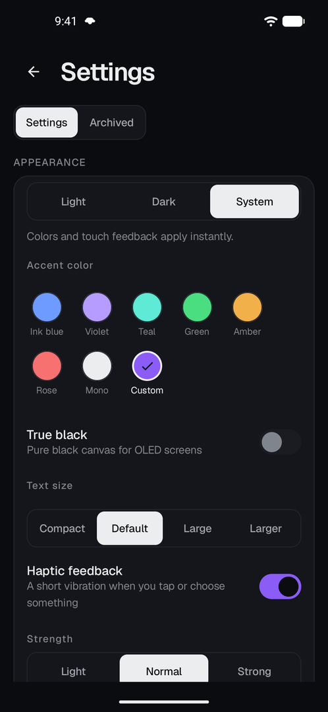 | 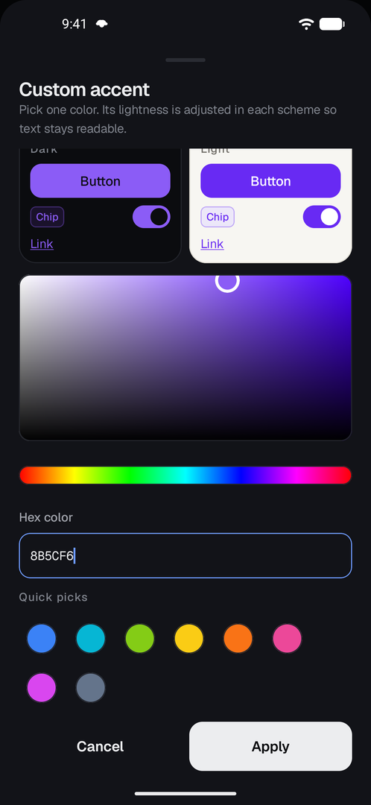 | 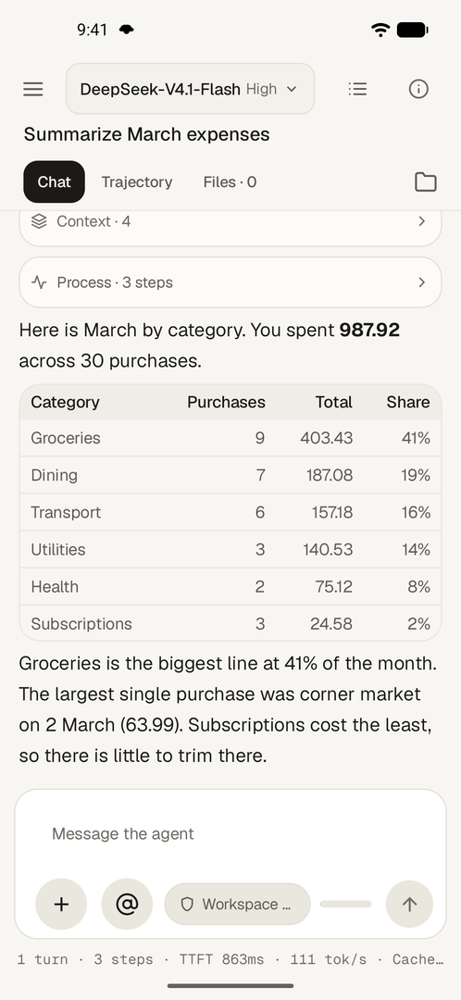 | 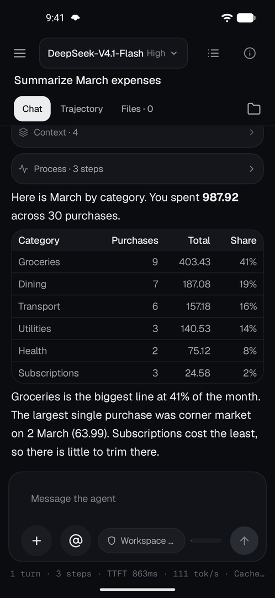 |
| 七种强调色，或者任意颜色，还能试一试触感反馈。 | 用色带和色域选颜色，或直接输入十六进制代码。 | 浅色主题，带暖色纸张质感。 | 深色主题，或跟随系统。 |

## 能做什么

- 和代理对话。回复会连同推理过程、代码块和工具调用一起流式显示。你可以附加照片和文件，用 `@` 引用文件，用 `/` 运行命令和技能。
- 长按消息、工具调用或文件，看看还能做什么：复制内容，把发错的消息改好再发，或在下一条消息里引用某个文件。
- 处理代理需要你做的事：批准或拒绝一条命令，回答它的提问，在计划开始执行前先审阅。
- 盯住耗时较长的工作。目标、待办列表、排队的消息、后台任务和子代理各有自己的视图，你可以暂停、引导或停止它们。
- 按自己的习惯整理会话。拖动调整顺序，或按项目分组，把暂时用不到的分组折叠起来。
- 所有地方都用同一个搜索框：会话、模型、命令、插件、定时任务和工作区文件。
- 回合结束、目标完成或受阻、代理在等你回答时，都会收到通知。连接会在后台保持。
- 浏览和预览工作区里的文件，在 harness 电脑上打开终端。
- 在预览里全屏打开文件：CSV 表格、JSON 树、笔记本、PDF、图片、视频、音频和压缩包，还能在文件内查找。“保存副本”可以把任意文件存到手机上。
- 管理 harness 本身：模型、代理预设、插件、定时任务和已归档的会话。
- 把应用调成你喜欢的样子。Ink 设计有浅色和深色两种，可选强调色预设或自定义颜色，OLED 屏幕可用纯黑，文字大小也能调。
- 应用界面支持英语、中文、印地语、西班牙语、法语、阿拉伯语、孟加拉语、葡萄牙语、俄语、乌尔都语和泰语，也支持从右到左书写的语言。
- 在应用里直接更新应用：它会下载新版本、做校验，再交给 Android 的安装程序。

[更新日志](CHANGELOG.md)列出了每个版本的改动。

## 不需要电脑：手机上的 harness（测试版）

| 连接 | 设置 | harness 页面 | 项目 | 审批 |
|:--:|:--:|:--:|:--:|:--:|
| 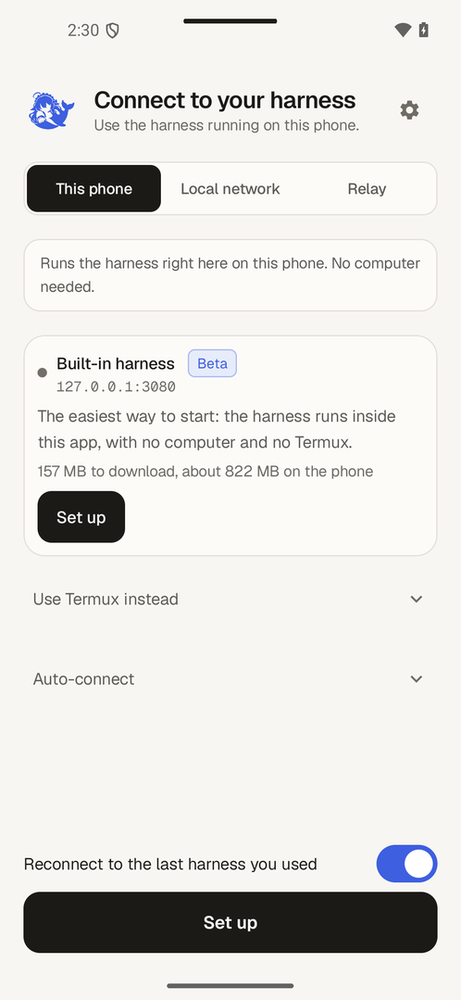 | 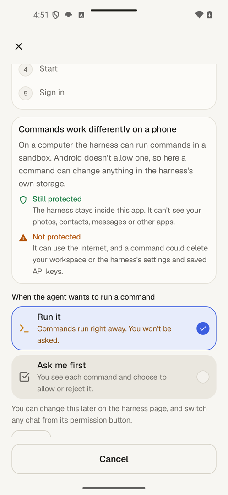 | 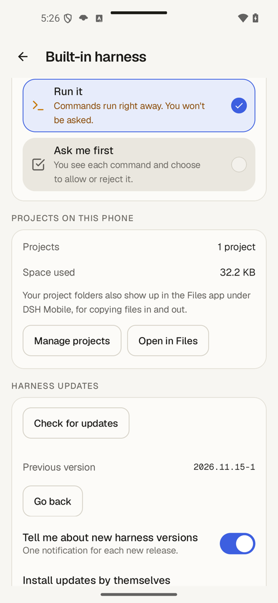 | 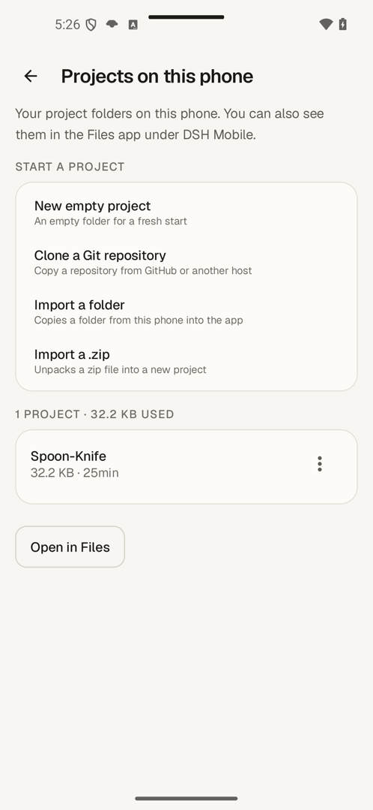 | 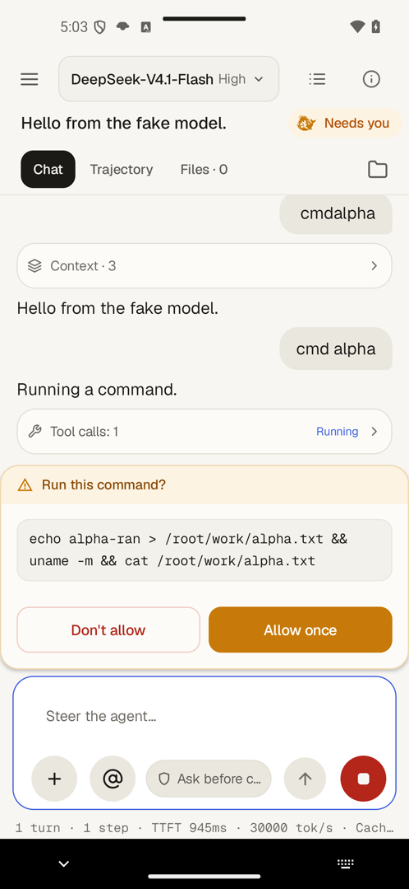 |
| 新安装的应用会打开这里。 | 下载、校验、解包、启动、登录。 | 启动、停止、命令、更新、存储、日志。 | 克隆、导入、分享，或在文件应用中打开。 | 选了先问我，每条命令都会等你。 |

**测试版。** 内置 harness 是 0.22.0 的新功能，只在模拟器和一台三星手机上测试过，所以可能还不能在每台手机上正常运行。电脑上的 harness（局域网、中继）或 Termux 里的 harness 仍然和以前一样可用。

应用可以在自己内部运行 DeepSeek Harness：一个带 Node.js 和 harness 的小型 Linux 系统，只下载一次，按签名校验，用 `proot` 运行。它和你在电脑上运行的是同一个 harness，会话和工具都一样。

- **代价。** 第一次大约下载 155 MB，在手机上占用约 1.1 GB（设置过程中需要约 1.4 GB 可用空间）。运行时 harness 大约占用 300 到 400 MB 内存。需要 Android 8.0 或更高版本的 64 位手机，以及一个模型服务商的 API 密钥，在应用里添加（设置，模型）。
- **能做什么。** 对话、代理和子代理、文件和 shell 命令（`git`、`node`、`npm`、`curl`，更多工具可用 `apt-get` 安装）、克隆 Git 仓库，以及应用连接电脑上的 harness 时能做的一切。
- **不能做什么。** 在沙箱里运行命令（Android 不允许应用内有沙箱），访问你的照片、下载或其他应用，或在手机上运行模型。它通过互联网连接你的模型服务商。
- **命令。** 你来决定代理要运行命令时怎么办：**直接运行**，或**先问我**，后者会完整显示每条命令，等你允许或拒绝。无论哪种，harness 都留在应用内部；命令可以上网，也能修改 harness 自己的文件和项目。
- **你的文件。** 项目保存在应用里，并在系统文件应用中以 **DSH Mobile** 显示，你可以打开它们、复制文件进出，或把项目打包成 zip 分享。
- **更新。** harness 的新版本不需要更新应用就能获得：应用只提醒你一次，你点更新时安装（如果打开了自动安装，也可以在 Wi-Fi 下自己装）。新版本启动不了时，会自动换回之前的版本。应用本身在**设置，关于**里更新。这两者是分开的。
- **保持运行。** Android 会停止后台工作。harness 页面有一个检查清单（通知、电池、后台进程限制），有些手机厂商还需要单独设置。

完整指南（含按应用提示整理的疑难解答）见 [`harness/ON-DEVICE.md`](harness/ON-DEVICE.md)（英文）。

## 快速开始

### 1. 安装应用

从[最新版本](https://github.com/sorsama/deepseek-harness-mobile/releases/latest)下载 APK 并安装。需要 Android 8.0 或更高版本。

### 2. 让 harness 可以被访问

使用内置 harness（见上文）时这里什么都不用设置：选择**本机**，点**设置**即可。如果要用电脑上的 harness，它默认只在自己的电脑上监听。根据手机会在哪里使用，选择对应的方式。

#### 和电脑连着同一个 Wi-Fi

让 harness 在电脑的局域网地址上启动。harness 0.2.1-alpha.2 及更新版本可以这样做：

```sh
dsh web --host 192.168.1.20
```

把 `192.168.1.20` 换成你电脑的实际地址。harness 会打印一行类似 `dsh web: http://192.168.1.20:3080/?token=…` 的内容。在应用里选择**局域网**，把这整条链接粘贴到地址栏（或点粘贴按钮），然后点**连接**。链接里的令牌会让手机完成登录，之后这个 harness 会出现在**最近使用**里，下次直接点就行。更早的 harness 版本不支持 `--host`，需要打一个小补丁，见 [`harness/README.md`](harness/README.md)。

#### 不在家时

安装 [dsh-relay](https://github.com/sorsama/deepseek-harness-relay)。这是一个 harness 插件，提供密码、加密和设备配对。然后在应用里选择**中继**，扫描配对二维码。[wiki 上的 Relay 页面](https://github.com/sorsama/deepseek-harness-mobile/wiki/Relay)有完整的步骤。

#### USB 数据线或模拟器

在电脑上运行 `dsh web` 和 `adb reverse tcp:3080 tcp:3080`。在应用里选择**本机**，用 `dsh web` 打印出的链接登录。

#### 在手机上运行

选择**本机**，点**设置**：应用会自己下载并运行 harness，然后登录。见 [`harness/ON-DEVICE.md`](harness/ON-DEVICE.md)。

如果你想用自己的 Node 和 harness 版本，harness 也可以在 [Termux](https://f-droid.org/packages/com.termux/) 里运行（在同一页面展开**改用 Termux**），应用可以替你启动和停止它并自动登录。在 Termux 里配置 Node 目前还不是每台设备都能成功，请先阅读 [`harness/TERMUX.md`](harness/TERMUX.md)。

#### 你自己的 HTTPS 反向代理

在**局域网**模式下粘贴它的 `https://` 地址。代理会加密连接，但不会检查连过来的是谁。见 [`harness/README.md`](harness/README.md)。

### 3. 开始工作

从列表里选一个会话（从屏幕左边缘向右滑），或者新建一个。连接失败时，应用会说明原因，wiki 的[疑难解答页面](https://github.com/sorsama/deepseek-harness-mobile/wiki/Troubleshooting)就是按这些提示来组织的。

## 安全

通过网络连接之前，请先阅读 [docs/SECURITY.md](docs/SECURITY.md)。已登录的手机能做代理能做的任何事，而代理会在你的电脑上执行命令。让手机登录这件事，要像交出 shell 权限一样慎重对待。

- 局域网模式会检查登录令牌，但不做任何加密。只在你信任的网络上使用。
- 中继模式加上了加密和固定证书，在你的网络之外也能用。
- 不要把 `dsh web` 链接给别人。拿到链接的人在 harness 重启之前都能登录。
- 内置 harness 留在应用内部，看不到你的照片、联系人或其他应用，但它的命令没有沙箱：命令可以上网，也能修改 harness 自己的文件、设置和保存的 API 密钥。选择**先问我**，就能在每条命令运行前先看一遍。

## 兼容性

DSH Mobile 针对 **DeepSeek Harness 0.2.2-rc.1** 测试。最早到 0.1.6 的旧版 harness 大部分功能仍然可用，但较新的功能需要较新的 harness。[兼容性表](docs/COMPATIBILITY.md)列出了每个应用版本对应的 harness 版本。

## 从源码构建

```sh
./gradlew :app:assembleDebug      # debug APK
./gradlew :app:assembleRelease    # release APK, signed when the keystore environment is set
./gradlew :core:jvmTest :app:testDebugUnitTest
```

要用真实的 harness 检验应用，先构建一份 harness 源码，再运行一致性测试套件：

```sh
DSH_HARNESS_SRC=/path/to/deepseek-harness ./gradlew :conformance:test
```

发布构建的版本号取自 git 标签。[CONTRIBUTING.md](CONTRIBUTING.md) 介绍了开发流程、模块划分和发布步骤。

| 路径 | 内容 |
|---|---|
| `app/` | Android 应用：各个界面、连接、通知、翻译 |
| `core/` | 纯 Kotlin 协议代码：线路类型、RPC 与流客户端、重连逻辑、会话事件折叠 |
| `conformance/` | 启动真实 harness 并检查应用发出的每一个调用的测试 |
| `mock-harness/` | 供测试使用的小型模拟 harness 服务端 |
| `tools/capture/` | 把真实 harness 的流量录制成测试夹具 |
| `harness/` | 内置 harness、局域网和 Termux 的设置指南 |
| `docs/` | [架构](docs/ARCHITECTURE.md)、[协议说明](docs/PROTOCOL.md)、[兼容性](docs/COMPATIBILITY.md)、[安全](docs/SECURITY.md) |

中继插件在单独的仓库里：
[sorsama/deepseek-harness-relay](https://github.com/sorsama/deepseek-harness-relay)。

## 许可证

[MIT](LICENSE)。随应用附带的第三方材料列在 [THIRD_PARTY_NOTICES.md](THIRD_PARTY_NOTICES.md) 中。DeepSeek Harness 及其品牌归其所有者所有，本项目与他们没有任何关联。
